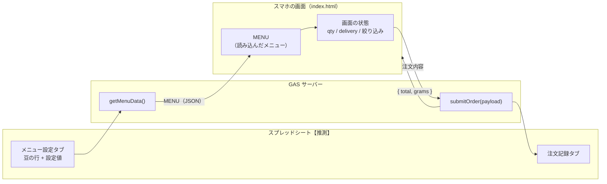
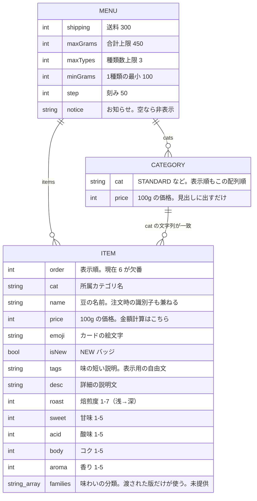
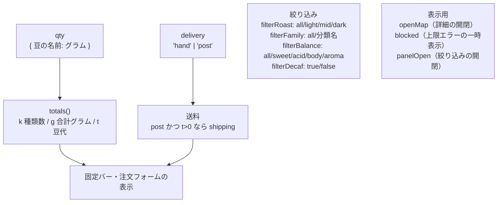
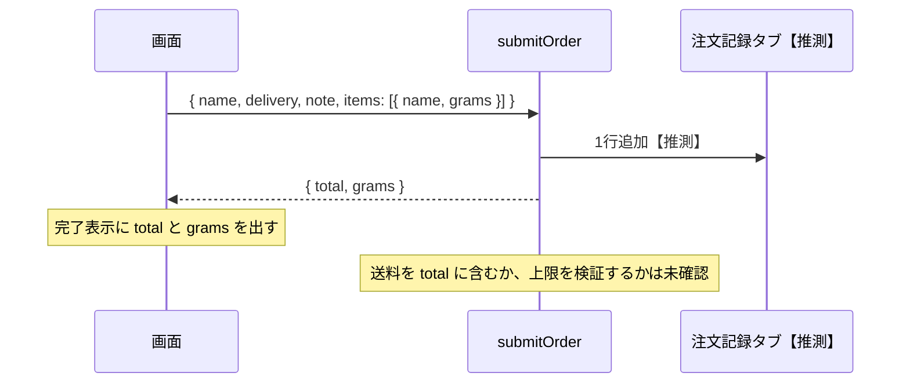
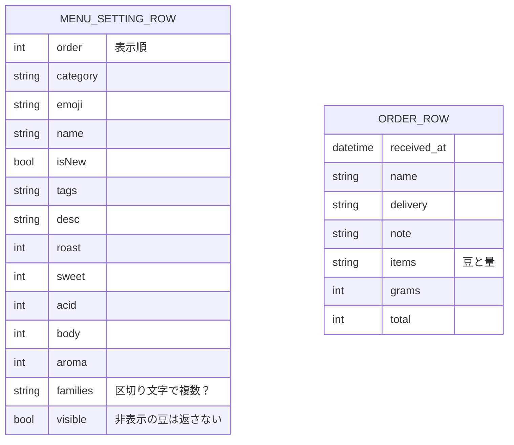

# 【現行】データモデル

> 【現行】作り直す前の現行サイトについての文書。新しい設計は `docs/to-be/` を見る。

対象は渡された版（`_work/raw/provided_index.html`）と、2026-11-21 時点の公開中の `getMenuData`。
【推測】の印がない項目は、実データかコードで確かめた内容。

## 1. 全体の流れ

## 2. メニュー（getMenuData の戻り値）

- カテゴリと豆の結び付きは、ID ではなくカテゴリ名の文字列の一致
- デカフェの判定は「カテゴリ名が `DECAF` で始まるか」
- 現在のデータ（8件）は `_work/raw/getMenuData_2026-11-21.json`

### families とは

渡された版で追加された、豆の「味わいの分類」。1つの豆に複数付けられる文字列の配列。

| 項目 | 中身 | 用途 | 現状 |
|---|---|---|---|
| `tags` | 「柑橘・爽やか・甘い余韻」のような自由文1つ | カードに表示 | 提供あり |
| `sweet` 〜 `aroma` | 甘味・酸味・コク・香りの強さ（1〜5） | 詳細の豆アイコン、「強さ」の絞り込み | 提供あり |
| `families` | 分類名の配列（【推測】例 `["フルーティー", "柑橘"]`） | 「味わい」の絞り込みボタン | **未提供** |

- 画面は全豆の `families` から重複を除いた値を集め、その数だけ「味わい」行にボタンを作る。ボタンの種類と並び順はデータ次第で、画面側に候補の一覧はない
- 絞り込みは「選んだ分類がその豆の `families` に含まれるか」で判定する
- `families` がないと「味わい」行は「すべて」だけになる。実際の値の候補は開発者に確認する（`docs/as-is/requests-to-developer.md`）

## 3. 画面の状態（ブラウザ内だけ、保存しない）

- 豆代 t = Σ（グラム ÷ 100 × `items[].price`）
- 量の選択肢 = `minGrams` から 300（直書き）まで `step` 刻み

## 4. 注文（submitOrder）

- 価格は送らず、サーバーが豆の名前から引き直す【推測】
- 名前（LINE の名前）以外の連絡先と住所は取らない。確認は LINE で行う

## 5. スプレッドシート【推測】

設定値（カテゴリ価格、送料、上限、刻み、お知らせ）は同じタブの別の欄か、別のタブにあると見られる。
