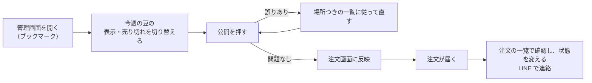

# 【新設計】管理画面の要件定義（叩き台）

> 【新設計】作り直した後の姿についての文書。Issue #54。メインのセッションが書いた叩き台で、ユーザーとオーナーの判断（§9）を経て確定する。確定した内容は `docs/to-be/design.md` に書き戻し、この文書は要件の正本として残す。

2026-11-28 作成。

## 用語

説明の元は `docs/to-be/glossary.md`。

| 用語 | 意味 |
|---|---|
| 管理画面 | オーナーが Web ブラウザで開き、設定、豆、公開、注文を管理するページ。注文画面と同じスクリプトが出す |
| 注文画面 | お客さんがメニューを見て注文するページ |
| 持ち主 | テンプレートをコピーして、スプレッドシートとスクリプトを持っている人。本番ではお店のオーナー |
| 公開 | 管理画面で保存した内容を検証し、注文画面に出すメニューとして確定すること。公開するまで、注文画面は変わらない |
| 下書き | 保存したが、まだ公開していない内容 |
| ローダー、モジュール、アプリを更新 | `docs/to-be/design.md` の冒頭の用語の表のとおり |

## 1. 目的

オーナーが、スプレッドシートを直接さわらずに、管理画面だけで毎週の運用（豆の表示の切り替え、公開、注文の確認）と、ときどきの変更（豆の追加、単価やカテゴリの変更、見せ方の変更）を行えるようにする。

背景
- スマホのスプレッドシートアプリでは、スクリプトのメニューとボタンが使えない（`docs/to-be/spikes.md` の T1-3、S08）
- シートだけの管理は見た目が整わず、入力の誤りも起きやすい（ユーザーの判断。Issue #9、#50）
- 持ち主だけが操作できる Web ページは、今の GAS の仕組みで作れる（T1-3、S15〜S18）

## 2. 前提と方針

- データの置き場はスプレッドシートのままにする。管理画面はシートを読み書きする画面であり、データベースを別に持たない
  - 理由: オーナーが表として見られる、Google ドライブで履歴が残る、管理画面が動かないときもデータに触れる、移行と受け渡しの仕組み（テンプレートのコピー、`_コード` タブ）をそのまま使える
- 管理画面の操作は、持ち主だけができる。持ち主でない人が管理画面を開いても、データは表示されず、操作は断られる（`docs/to-be/design.md` §3.3 の `adminCall`）
- 管理画面は、アプリのコード（モジュールと画面の HTML）に含め、「アプリを更新」で新しくなる。画面と操作は、後から「アプリを更新」で足せる
- 管理画面が動かなくなったときの逃げ道として、スプレッドシートのメニューに「前のバージョンに戻す」と「初期設定」を残す。これらはローダーの中の処理なので、アプリのコードに不具合があっても動く
- 注文画面との関係
  - 管理画面で保存した内容は下書きで、公開を押したときだけ注文画面に出る（今の設計の「メニューを公開」と同じ考え方）
  - 公開の前に検証し、誤りは場所つきで知らせる

## 3. 利用者と使う場面

| 利用者 | 主な端末 | 使う場面 |
|---|---|---|
| オーナー | PC とスマホ（Issue #9 で PC 中心と決めたが、管理画面ではスマホでも同じことができるようにする） | 毎週の切り替えと公開、注文の確認、ときどきの変更 |
| デザイン担当 | PC | 受け渡しの前の確認、不具合の相談のときの確認（オーナーが渡した調査用のコピーで） |
| お客さん | スマホ（LINE の中のブラウザを含む） | 管理画面は使わない |

## 4. 業務の流れ

| 頻度 | 業務 | 管理画面での操作 |
|---|---|---|
| 毎週 | 今週の豆を決める | 豆の一覧で、表示と売り切れを切り替え、公開を押す |
| 毎週 | 受付を止める、始める | 受付中を切り替え、公開を押す。受付停止の文言とお知らせを変える |
| 毎週 | 注文を確かめる | 注文の一覧で新しい注文を見て、状態（確認済み、渡し済み、キャンセル）を変える |
| ときどき | 豆を足す、直す | 豆の追加と編集の画面で入力し、保存して公開する |
| ときどき | 単価、カテゴリ、送料を変える | 設定の画面で変え、保存して公開する |
| ときどき | 好みを見る | ダッシュボードを開く。同じ人の名前をまとめる候補を確かめる |
| まれ | 見せ方を変える（項目、絞り込み、並べ替え、文言） | 見せ方の画面で変え、保存して公開する |
| まれ | アプリを更新する | 更新の画面でボタンを押す。問題があれば戻す |
| まれ | 不具合を相談する | 調査用の書き出しを押し、デザイン担当に渡す |

## 5. 機能の要件

画面ごとに書く。「最初」は最初のリリース（v1.0.0）に入れるもの、「後」は後から「アプリを更新」で足すもの（§7）。

### 5.1 入口と持ち主の確かめ（最初）

- 管理画面は、注文画面と同じ Web アプリの URL に、管理画面を表す引数を付けて開く。オーナーはこの URL をブックマークする
- 開いたとき、持ち主のアカウントでログインしているかを確かめ、違えば「このページは持ち主だけが使えます」と出して何も表示しない
- 持ち主でないときに出す文言と、複数のアカウントでログインしたブラウザで開けないときの案内は、T1-4（Web アプリの動作）の結果で決める

### 5.2 ホーム（最初）

- 受付中かどうか（下書きと公開中の両方）、最終公開日時、未公開の変更の有無、今週の注文の件数と金額、新しい注文の件数、アプリのバージョンを出す
- 毎週の操作への近道（豆の一覧、公開、注文の一覧）を置く

### 5.3 豆の一覧と編集（最初）

- 一覧
  - おすすめ順（今のシートの行の順）に並べる。並びを変えられる
  - 豆ごとに、表示、売り切れ、NEW を、その場で切り替えられる
  - カテゴリ、名前、価格、表示の状態で絞り込める
- 追加と編集
  - カテゴリ、名前、アイコン、タグ、説明、100g価格（空ならカテゴリの価格）、項目の値（焙煎度などの段階、味わいなどの分類、はい・いいえ）を入力する
  - 入力欄は、項目の種類に合う部品にする（段階はスライダーか段の選択、分類はチップ、はい・いいえはスイッチ）
  - 入力の誤り（必須の空欄、範囲外の値、名前の重複）は、保存の前にその場で知らせる
  - ID はスクリプトが振る。オーナーは見なくてよい
- 削除
  - 注文と集計は豆の ID で結び付くので、豆は消さずに「使わない」にする。使わない豆は一覧の初期の表示から外す

### 5.4 設定（最初）

- 受付中、受付停止の文言、お知らせ、案内文
- 量の上限（種類数、合計、1種類の最小と上限、刻み）、1杯あたりの g
- カテゴリ（名前、100g価格、デカフェ、アイコン、説明）の追加、編集、並び替え
- 受け取り方法（名前、料金、説明、有効）の追加、編集、並び替え
- 値の矛盾（最小が上限より大きいなど）は保存の前に知らせる

### 5.5 公開（最初）

- 公開を押すと、今の `docs/to-be/design.md` §2.14 の検証を行い、誤りがあれば、画面のどこを直せばよいかを一覧にし、押すとその入力欄へ移る
- 公開の前に、前回の公開からの変更点（表示になる豆、売り切れになる豆、価格の変更など）を確かめる画面を出す
- 公開した内容は、注文画面に出る。公開日時と、公開した人（持ち主）を残す

### 5.6 注文の一覧（最初）

- 新しい順に並べ、状態（新規、確認済み、渡し済み、キャンセル）で絞り込める
- 注文ごとに、受付番号、名前、受け取り方法、明細、合計、備考、お気に入りを出す
- 状態を変えられる
- LINE への連絡は今までどおりオーナーが行う。管理画面から LINE に送る機能は作らない（§8 の拡張の候補）

### 5.7 ダッシュボードと名寄せ（後）

- `docs/to-be/design.md` §5.2 の集計（豆ごと、週ごと、人ごと）を表とグラフで出す
- 同じ人の名前をまとめる候補（`docs/to-be/design.md` §5.3）を一覧にし、まとめるかを押して決める
- 最初のリリースではシートのダッシュボードのままにし、後から管理画面に足す案（§9 の R-1 で決める）

### 5.8 見せ方の設定（後）

- 項目（追加、名前の変更、種類、段階の数、両端の名前、表示のしかた、まとめ、カードと詳細に出すか）
- 選択肢、区分け、絞り込み、並べ替え、文言
- 項目を足すと、豆の編集の画面に入力欄が増える
- 最初のリリースではシートの隠すタブのまま編集し、後から管理画面に足す案（§9 の R-1 で決める）

### 5.9 アプリの更新と戻し（最初）

- 今のアプリのバージョンと、最新のリリースのバージョンを出し、「アプリを更新」を押せる
- 「前のバージョンに戻す」も押せる。管理画面が動かないときのために、シートのメニューにも同じ操作を残す（§2）

### 5.10 調査用の書き出し（後）

- 名前、備考、端末 ID を伏せたコピーを作る（`docs/to-be/delivery-flow.md` §7）

## 6. 画面に依らない要件

- 持ち主の確かめ
  - 管理画面からの操作は、すべて持ち主の確かめを通る（`docs/to-be/design.md` §3.3）。管理画面の HTML にはシートの値を埋め込まない
- 端末
  - スマホの幅（375px 程度）でも、毎週の操作（表示と売り切れの切り替え、公開、注文の状態の変更）を片手で行える
  - PC では、豆の編集などの入力を広い画面で行える
- 保存と同時の操作
  - 保存は、操作ごと（豆1つ、設定の1画面）に行う。保存の途中で閉じても、ほかのデータは壊れない
  - 同じ持ち主が PC とスマホで同時に開いた場合、後から保存した内容で上書きする前に、先に別の保存があったことを知らせる
  - 書き込みは `LockService` で順番にする（T1-3 で、同時に書くとログが乱れた）
- 速さ
  - 管理画面を開いてから、豆の一覧が出るまで数秒以内（目安は T1-4 の往復の時間の結果で決める）
- 履歴
  - 公開ごとに、公開した内容を残す（今の `_公開データ` に加え、過去の公開の一覧）。誤って公開したときに、前の公開の内容に戻せる
- シートを直接さわったとき
  - オーナーやデザイン担当がシートを直接直しても、管理画面と公開の検証が壊れない（見出しの文字で列を探す今の決まりを保つ）

## 7. 最初のリリースの範囲（案）

| 機能 | 最初 | 後 |
|---|---|---|
| 入口と持ち主の確かめ、ホーム | ○ | |
| 豆の一覧と編集（表示、売り切れ、追加、編集） | ○ | |
| 設定（受付、上限、カテゴリ、受け取り方法） | ○ | |
| 公開（検証、変更点の確認） | ○ | |
| 注文の一覧と状態の変更 | ○ | |
| アプリの更新と戻し | ○ | |
| ダッシュボードと名寄せ | | ○（それまではシート） |
| 見せ方の設定（項目、選択肢、区分け、絞り込み、並べ替え、文言） | | ○（それまではシート） |
| 公開の履歴から戻す | | ○ |
| 調査用の書き出し | | ○（それまではシートのメニュー） |

理由
- 毎週の運用（表示の切り替え、公開、注文の確認）と、お店の数字（単価、送料）は最初から管理画面でできるようにする
- 見せ方の設定は種類が多く、変える頻度も低いので後にする。後から足せるように、最初から §8 の「今決めておくこと」を守る

## 8. 今後の拡張と、そのために今決めておくこと

拡張の候補は、作るかどうかを今は決めない。ただし、後から足すときにローダー（テンプレートの後は変えられない）やデータの持ち方を作り直さずに済むよう、次を今決めておく。

| 拡張の候補 | 今決めておくこと |
|---|---|
| 管理の操作を足す（見せ方、ダッシュボード、履歴など） | 管理画面の操作は、ローダーの1つの入口（`adminCall`）から、引数で選ぶ形にする。操作を足すのは「アプリを更新」だけで済む |
| 持ち主以外の人（家族、スタッフ）も管理する | 今の持ち主の確かめは「持ち主だけ」。将来、許可した人を足せるように、確かめの関数を「許可された人か」という形にし、許可した人の一覧をスクリプトのプロパティに置けるようにしておく（最初は持ち主だけ） |
| 豆の写真 | 豆の行に、画像の置き場所を足せる余地を残す（列を足しても読めるように、見出しの文字で列を探す今の決まりを保つ） |
| 在庫の数（g）を持つ | 注文の処理（`placeOrder`）は既にロックで1件ずつ処理しているので、在庫を引く処理を足せる。豆の行に在庫の列を足せる余地を残す |
| 受付の期間（何日から何日まで）、予約の受付 | 受付中を、真偽だけでなく期間も持てる形にしておく（設定の値の形） |
| 注文の通知（メール、LINE） | D-1（受付中の切り替えと注文の通知メール）の判断に従う。LINE への送信は、LINE の公式アカウントと API の契約が要るので、今は作らない |
| 決済、会員登録 | 今回やらない（`docs/to-be/design.md` §0）。データの持ち方では考えない |
| 別のお店にも配る | テンプレートのコピーで配る今の仕組みのままで足りる。お店ごとの名前や色は設定に持つ |
| データの形を変える | 公開データとシートの形に、形式のバージョン（`schemaVersion`）を持たせ、新しいコードが古い形を読めるようにする（`docs/to-be/glossary.md` の「形式のバージョン」） |

## 9. 決めてほしいこと

| 番号 | 内容 | 案 | 決める人 |
|---|---|---|---|
| R-1 | 最初のリリースの範囲（§7 の表） | 表のとおり。見せ方の設定とダッシュボードは後 | ユーザー |
| R-2 | オーナーがシートを直接さわる場面を残すか | 残す（管理画面が動かないときの逃げ道、表として見たいとき）。ただし普段の手順書には書かない | ユーザー |
| R-3 | 管理画面のデザインを Figma で作るか | 作る（注文画面と同じ部品の考え方）。ただし最初は仮の見た目で動かし、後で差し替える | ユーザー |
| R-4 | スマホでもすべての操作をできるようにするか | 毎週の操作は必ず。豆の編集と設定もできるが、PC の方が楽な作りでよい | ユーザー、オーナー |
| R-5 | 持ち主以外の人に管理を許す見込みがあるか | 今は持ち主だけ。見込みがあれば §8 の形で用意する | オーナー |
| R-6 | 公開の前の変更点の確認画面を出すか | 出す（誤って全部を非表示にして公開する、などを防ぐ） | ユーザー |
| R-7 | 注文の一覧で、LINE の連絡を楽にする機能（連絡の文のひな形のコピーなど）を入れるか | 後の候補にする | オーナー |
| R-8 | スプレッドシートの管理タブのボタンとチェックボックス（今の設計 §2.14、§2.15）を残すか | 管理画面ができたら外す。メニューは逃げ道の操作だけを残す | ユーザー |
