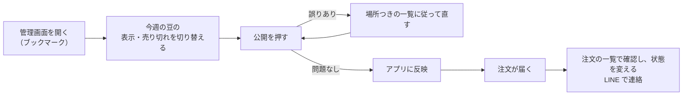

# 【新設計】管理画面の要件定義

> 【新設計】作り直した後の姿についての文書。Issue #54。メインのセッションが書いた初案に、ユーザーと Oka の判断（§10）を反映した。R-1（管理画面の開き方）と R-12（複数のアカウントでログインしたブラウザ）は方向を決めたが、確認は T1-6 で行う（§10）。確定した内容は `docs/to-be/design.md` に書き戻した。この文書は「何ができるべきか」の正本、design.md は「どう作るか」の正本とし、食い違ったときは、この文書で要件を確認してから design.md を直す。

2026-11-28 作成、同日に判断を反映。T1-3（シートの機能）の結果は、`docs/to-be/spikes.md` の T1-3 と `docs/to-be/design.md` §3.3 にある。S08、S11 などの S 番号は、spikes.md の T1-3 の見出しの番号（シナリオの番号）を指す。

## 用語

説明の元は `docs/to-be/glossary.md`。

| 用語 | 意味 |
|---|---|
| Oka、Yu | Oka は発注者（お店の人）で、アプリの管理者として管理画面を使う人。Yu はこのプロジェクトを開発する人（作業を依頼するユーザー）。実名は書かない（公開リポジトリ） |
| アプリ | お客さんが注文するサイト。スマホのブラウザ（LINE の中のブラウザを含む）で開くページで、メニューを見て注文する |
| 管理画面 | Oka が設定、豆、公開、注文を管理する Web ページ。所有アカウントでログインした人だけが操作できる。アプリと同じシステムの一部で、デプロイの URL で開く |
| 表示設定 | アプリの見え方を決める設定。項目、選択肢、区分け、絞り込み、並べ替え、文言を含む。管理画面の表示設定の画面で下書きとして直し、「メニューを公開」でアプリに出る |
| システム | アプリと管理画面を動かすプログラム全体（モジュールと画面の HTML）。アプリと管理画面は1つのプログラムなので、「システムを更新」で両方が新しくなる。番号は「システムのバージョン」（v1.3.0 の形） |
| デプロイ | スクリプトを URL で開けるページにする GAS の設定と、その結果。アプリと管理画面は、同じデプロイの URL（管理画面は引数つき）で開く。Oka が初回に作り、作り直さないので、URL は変わらない（所有アカウント認証が通らないときは、管理画面を2つ目のデプロイで出す。T1-6 で検証する） |
| 所有アカウント | スプレッドシートとスクリプトを所有している Google アカウント。Google の画面では「オーナー」と出る。本番では Oka のアカウント、テンプレートとテスト用スプレッドシートでは Yu のアカウントが所有アカウントになる。テンプレートをコピーすると、コピーの所有アカウントは、コピーした人（本番では Oka）のアカウントになる |
| 所有アカウント認証 | 開いた人、または関数を呼んだ人が、スプレッドシートの所有アカウントかの判定。`adminCall`、`adminUpload`、メニュー OUCA の操作は、これを通ってから動く |
| 公開 | 「メニューを公開」（豆のメニューをアプリに出す操作）だけ。管理画面の「公開」も、この操作を管理画面から行うもの。公開するまで、アプリは変わらない |
| 下書き | 管理画面で保存したが、まだ公開していない内容 |
| メニュー OUCA | スプレッドシートの上に出る、このシステムのメニュー。「OUCA ▸ メニューを公開」のように、中の項目を押して操作する。初期設定の前は「初期設定」など少しの項目だけが出る |
| ローダー | スプレッドシートに紐づくスクリプト。外から呼べる関数（入口）、`_コード` タブからの読み込み、「システムを更新」と「前のバージョンに戻す」の処理、初期のコードを持つ。テンプレートのコピーの後は変えない。「システムを更新」でも変わらないので、ローダーの中の処理に不具合があっても、「システムを更新」では直せない |
| 復旧用のページ | 管理画面が開けないときのために、ローダーが自前で出す小さなページ。機能は「前のバージョンに戻す」と「システムを更新」の2つだけで、今のシステムのバージョンと使用中の保存場所を出す。HTML はローダーの中に持ち、モジュールを読み込まずにローダーだけで動くので、モジュールが壊れていても開ける。見た目は簡素な固定の HTML で、Figma のデザインの対象にしない |
| モジュール | バンドルのうち、サーバーで動く処理の部分。ローダーが `_コード` タブから文字列として読み込み、動かせる関数に変えて（評価して）呼ぶ |
| システムを更新 | Yu が出した最新のリリースのバンドルを取り込み、アプリと管理画面をまとめて新しくする操作。管理画面、復旧用のページ、メニュー OUCA から押せる。管理画面と復旧用のページからの更新は、リリースを取得して確認する呼び出しと、更新する呼び出しの2回になる |
| バージョンの照合 | 呼び出した側が持つシステムのバージョンと、サーバー側のシステムのバージョンを比べ、違えば何も変えずに拒否すること。システムを更新の2回目の呼び出しでは、1回目に確認したシステムのバージョンと、取り直したバンドルのバージョンを比べ、違えば何も変えずに拒否する。モジュールの操作では、画面のシステムのバージョンとサーバーのシステムのバージョンを比べる。ローダーの処理（今のバージョン、システムを更新、前のバージョンに戻す）には、画面のシステムのバージョンの照合を行わない |
| 更新番号 | 管理画面が書く行（豆、カテゴリ、設定など）が持つ、保存するたびに1増える数。管理画面は読んだときの更新番号を送り、保存のときに変わっていれば、保存せずに知らせる。PC とスマホで同時に開いたときに、先の保存を上書きしないために使う |
| 下書きの照合 | 管理画面の「公開」で、変更点の確認の呼び出しが返した下書きの印（更新番号の組かハッシュ。形は T2-5）を公開の呼び出しに送り、今の下書きと比べること。違えば公開せずに、確認からやり直させる。メニュー OUCA の「メニューを公開」は確認の画面がないので、照合しない |
| `adminCall`、`adminUpload` | 管理画面と復旧用のページが `google.script.run` で呼ぶ入口。`adminCall` は引数の JSON の文字列で操作を選ぶ。`adminUpload` は、ファイルを受け取るために別に置く（GAS では、form を渡すときは form がただ1つの引数でなければならない）。どちらも、所有アカウント認証を通ってから動く |

## 1. 目的

Oka が、スプレッドシートを直接操作せずに、管理画面だけで、毎週の運用（豆の表示の切り替え、公開、注文の確認）と、ときどきの変更（豆の追加、単価やカテゴリの変更）を行えるようにする。表示設定の変更（項目、絞り込みなど）も、管理画面でできるようにする。

背景
- スマホのスプレッドシートアプリでは、メニュー OUCA と画像のボタンが使えない（T1-3 の S08）
- シートだけの管理は見た目が整わず、入力の誤りも起きやすい（ユーザーの判断。Issue #9、#50）
- 所有アカウントでログインした人だけが操作できる Web ページは、今の GAS の仕組みで作れる（T1-3 の S15〜S18）

## 2. 前提と方針

- データの置き場はスプレッドシートのままにする。管理画面はシートを読み書きする画面で、データベースを別に持たない。そうする理由は次のとおり
  - Oka が表として見られる
  - Google ドライブで変更の履歴が残る
  - 管理画面が動かないときも、データに触れる
  - 受け渡しと更新の仕組み（テンプレートのコピー、`_コード` タブ）をそのまま使える
- 管理画面の操作は、所有アカウントでログインした人だけができる。所有アカウント以外の人が管理画面を開いても、データは表示されず、操作は拒否される（`docs/to-be/design.md` §3.3 の `adminCall`）。Oka 以外の人に管理を許す予定はない（R-9）
- 管理画面は、システムのコード（モジュールと画面の HTML）に含め、「システムを更新」で新しくなる。画面と操作は、後から「システムを更新」で足せる。ただし、ローダーとマニフェストで決まることは後から変えられない（§8.1）
- 管理画面で保存した内容は下書きで、公開を押したときだけアプリに出る（以前の設計の「メニューを公開」と同じ考え方）。急ぎの切り替え（受付の停止、売り切れ）も、公開を待つ（R-6）
- 管理画面が動かなくなったときの備えを持つ（§5.9）

## 3. 使う人と使う場面

| 使う人 | 主な端末 | 使う場面 |
|---|---|---|
| Oka（お店の発注者。本番のスプレッドシートの所有アカウントでログインする人） | PC とスマホ。Issue #9 では PC 中心と決めたが、管理画面では、毎週の操作をスマホで必ずできるようにする（R-4） | 自分の Google アカウントで管理画面を使う。毎週の切り替えと公開、注文の確認、ときどきの変更 |
| Yu（Oka とは別の人。本番には触れない） | PC | 管理画面を使う場面は、テスト用スプレッドシートでの確認と、Oka が渡した調査用のコピーでの確認だけ。受け渡しの前の確認と、不具合の相談のときに使う |
| お客さん | スマホ（LINE の中のブラウザを含む） | アプリだけを使う。管理画面は使わない |

## 4. 業務の流れ

| 頻度 | 業務 | 管理画面での操作 |
|---|---|---|
| 毎週 | 今週の豆を決める | 豆の一覧で、表示と売り切れを切り替え、公開を押す |
| 毎週 | 注文を確認する | 注文の一覧で新しい注文を見て、状態（確認済み、渡し済み、キャンセル）を変える |
| ときどき | 受付を止める、始める | 受付中を切り替え、受付停止の文言とお知らせを変えて、公開を押す |
| ときどき | 豆を足す、直す | 豆の追加と編集の画面で入力し、保存して公開する。新しい味わいの候補も、その場で足せる |
| ときどき | 単価、カテゴリ、送料を変える | 設定の画面で変え、保存して公開する |
| ときどき | 好みを見る | ダッシュボードの表とグラフを見る。更新を押す。同じ人の名前をまとめる候補（名寄せ）を確認する |
| まれ | 表示設定を変える（項目、絞り込み、並べ替え、文言） | 表示設定の画面で変え、保存して公開する |
| まれ | システムを更新する | 更新の画面でボタンを押す。問題があれば戻す。管理画面が開けないときは、復旧用のページで行う |
| まれ | 不具合を相談する | PC のメニュー OUCA の「調査用に書き出す」を押し、Yu に渡す（管理画面からの書き出しは後） |

## 5. 機能の要件

画面ごとに書く。「最初」は最初のリリース（v1.0.0）に入れるもの、「後」は後から「システムを更新」で足すもの（§7）。

### 5.1 入口と所有アカウント認証（最初）

- Oka は管理画面の URL をブックマークして開く。開き方は、アプリと同じデプロイの URL に引数を付ける（R-1）。所有アカウントでログインしたスマホのブラウザで所有アカウント認証が通るかは T1-6 で検証し、通らなければ、テンプレートの前に2つ目のデプロイ（所有アカウントでログインした人だけが開ける）に切り替える
- 開いたとき、所有アカウント認証を行い、通らなければ何も表示せず、1つの画面に次の3つの案内をまとめて出す（2つ目のデプロイで出す場合、所有アカウント以外の人には Google のエラーの画面が出て、この案内は出ない）。サーバーは「所有アカウントでない人」と「所有アカウントが既定でない複数ログイン」を見分けられない（個人の Gmail のアカウントでは active が空になる）ので、3つをまとめる。文言は T2-3（管理画面）と T4-9（復旧用のページ。ローダーに入るので、テンプレートの前に決める）で決める。案は次のとおり
  - 「このページは、お店のスプレッドシートを持っている Google アカウントでログインしたときだけ使えます」
  - 「Google アカウントを複数使っている場合は、そのアカウントで最初にログインしたブラウザ（PC なら管理画面用の Chrome のプロフィール）で開いてください」
  - 「LINE の中で開いた場合は、Safari か Chrome で開き直してください」
  - 画面の文言に「所有アカウント」を使わない。メールアドレスを出さない
- Oka は、PC とスマホのブラウザで、複数の Google アカウントにログインしていることがあり得る（R-12 の Oka の答え）。複数のアカウントでログインしたブラウザでは、URL が既定でないアカウントの形（`/macros/u/1/s/…`）に書き換えられ、既定でないアカウントではデプロイを開けない（T1-3、T1-4）。そのため、管理画面のブックマークの URL は、既定のアカウントで開く形（`/macros/u/0/s/…/exec?…`）にする（R-12）。既定のアカウントが所有アカウントでなければ、管理画面は開くが所有アカウント認証が通らないので、上の案内が出る。既定でないアカウントのまま管理画面を使うことはできない。Oka は URL を組み立てない。デプロイの後に「OUCA ▸ 初期設定」をもう一度押すと、管理画面と復旧用のページの2つの URL（`ScriptApp.getService().getUrl()` から作った `/u/0/` の形）がダイアログに出る（ローダーに置く部分。テンプレートの前に決める）ので、Oka は2つをブックマークする。この形で開けるかは T1-6 の結果しだい
- LINE の中のブラウザで開いたときは、所有アカウント認証が通らない可能性がある（未確認。T1-6 で検証する）ので、上の3つ目の案内を出す

### 5.2 ホーム（最初）

- 受付中かどうか（下書きと公開中の両方）、最終公開日時、未公開の変更の有無、今週の注文の件数と金額、新しい注文の件数、システムのバージョンを出す
  - 未公開の変更の有無は、下書きと公開中のメニューを比べて出す（以前の設計 §2.15 の onEdit による目安より正確になる）
- 毎週の操作への近道（豆の一覧、公開、注文の一覧）を置く

### 5.3 豆の一覧と編集（最初）

- 一覧
  - おすすめ順に並べる。並びを変えられる
  - 豆ごとに、表示、売り切れ、NEW を、その場で切り替えられる。切り替えるたびに下書きに保存し、保存中、保存済み、失敗を豆ごとに出す。失敗したときは、どの切り替えが保存されていないかを出し、やり直せる
  - 切り替えは、公開を押すまでアプリに出ない。売り切れなどの急ぎの切り替えも同じ（R-6）
  - カテゴリ、名前、価格、表示の状態で絞り込める
- 追加と編集
  - カテゴリ、名前、アイコン、タグ、説明、100g価格（空ならカテゴリの価格）、項目の値（焙煎度などの段階、味わいなどの分類、はい・いいえ）を入力する
  - 入力欄は、項目の種類に合う部品にする（段階は段の選択、分類はチップ、はい・いいえはスイッチ）
  - 分類の項目の候補（選択肢。例 味わいの「ナッツ」）にない値は、その場で候補に足せる
  - 入力の誤り（必須の空欄、範囲外の値、名前の重複）は、保存の前にその場で知らせる
  - 新しく足した豆は、初めは表示しない状態で保存する（R-13）。Oka は、豆を足したら表示を切り替えてから公開する
- 豆を消すことと「使わない」
  - 注文と集計は豆の ID で結び付くので、豆は消さずに「使わない」にする
  - 「表示」は今週メニューに出すかで、毎週切り替える。「使わない」は、もう扱わない豆で、一覧の初期の表示から外す。使わない豆は表示にできない

### 5.4 設定（最初）

- 受付中の切り替え、受付停止の文言、お知らせ、案内文
- 量の上限（種類数、合計、1種類の最小と上限、刻み）、1杯あたりの g
- お気に入りを使うか、集計の期間、注文の通知メールの送り先（通知を入れることは D-1 で決めた）
- カテゴリ（名前、100g価格、デカフェ、アイコン、説明）の追加、編集、並び替え
- 受け取り方法（名前、料金、説明、有効）の追加、編集、並び替え
- カテゴリと受け取り方法は、豆と過去の注文が名前で指しているので消さない。カテゴリは「使わない」にし、使わないにしていない豆が使っているうちは、使わないにできない。受け取り方法は「有効」を外す
- 値の矛盾（最小が上限より大きいなど）は保存の前に知らせる

### 5.5 公開（最初）

- 公開を押すと、今の `docs/to-be/design.md` §2.14 の検証を行い、誤りがあれば、画面のどこを直せばよいかを一覧にし、押すとその入力欄へ移る
- 公開の前に、前回の公開からの変更点（表示になる豆、売り切れになる豆、価格の変更など）を確認する画面を出す（R-5）
- 変更点を確認する呼び出しが返した下書きの印（更新番号の組かハッシュ。形は T2-5）を、公開する呼び出しに送る。今の下書きと違えば、公開せずに、確認からやり直させる（下書きの照合）。メニュー OUCA の「メニューを公開」は、確認の画面がないので、照合しない
- 公開した内容は、アプリに出る。公開日時を残す。公開した内容は、毎回、公開の履歴として残す（履歴から戻す操作は後。§7。それまでは、戻したいときは直して公開し直す）

### 5.6 注文の一覧（最初）

- 新しい順に並べ、状態（新規、確認済み、渡し済み、キャンセル）で絞り込める。初めに出すのは、直近8週間のうち新しい順に100件までとし、それより前は期間を選んで出す
- 注文ごとに、受付番号、名前、受け取り方法、明細、合計、備考、お気に入りを出す
- 状態を変えられる。変える注文は、行の番号ではなく受付番号で探す（注文は同時に足され、Oka がシートで並べ替えることもあるため）
- LINE への連絡は今までどおり Oka が行う。連絡の文のひな形をコピーする機能と、Oka が注文の中身を直す機能は作らない（R-10。後の候補にもしない）

### 5.7 ダッシュボードと名寄せ（最初）

- 管理画面に「ダッシュボードを更新」のボタンと、`docs/to-be/design.md` §5.2 の集計（豆ごと、週ごと、人ごと）の表とグラフを出す（スマホのスプレッドシートアプリではシートのボタンが使えないので、更新は管理画面で行う）
- 同じ人の名前をまとめる候補（design.md §5.3）を一覧にし、まとめるかを押して決める

### 5.8 表示設定（最初）

- 項目（追加、名前の変更、種類、段階の数、両端の名前、表示のしかた、まとめ、カードと詳細に出すか）、選択肢（並べ替え、名前の変更、消す）、区分け、絞り込み、並べ替え、文言
- 項目を足すと、豆の編集の画面に入力欄が増える
- 変えた内容は下書きで、公開を押したときにアプリに出る

### 5.9 システムの更新と戻し、復旧用のページ（最初）

- 更新の画面に、今のシステムのバージョンを出す。最新のリリースのシステムのバージョンは、リリースのファイルを丸ごと取らないと分からない（GitHub の API を使わない決まり。`docs/to-be/delivery-flow.md` §5.2）ので、取るのは「システムを更新」を押したときだけにする
- 「システムを更新」と「前のバージョンに戻す」を、PC でもスマホでも押せる（R-7）。どちらもローダーの中の処理なので、管理画面からはローダーの処理を呼ぶ（§8.1）
- 管理画面が壊れたときの備え
  - 管理画面はモジュールが出すので、更新したシステムに不具合があると、管理画面ごと開けなくなり得る
  - スマホではメニュー OUCA が使えない（S08）。スマホから「システムを更新」を押せるようにするので、管理画面が壊れたときにスマホだけで戻せるよう、ローダーが復旧用のページを出す（R-7）
  - 復旧用のページの要件
    - 機能は「前のバージョンに戻す」と「システムを更新」の2つだけ。今のシステムのバージョンと、使用中の保存場所を出す
    - モジュールを読み込まずに、ローダーだけで動く（モジュールが壊れていても開ける）。ローダーはテンプレートの後は直せないので、機能を絞り、テンプレートの前に十分に確認する
    - スマホのブラウザで開ける。開き方は管理画面と同じ（デプロイの URL に引数を付ける。R-1）
    - セキュリティ対策は管理画面と同じにする（所有アカウント認証、URL の引数で操作を始めない、押したときだけ動く、`setXFrameOptionsMode(ALLOWALL)` を使わない。§9）
    - 「システムを更新」のバージョンの照合（2回目の呼び出しで、1回目に確認したシステムのバージョンと、取り直したバンドルのバージョンを比べ、違えば何も変えずに拒否する）も、管理画面と同じにする（§8.1）
    - 画面のシステムのバージョンとサーバーのシステムのバージョンを比べる照合は、モジュールの操作だけに行い、ローダーの処理（今のバージョン、システムを更新、前のバージョンに戻す）には行わない。復旧用のページからの更新と戻しが、画面とサーバーのバージョンの違いで拒否されないようにするため
    - 止まった場所と、最後に更新した日時を記録して返す。同じバージョンを取り直したときは、「既に vX.Y.Z です」と出す
    - 所有アカウント認証が通らないときの案内（§5.1 の3つ）を出す。文言は T4-9 で決める（ローダーに入るので、テンプレートの後は直せない）
  - PC では、メニュー OUCA の「前のバージョンに戻す」と「システムを更新」も使える（R-11）。2つの保存場所のどちらでも管理画面が開けないとき（不具合のある更新を2回続けた場合など）や、`_コード` タブが読めず初期のコードで動いているときは、Yu が直したリリースを出し、Oka が復旧用のページかメニュー OUCA の「システムを更新」を押して直す（`docs/to-be/delivery-flow.md` §5.3）

### 5.10 調査用の書き出し（後）

- 名前、備考、端末ID を伏せたコピーを作る（`docs/to-be/delivery-flow.md` §7）。管理画面からの書き出しは後で足す。それまでは、PC のメニュー OUCA の「調査用に書き出す」で行う。この項目は、管理画面から書き出せるようになった後も、メニュー OUCA に残す（R-11）

## 6. データの構成の変わるところ

管理画面を入れると、以前の設計（`docs/to-be/design.md` §2）から次が変わる。詳しい形は T2-1（データモデル）と T2-2（スプレッドシート構成）で決める。

- 豆に「使わない」を足す（§5.3）。カテゴリにも「使わない」を足す（§5.4）
- 豆の ID を振る時期を、公開のときから、保存のときに変える（管理画面が保存の時点で豆を指せるように）。シートで直接足した豆のために、公開のときも、空なら振る今の決まり（design.md §2.3）を残す
- 公開の履歴を残す。公開ごとに、公開日時と、公開した内容と、その形式のバージョン（`schemaVersion`）を残す。置き場（タブか `_公開データ` の行か）と、何回分を残すかは T2-2 で決める
- 先に別の保存があったことを知るために、管理画面が書く行（豆、カテゴリ、受け取り方法、項目、選択肢、区分け、絞り込み、並べ替え、文言の行と、設定）ごとに更新番号（保存するたびに1増える数）を持つ。管理画面は読んだときの更新番号を送り、保存のときに変わっていれば保存せずに知らせる（§9）。更新番号は管理画面からの保存でしか変わらないので、シートを直接直したことは見分けられない（見分けるなら、読んだときの値と比べる。T2-2 で決める）
- シートの並び
  - 以前の設計は、管理タブの上の段（ボタン、状態、毎週の設定）と下の段（豆の表）を1枚に置き、普段見えるタブを3枚にしている（§2.3、§2.15）。これは Oka がシートで操作する前提の形で、管理画面を入れると要らなくなる
  - 豆の表を1枚のタブにし、状態の表示は管理画面に移す。画像のボタンとチェックボックスは置かない（R-11、§8.1）。どのタブを普段見せるかは T2-2 で決める
- 初回の受け渡しの手順（`docs/to-be/delivery-flow.md` §4.1）の「メニューを公開」と「OUCA ▸ システムを更新」は、初回は PC でメニュー OUCA から行う（管理画面の開き方が T1-6 の結果で決まる前でも書けるように）。その後に、管理画面を開いて、ホームが出ることを確認する。書き戻した
- Oka が管理画面で入力した文字も、シートに書くときに数式や日付、数に変わらないようにする。文字の欄の値は、すべて先頭に `'` を付けて書く（お客さんの入力と同じ扱い。design.md §3.2）。数の欄（価格、段階の項目の値。プルダウンで選ぶ欄でも数として書く）とチェックボックスの欄は、数と真偽で書く。文字のプルダウン（カテゴリ、アイコンなど）の欄は、文字の欄と同じく `'` を付ける

## 7. 最初のリリースの範囲（R-2 で決めた）

| 機能 | 最初 | 後 |
|---|---|---|
| 入口と所有アカウント認証、ホーム | ○ | |
| 豆の一覧と編集（表示、売り切れ、追加、編集、使わない、選択肢の候補を足す） | ○ | |
| 設定（受付、上限、カテゴリ、受け取り方法、通知先など） | ○ | |
| 公開（検証、変更点の確認、履歴を残す） | ○ | |
| 注文の一覧と状態の変更 | ○ | |
| システムの更新と戻し、復旧用のページ | ○ | |
| ダッシュボードの更新、表とグラフ、名寄せ | ○ | |
| 表示設定（項目、選択肢、区分け、絞り込み、並べ替え、文言） | ○ | |
| 公開の履歴から戻す | | ○（それまでは、戻したいときは直して公開し直す。履歴は最初から残す） |
| 調査用の書き出し | | ○（それまでは PC のメニュー OUCA で行う） |

- 毎週の運用（表示の切り替え、公開、注文の確認）と、お店の数字（単価、送料）は、最初からスマホでも管理画面でできるようにする
- 後に回すのは、公開の履歴から戻すことと、調査用の書き出しの2つだけ。後から足せるように、最初から §8.1 を守る

## 8. 今後の拡張と、そのために今決めておくこと

### 8.1 ローダーとマニフェストで今決めること（テンプレートの後は変えられない）

ローダーの入口、ローダーとモジュールの取り決め、マニフェストの権限の範囲は、テンプレートを作った後は「システムを更新」で変えられない。後から管理画面の機能を足すときに困らないよう、次をテンプレートの前に決める。

| 決めること | 案 | 関わる拡張 |
|---|---|---|
| 管理画面の入口の形 | `adminCall` を1つ置き、引数の JSON の文字列で操作を選ぶ（design.md §3.3 のとおり、文字列でなければ拒否する）。GAS では、画面から form を渡すとき、form がただ1つの引数でなければならない（GAS の資料。T1-3 の S13 で確認したのも form を1つだけ渡す形）。そのため、ファイルを受け取る入口 `adminUpload(form)` を別にテンプレートの前に置いておく。form の中の file 入力は、サーバーには Blob として届く（S13）。操作の名前は form の隠した入力欄で送り、所有アカウント認証は `adminCall` と同じにする | 管理の操作を足す、写真 |
| 返り値と拒否するときの形 | 返り値は JSON の文字列。拒否するときは、理由（所有アカウントでない、先に別の保存があった、システムのバージョンが違う、入力の誤り）を決めた形で返す | すべて |
| 管理画面から呼べるローダーの処理 | `adminCall` が、モジュールの操作に加えて、ローダーの処理（システムを更新、前のバージョンに戻す、今のバージョン）も呼べる形にする。復旧用のページも、同じローダーの処理を呼ぶ。更新は、取得して確認する呼び出しと、更新する呼び出しの2回に分かれる。リリースを出した直後は古い中身が返ることがある（`docs/to-be/delivery-flow.md` §5.2）ので、更新するときは確認したシステムのバージョンを送り、取り直したバンドルのバージョンが違えば何も変えずに拒否する（バージョンの照合）。画面のシステムのバージョンの照合は、ローダーの処理には行わず、モジュールの操作だけに行う。拒否の返り値に、所有アカウントや呼んだ人のメールアドレスを含めない | 更新の画面、復旧用のページ |
| doGet とモジュールの取り決め | ローダーがモジュールに渡すもの（`e`、`getUrl()` など）と、バンドルの中の管理画面の HTML の名前を決める。アプリを開くときに管理画面の HTML まで読まないように、読む単位を分ける（管理画面の HTML を足すとバンドルが大きくなり、キャッシュ（`CacheService`）の1つの値の上限 100KB を超え得ることも理由） | 管理画面、速さ |
| 復旧用のページ | ローダーが自前の小さなページを出す（R-7）。画面の文言（所有アカウント認証が通らないときの案内を含む）もローダーに入るので、テンプレートの前に決める。機能は「前のバージョンに戻す」と「システムを更新」の2つだけで、モジュールを読み込まずに動く。ローダーはテンプレートの後は直せないので、機能を絞り、テンプレートの前に十分に確認する。開き方は管理画面と同じ（デプロイの URL に引数を付ける。R-1。§5.9） | 更新、戻し |
| 時間主導のトリガーの入口 | 汎用の時間主導のトリガーの入口を1つ置く（メインのセッションが決める）。入口が1つ増えるだけで、`triggerUid` の照合で守れ（T1-3 の S12）、新しい権限の範囲も要らない。今は作るトリガーがない。足すときは、使う機能を入れる操作か、初期設定のうちモジュールに置いた部分で作る（どちらも「システムを更新」で足せる）。トリガーの管理の権限と `getProjectTriggers()` は残す | 受付の期間、集計 |
| 変更トリガー（onChange）の入口 | 置かない（メインのセッションが決める）。管理画面では「未公開の変更」を比べ合わせで出せる | シートの直接の編集 |
| インストール型の編集トリガーの入口 | 置かない（R-11 で、管理タブのチェックボックスを外すと決めた）。design.md §2.14 で #54 に預けた決めごと | スマホでのシートの操作 |
| 初期設定のうちローダーに置く部分 | 使用中の指定を決め直す処理と、管理画面と復旧用のページの2つの URL を出す処理は、ローダーに置く。メニュー OUCA からだけ呼び、復旧用のページと管理画面からは呼べない。タブ、見出し、入力規則、初期データなどはモジュール（初期のコードを含む）に置き、「システムを更新」で足せる（design.md §2.14、§3.4） | 初期設定、R-12 |
| 画像のボタン | 置かない（R-11）。ボタンから呼ぶ関数は末尾に `_` を付けられず、誰でも画面から呼べる入口になる。ボタンを置かないので、メニュー OUCA に残す操作をすべて末尾 `_` の関数にでき、外から呼べる関数が減る。design.md §3.3 で #54 に預けた決めごと | なし |
| マニフェストの権限の範囲 | 入れるのは、メールの送信（注文の通知メール。D-1 で入れると決めた）。Google ドライブは、豆の写真を置く見込みがあるので、このシステムが作ったファイルだけを扱う狭い許可（`drive.file`）が GAS で使えるかを、テンプレートの前に技術検証（T1-6）で検証する（`DriveApp` と高度なサービスの Drive の両方で、作った写真をアプリに出せるかも検証する）。権限の範囲（`oauthScopes`）と、高度なサービス（`dependencies.enabledAdvancedServices`。Sheets、Drive）が、テンプレートの後に変えられないもの。使えなければ、ドライブ全体の許可を入れるか、写真をあきらめるかを、そのときに決める。調査用の書き出しは新しいスプレッドシートを作る方法で、今の範囲で足りる見込み（未確認）。入れると、Oka が初回に許可する画面の項目が増える（R-8） | 通知、写真 |
| Oka 以外の人に管理を許すか | 許さない。技術検証は要らない（R-9。Oka の答え） | なし |

### 8.2 データの構成で守ること（後から「システムを更新」で足せる）

列は見出しの文字で探す決まり（design.md §2.0）と、形式のバージョン（`schemaVersion`）があれば、次は後から足せる。今は作らない。

- 豆の写真（豆の行に画像の置き場所の列を足す。Google ドライブに置くなら §8.1 の権限の範囲が要る）
- 在庫の量（豆の行に在庫の列を足し、注文の処理で引く。注文は設計ではロックで1件ずつ処理する）
- 受付の期間（設定に開始と終了を足す。自動で切り替えるなら §8.1 の時間主導のトリガーが要る）
- 別のお店にも配る（テンプレートのコピーで配る今の仕組みのままで足りる。お店の名前や色は設定に持つ）
- 決済、会員登録は今回やらない（design.md §0）

## 9. 画面に依らない要件

- セキュリティ対策
  - 管理画面からの操作は、すべて所有アカウント認証を通る（design.md §3.3）。管理画面の HTML にはシートの値を埋め込まない
  - 管理画面に出すお客さんの入力（名前、備考）とシートの値は、HTML として描画しない（design.md §4 を管理画面にも当てはめる）。所有アカウントでログインしたブラウザで動くスクリプトを差し込まれると、所有アカウントの操作として通ってしまう
  - 管理画面は、URL の引数で操作を始めない。Oka が押したときだけ操作する
  - 管理画面の HTML を返すときは、`setXFrameOptionsMode(ALLOWALL)` を使わない。ほかのサイトの中に管理画面を表示させ、押す位置をだまして操作させる攻撃を防ぐ
  - 復旧用のページも、同じセキュリティ対策にする（所有アカウント認証、URL の引数で操作を始めない、押したときだけ動く、`setXFrameOptionsMode(ALLOWALL)` を使わない）。「システムを更新」のバージョンの照合（確認したシステムのバージョンを2回目の呼び出しで送り、違えば拒否する）も、管理画面と同じにする
- 端末（確認方法）
  - 幅 375px の画面で、横に動かさずに、毎週の操作（表示と売り切れの切り替え、公開、注文の状態の変更）ができる。押すところは縦横 44px 以上にする
  - PC では、豆の編集などの入力を広い画面で行える。豆の編集と設定はスマホでもできるが、PC の方が楽な作りでよい（R-4）
- 保存と同時の操作
  - 保存は、操作ごと（豆1つ、設定の1画面）に行う。保存の途中で閉じても、ほかのデータは壊れない
  - Oka が PC とスマホで同時に開いた場合、後から保存する前に、先に別の保存があったことを知らせ、上書きしない（§6 の更新番号）
  - 書き込みは `LockService` で順番にする（T1-3 で、同時に書いたことが原因と思われるログの乱れがあった）
  - お客さんの注文（`placeOrder`）はロックが取れないと拒否する（design.md §3.2）。公開のような時間のかかる処理がロックを長く持つと、その間の注文が拒否される。ロックを持つのは書き込みの間だけにし、検証などはロックの外で行う
- 速さ（確認方法）
  - 測る条件
    - 豆 30 種類、注文 500 件、スマホの Safari と PC の Chrome
  - 測る区間
    - 管理画面を開いてから、豆の一覧を操作できるまで
  - 目安
    - 5秒以内（仮の値。T1-4 の結果（`docs/to-be/spikes.md` の W7）で、PC では1回の通信に 0.6〜0.9 秒かかった。5秒で足りるかは、管理画面を作った後の測定で確認する）
  - 作りの前提
    - 1回の通信に 0.6〜0.9 秒かかる前提で、保存中の表示と、まとめて送る作りにする
- 履歴
  - 公開ごとに公開した内容を残す（§6）。履歴から戻す操作は後（§7）
- シートを直接操作したとき
  - Oka や Yu がシートを直接直しても、管理画面と公開の検証が壊れない（見出しの文字で列を探す今の決まりを保つ）

## 10. 決めたこと

| 番号 | 内容 | 決めた内容 | 決めた人と日 |
|---|---|---|---|
| R-2 | 最初のリリースの範囲（§7 の表） | 表示設定（§5.8 の全部。項目、選択肢、区分け、絞り込み、並べ替え、文言）と、ダッシュボードの表とグラフ、名寄せ（§5.7）も最初に入れる。後に回すのは「公開の履歴から戻す」と「調査用の書き出し」の2つだけ。それまでは、戻すときは直して公開し直し、書き出しは PC のメニュー OUCA で行う。公開の履歴は最初から残す | ユーザー、2026-11-28 |
| R-3 | 管理画面のデザイン | Figma で作る（アプリと同じ部品の考え方）。最初は仮の見た目で動かし、デザインが届いたら差し替える | ユーザー、2026-11-28 |
| R-4 | スマホでどこまでできるようにするか | 毎週の操作（表示の切り替え、公開、注文の状態）はスマホで必ずできる。豆の編集と設定もスマホでできるが、PC の方が楽な作りでよい | ユーザー、2026-11-28 |
| R-5 | 公開の前に変更点の確認画面を出すか | 出す（誤って全部を非表示にして公開する、などを防ぐ） | ユーザー、2026-11-28 |
| R-6 | 急ぎの切り替えをすぐ出すか | 受付の停止と再開、売り切れとその取り消しも含め、すべて公開を待つ（すぐ出さない）。作りが単純で、考え方が1つで済む | ユーザー、2026-11-28 |
| R-7 | スマホの復旧手段 | スマホからも「システムを更新」を押せるようにする（「PC だけ」にはしない）。そのため、管理画面が壊れたときの備えとして、ローダーが自前の小さなページ（復旧用のページ）を出す。要件は §5.9、§8.1、§9 | ユーザー、2026-11-28 |
| R-8 | Oka が初回に許可する権限（§8.1） | 注文の通知メールを入れるので、「メールの送信」の許可を足す。豆の写真を Google ドライブに置く見込みがあるので、このシステムが作ったファイルだけを扱う狭い許可（`drive.file`）を GAS で使えるかを、テンプレートの前に技術検証（T1-6）で検証する。使えなければ、ドライブ全体の許可を入れるか、写真をあきらめるかを、そのときに決める。調査用の書き出しは、新しいスプレッドシートを作る方法で、今の「スプレッドシートの読み書き」の許可で足りる見込み（未確認。T4-6（ダッシュボードを更新、お客さん、調査用に書き出す）の仕様で確認する） | ユーザー、2026-11-28 |
| R-9 | Oka 以外の人（家族、スタッフ）に管理を許す見込み | 許さない。管理は Oka だけにし、技術検証は要らない | Oka、2026-11-28 |
| R-10 | 注文の一覧に、LINE の連絡を楽にする機能と、Oka が注文の中身を直す機能を入れるか | どちらも入れない。LINE の返信のひな形をコピーする機能も、注文の中身を直す機能も要らず、後の候補にもしない | Oka、2026-11-28 |
| R-11 | 管理タブの画像のボタンとチェックボックス、メニュー OUCA の項目（以前の設計 §2.14、§2.15）を残すか | メニュー OUCA には、備えの操作だけを残す。残すのは「初期設定」「システムを更新」「前のバージョンに戻す」「メニューを公開」「調査用に書き出す」の5つ。「メニューを公開」は、シートを直接直した後や、管理画面が開けないときに公開できるように残す（検証の処理は管理画面と同じものを使い、誤りの出し方だけがダイアログになる）。ほかの項目（項目を追加、項目の名前を変える、詳しい設定を開く、ダッシュボードを更新）は管理画面に移し、メニュー OUCA から外す。管理タブの画像のボタンとチェックボックスは外す。インストール型の編集トリガーの入口は置かない | ユーザー、2026-11-28 |
| R-13 | 新しく足した豆を、初めは表示しない状態で保存するか | 表示しない状態で保存する。作りかけの豆が、次の公開でアプリに出ない。Oka は、豆を足したら表示を切り替えてから公開する | ユーザー、2026-11-28 |
| D-1 | 受付中の切り替えと、注文の通知メールを入れるか | どちらも入れる | ユーザー、2026-11-28 |
| R-1 | 管理画面の開き方 | アプリと同じデプロイの URL に引数を付けて開く。Oka の初回の手順でデプロイを1回作るだけで済み、セキュリティ対策は所有アカウント認証で足りる（T1-3 の S11、S15）。ただし、所有アカウントでログインしたスマホのブラウザで、このデプロイ（アクセスできるユーザー「全員」）から所有アカウント認証が通るかは、まだ未確認（S18 で確認したのは2つ目のデプロイだけで、T1-4 も記録していない）。T1-6 で検証し、通らなければ、テンプレートの前に「所有アカウントでログインした人だけが開ける2つ目のデプロイ」に切り替える。2つ目のデプロイにすると、所有アカウント以外の人には Google が画面ごと拒否する分だけセキュリティ対策が重なるが、Oka がデプロイを2回作り、「アプリのデプロイを出し直さない」注意も要る（T1-3 の S16 と Issue #9 のコメント）。復旧用のページ（R-7）の開き方も同じにする | ユーザー、2026-11-28 |
| R-12 | 複数のアカウントでログインしたブラウザでも、管理画面を開ける方法と、開けないときの案内 | Oka の答えは、PC とスマホのブラウザで、複数の Google アカウントにログインしていることがあり得る。原因の見込みは、複数ログインのブラウザでは URL が `/macros/u/1/s/…` のように既定でないアカウントに書き換えられ、GAS のデプロイは既定でないアカウントでは開けないこと（T1-3、T1-4）。案は、管理画面のブックマークの URL を、既定のアカウントで開く形（`/macros/u/0/s/…/exec?…`）にすること。既定のアカウントが所有アカウントなら、ほかのアカウントが入っていても使える。既定が所有アカウントでないときは、Google のエラーの画面でなく管理画面が開き、所有アカウント認証が通らないので、§5.1 の3つの案内をまとめて出す。URL は Oka が組み立てず、デプロイの後に「OUCA ▸ 初期設定」をもう一度押すと、管理画面と復旧用のページの2つの URL がダイアログに出る。Google の仕組みなので、既定でないアカウントのまま管理画面を使うことはできない。手順書（T6-3）に、管理画面を開くブラウザでは所有アカウントを既定にする（最初にログインする。PC なら管理画面用の Chrome のプロフィールでもよい）と書く。この案で開けるか（`/u/0/` の形で開けるか、案内を出せるか）は T1-6 で検証する。開けなければ、手順書の案内だけにする | ユーザー、2026-11-28 |
