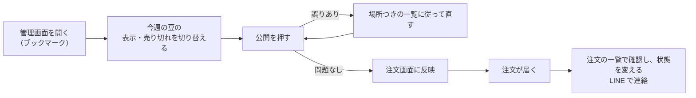

# 【新設計】管理画面の要件定義（叩き台）

> 【新設計】作り直した後の姿についての文書。Issue #54。メインのセッションが書いた叩き台で、ユーザーとオーナーの判断（§10）を経て確定する。確定した内容は `docs/to-be/design.md` に書き戻す。この文書は「何ができるべきか」の正本、design.md は「どう作るか」の正本とし、食い違ったときは、この文書で要件を確かめてから design.md を直す。

2026-11-28 作成。T1-3（シートの機能）の結果は、`docs/to-be/spikes.md` の T1-3 と `docs/to-be/design.md` §3.3 にある（ブランチ `spike/9-T1-3-sheet-features`。この文書より先に main に入れる）。

## 用語

説明の元は `docs/to-be/glossary.md`。この文書で新しく使う語（管理画面、注文画面、下書き）は、確定したときに用語集に足す。

| 用語 | 意味 |
|---|---|
| 管理画面 | オーナーが Web ブラウザで開き、設定、豆、公開、注文を管理するページ。注文画面と同じスクリプトが出す |
| 注文画面 | お客さんがメニューを見て注文するページ。用語集の「Web アプリ」の説明にある「お客さんが注文する画面」 |
| 持ち主 | Google ドライブの上でスプレッドシートやスクリプトを持っている人。Google の画面では「オーナー」と出る。本番では、お店のオーナーが持ち主になる |
| 公開 | 管理画面で保存した内容を検証し、注文画面に出すメニューとして確定すること。公開するまで、注文画面は変わらない |
| 下書き | 保存したが、まだ公開していない内容 |
| ローダー、モジュール、アプリを更新 | 用語集のとおり。ローダーはテンプレートの後は変えられない |

## 1. 目的

オーナーが、スプレッドシートを直接さわらずに、管理画面だけで、毎週の運用（豆の表示の切り替え、公開、注文の確認）と、ときどきの変更（豆の追加、単価やカテゴリの変更）を行えるようにする。見せ方の変更（項目、絞り込みなど）も、後から管理画面でできるようにする。

背景
- スマホのスプレッドシートアプリでは、スクリプトのメニューとボタンが使えない（T1-3 の S08）
- シートだけの管理は見た目が整わず、入力の誤りも起きやすい（ユーザーの判断。Issue #9、#50）
- 持ち主だけが操作できる Web ページは、今の GAS の仕組みで作れる（T1-3 の S15〜S18）

## 2. 前提と方針

- データの置き場はスプレッドシートのままにする。管理画面はシートを読み書きする画面で、データベースを別に持たない。そうする理由は次のとおり
  - オーナーが表として見られる
  - Google ドライブで変更の履歴が残る
  - 管理画面が動かないときも、データに触れる
  - 受け渡しと更新の仕組み（テンプレートのコピー、`_コード` タブ）をそのまま使える
- 管理画面の操作は、持ち主だけができる。持ち主でない人が管理画面を開いても、データは表示されず、操作は断られる（`docs/to-be/design.md` §3.3 の `adminCall`）
- 管理画面は、アプリのコード（モジュールと画面の HTML）に含め、「アプリを更新」で新しくなる。画面と操作は、後から「アプリを更新」で足せる。ただし、ローダーとマニフェストで決まることは後から変えられない（§8.1）
- 管理画面で保存した内容は下書きで、公開を押したときだけ注文画面に出る（今の設計の「メニューを公開」と同じ考え方）。急ぎの切り替え（受付の停止、売り切れ）をすぐ出すかは §10 で決める
- 管理画面が動かなくなったときの逃げ道を持つ（§5.9）

## 3. 利用者と使う場面

| 利用者 | 主な端末 | 使う場面 |
|---|---|---|
| オーナー | PC とスマホ。Issue #9 では PC 中心と決めたが、管理画面ではスマホでも毎週の操作ができるようにする | 毎週の切り替えと公開、注文の確認、ときどきの変更 |
| デザイン担当 | PC | 受け渡しの前の確認、不具合の相談のときの確認（オーナーが渡した調査用のコピーで） |
| お客さん | スマホ（LINE の中のブラウザを含む） | 管理画面は使わない |

## 4. 業務の流れ

| 頻度 | 業務 | 管理画面での操作 |
|---|---|---|
| 毎週 | 今週の豆を決める | 豆の一覧で、表示と売り切れを切り替え、公開を押す |
| 毎週 | 注文を確かめる | 注文の一覧で新しい注文を見て、状態（確認済み、渡し済み、キャンセル）を変える |
| ときどき | 受付を止める、始める | 受付中を切り替え、受付停止の文言とお知らせを変える |
| ときどき | 豆を足す、直す | 豆の追加と編集の画面で入力し、保存して公開する。新しい味わいの候補も、その場で足せる |
| ときどき | 単価、カテゴリ、送料を変える | 設定の画面で変え、保存して公開する |
| ときどき | 好みを見る | ダッシュボードを更新して見る。同じ人の名前をまとめる候補を確かめる |
| まれ | 見せ方を変える（項目、絞り込み、並べ替え、文言） | 見せ方の画面で変え、保存して公開する |
| まれ | アプリを更新する | 更新の画面でボタンを押す。問題があれば戻す |
| まれ | 不具合を相談する | 調査用の書き出しを押し、デザイン担当に渡す |

## 5. 機能の要件

画面ごとに書く。「最初」は最初のリリース（v1.0.0）に入れるもの、「後」は後から「アプリを更新」で足すもの（§7）。

### 5.1 入口と持ち主の確かめ（最初）

- オーナーは管理画面の URL をブックマークして開く。開き方（注文画面と同じ URL に引数を付けるか、管理画面用の2つ目のデプロイを作るか）は §10 の R-1 で決める
- 開いたとき、持ち主のアカウントでログインしているかを確かめ、違えば「このページは持ち主だけが使えます」と出して何も表示しない（2つ目のデプロイで出す場合、持ち主でない人には Google のエラーの画面が出て、この文言は出ない）
- 複数のアカウントでログインしたブラウザで開けないときの案内は、T1-4（Web アプリの動作）の結果で決める

### 5.2 ホーム（最初）

- 受付中かどうか（下書きと公開中の両方）、最終公開日時、未公開の変更の有無、今週の注文の件数と金額、新しい注文の件数、アプリのバージョンを出す
  - 未公開の変更の有無は、下書きと公開中のメニューを比べて出す（今の設計 §2.15 の onEdit による目安より正確になる）
- 毎週の操作への近道（豆の一覧、公開、注文の一覧）を置く

### 5.3 豆の一覧と編集（最初）

- 一覧
  - おすすめ順に並べる。並びを変えられる
  - 豆ごとに、表示、売り切れ、NEW を、その場で切り替えられる。切り替えるたびに保存し、保存中、保存済み、失敗を豆ごとに出す。失敗したときは、どの切り替えが保存されていないかを出し、やり直せる
  - カテゴリ、名前、価格、表示の状態で絞り込める
- 追加と編集
  - カテゴリ、名前、アイコン、タグ、説明、100g価格（空ならカテゴリの価格）、項目の値（焙煎度などの段階、味わいなどの分類、はい・いいえ）を入力する
  - 入力欄は、項目の種類に合う部品にする（段階は段の選択、分類はチップ、はい・いいえはスイッチ）
  - 分類の項目の候補（選択肢。例 味わいの「ナッツ」）にない値は、その場で候補に足せる（見せ方の設定のうち、候補を足すことだけは最初から管理画面でできるようにする）
  - 入力の誤り（必須の空欄、範囲外の値、名前の重複）は、保存の前にその場で知らせる
  - 新しく足した豆は、初めは表示しない状態で保存するか（§10 の R-6）
- 豆を消すことと「使わない」
  - 注文と集計は豆の ID で結び付くので、豆は消さずに「使わない」にする
  - 「表示」は今週メニューに出すかで、毎週切り替える。「使わない」は、もう扱わない豆で、一覧の初期の表示から外す。使わない豆は表示にできない

### 5.4 設定（最初）

- 受付中、受付停止の文言、お知らせ、案内文
- 量の上限（種類数、合計、1種類の最小と上限、刻み）、1杯あたりの g
- お気に入りを使うか、集計の期間、通知先メール（通知を入れるかは D-1 で決める）
- カテゴリ（名前、100g価格、デカフェ、アイコン、説明）の追加、編集、並び替え
- 受け取り方法（名前、料金、説明、有効）の追加、編集、並び替え
- カテゴリと受け取り方法は、豆と過去の注文が名前で指しているので消さない。カテゴリは「使わない」にし、使われている豆があるうちは使わないにできない。受け取り方法は「有効」を外す
- 値の矛盾（最小が上限より大きいなど）は保存の前に知らせる

### 5.5 公開（最初）

- 公開を押すと、今の `docs/to-be/design.md` §2.14 の検証を行い、誤りがあれば、画面のどこを直せばよいかを一覧にし、押すとその入力欄へ移る
- 公開の前に、前回の公開からの変更点（表示になる豆、売り切れになる豆、価格の変更など）を確かめる画面を出す（§10 の R-5）
- 公開した内容は、注文画面に出る。公開日時を残す。公開した内容は、毎回、公開の履歴として残す（戻す操作は後。§7）

### 5.6 注文の一覧（最初）

- 新しい順に並べ、状態（新規、確認済み、渡し済み、キャンセル）で絞り込める。初めに出すのは直近の8週間か100件までとし、それより前は期間を選んで出す
- 注文ごとに、受付番号、名前、受け取り方法、明細、合計、備考、お気に入りを出す
- 状態を変えられる。変える注文は、行の番号ではなく受付番号で探す（注文は同時に足され、オーナーがシートで並べ替えることもあるため）
- LINE への連絡は今までどおりオーナーが行う。連絡を楽にする機能と、オーナーが注文の中身を直す機能は §10 で決める

### 5.7 ダッシュボードと名寄せ（最初はボタンだけ、表とグラフは後）

- 最初のリリースでは、管理画面に「ダッシュボードを更新」のボタンだけを置き、表とグラフはシートのダッシュボードで見る（スマホのアプリではシートのボタンが使えないため、更新だけは管理画面でできるようにする）
- 後から、`docs/to-be/design.md` §5.2 の集計（豆ごと、週ごと、人ごと）を管理画面に表とグラフで出す。同じ人の名前をまとめる候補（design.md §5.3）を一覧にし、まとめるかを押して決める

### 5.8 見せ方の設定（後）

- 項目（追加、名前の変更、種類、段階の数、両端の名前、表示のしかた、まとめ、カードと詳細に出すか）、選択肢（並べ替え、名前の変更、消す）、区分け、絞り込み、並べ替え、文言
- 項目を足すと、豆の編集の画面に入力欄が増える
- 最初のリリースでは、シートの隠すタブで編集する（PC で行う）。選択肢の候補を足すことだけは、豆の編集から最初にできる（§5.3）

### 5.9 アプリの更新と戻し、逃げ道（最初）

- 更新の画面に、今のアプリのバージョンを出す。最新のリリースのバージョンは、リリースのファイルを丸ごと取らないと分からない（GitHub の API を使わない決まり。`docs/to-be/delivery-flow.md` §5.2）ので、取るのは「アプリを更新」を押したときだけにする
- 「アプリを更新」と「前のバージョンに戻す」を押せる。どちらもローダーの中の処理なので、管理画面からはローダーの処理を呼ぶ（§8.1）
- 逃げ道
  - 管理画面はモジュールが出すので、更新したアプリに不具合があると、管理画面ごと開けなくなり得る
  - PC では、スプレッドシートのメニューの「前のバージョンに戻す」で戻せる
  - スマホではシートのメニューが使えない（S08）。スマホだけで更新して管理画面が壊れると戻せないので、「更新は PC だけで行う」にするか、ローダーが自前の小さな画面（前のバージョンに戻すだけ）を出すかを §10 の R-7 で決める

### 5.10 調査用の書き出し（後）

- 名前、備考、端末 ID を伏せたコピーを作る（`docs/to-be/delivery-flow.md` §7）。それまではシートのメニューで行う

## 6. データの持ち方の変わるところ

管理画面を入れると、今の設計（`docs/to-be/design.md` §2）から次が変わる。詳しい形は T2-1（データモデル）と T2-2（スプレッドシート構成）で決める。

- 豆に「使わない」を足す（§5.3）。カテゴリにも「使わない」を足す（§5.4）
- 豆の ID を振る時期を、公開のときから、保存のときに変える（管理画面が保存の時点で豆を指せるように）
- 公開の履歴を残す。公開ごとに、公開日時と、公開した内容と、その形式のバージョン（`schemaVersion`）を残す。置き場（タブか `_公開データ` の行か）は T2-2 で決める
- 先に別の保存があったことを知るために、豆と設定の行ごとに更新の印（更新日時か番号）を持つ。管理画面は読んだときの印を送り、保存のときに印が変わっていれば保存せずに知らせる（§9）
- シートの並び
  - 今の設計は、管理タブの上の段（ボタン、状態、毎週の設定）と下の段（豆の表）を1枚に置き、普段見えるタブを3枚にしている（§2.3、§2.15）。これはオーナーがシートで操作する前提の形で、管理画面を入れると要らなくなる
  - 豆の表を1枚のタブにし、状態の表示とボタンは管理画面に移す。どのタブを普段見せるかは T2-2 で決める
- オーナーが管理画面で入力した文字も、シートに書くときに数式にならないようにする（`=`、`+`、`-`、`@` で始まる値。お客さんの入力と同じ扱い。design.md §3.2）

## 7. 最初のリリースの範囲（案）

| 機能 | 最初 | 後 |
|---|---|---|
| 入口と持ち主の確かめ、ホーム | ○ | |
| 豆の一覧と編集（表示、売り切れ、追加、編集、使わない、選択肢の候補を足す） | ○ | |
| 設定（受付、上限、カテゴリ、受け取り方法、通知先など） | ○ | |
| 公開（検証、変更点の確認、履歴を残す） | ○ | |
| 注文の一覧と状態の変更 | ○ | |
| アプリの更新と戻し | ○ | |
| ダッシュボードを更新するボタン | ○ | |
| ダッシュボードの表とグラフ、名寄せ | | ○（それまではシート。PC で見る） |
| 見せ方の設定（項目、選択肢の並べ替えと名前の変更、区分け、絞り込み、並べ替え、文言） | | ○（それまではシート。PC で行う） |
| 公開の履歴から戻す | | ○ |
| 調査用の書き出し | | ○（それまではシートのメニュー。PC で行う） |

- 毎週の運用（表示の切り替え、公開、注文の確認）と、お店の数字（単価、送料）は、最初からスマホでも管理画面でできるようにする
- 見せ方の設定は種類が多く、変える頻度も低いので後にする。後から足せるように、最初から §8.1 を守る

## 8. 今後の拡張と、そのために今決めておくこと

### 8.1 ローダーとマニフェストで今決めること（テンプレートの後は変えられない）

ローダーの入口、ローダーとモジュールの取り決め、マニフェストの権限の範囲は、テンプレートを作った後は「アプリを更新」で変えられない。後から管理画面の機能を足すときに困らないよう、次をテンプレートの前に決める。

| 決めること | 案 | 関わる拡張 |
|---|---|---|
| 管理画面の入口の形 | `adminCall` を1つ置き、引数の JSON で操作を選ぶ。2つ目の引数として、form か Blob を受け取れるようにしておく（写真の取り込みなど。T1-3 の S13 で、form の file 入力は Blob として届いた） | 管理の操作を足す、写真 |
| 返り値と断るときの形 | 返り値は JSON の文字列。断るときは、理由（持ち主でない、先に別の保存があった、アプリのバージョンが違う、入力の誤り）を決めた形で返す | すべて |
| 管理画面から呼べるローダーの処理 | `adminCall` が、モジュールの操作に加えて、ローダーの処理（アプリを更新、前のバージョンに戻す、今のバージョン）も呼べる形にする | 更新の画面 |
| doGet とモジュールの取り決め | ローダーがモジュールに渡すもの（`e`、`getUrl()` など）と、バンドルの中の管理画面の HTML の名前を決める。お客さんの画面を開くときに管理画面の HTML まで読まないように、読む単位を分ける | 管理画面、速さ |
| スマホの逃げ道 | 「更新は PC だけ」にするか、ローダーが自前の小さな画面を出すか（§5.9、R-7） | 更新、戻し |
| 時間主導のトリガーの入口 | 定期の処理（受付の期間の自動の切り替え、集計の定期の更新など）を後から足せるように、汎用の時間主導のトリガーの入口を1つ置くか | 受付の期間、集計 |
| 変更トリガー（onChange）の入口 | 管理画面では「未公開の変更」を比べ合わせで出せるので、置かない案 | シートの直接の編集 |
| マニフェストの権限の範囲 | 次を入れるかを決める。メールの送信（`script.send_mail`。D-1 で通知を入れる場合）、Google ドライブのファイル（`drive.file`。写真や、調査用の書き出しで別のファイルを作る場合）。入れると、オーナーが初回に承認する画面の項目が増える（§10 の R-8） | 通知、写真、書き出し |
| 持ち主以外の人に管理を許すか | 今の仕組み（Web アプリを「自分として実行」）では、個人の Gmail のアカウントは持ち主でないとメールアドレスが取れず（T1-3 の S11）、許可した人を見分けられない。許すには別の方式（見る人として実行するデプロイ、合言葉など）が要り、本番に編集者を置かない決まり（`docs/to-be/delivery-flow.md` §5.2）ともぶつかる。見込みがあれば、テンプレートの前に技術検証をする（§10 の R-9） | 家族、スタッフの管理 |

### 8.2 データの持ち方で守ること（後から「アプリを更新」で足せる）

列は見出しの文字で探す決まり（design.md §2.0）と、形式のバージョン（`schemaVersion`）があれば、次は後から足せる。今は作らない。

- 豆の写真（豆の行に画像の置き場所の列を足す。Drive に置くなら §8.1 の権限の範囲が要る）
- 在庫の量（豆の行に在庫の列を足し、注文の処理で引く。注文は設計ではロックで1件ずつ処理する）
- 受付の期間（設定に開始と終了を足す。自動で切り替えるなら §8.1 の時間主導のトリガーが要る）
- 別のお店にも配る（テンプレートのコピーで配る今の仕組みのままで足りる。お店の名前や色は設定に持つ）
- 決済、会員登録は今回やらない（design.md §0）

## 9. 画面に依らない要件

- 守り
  - 管理画面からの操作は、すべて持ち主の確かめを通る（design.md §3.3）。管理画面の HTML にはシートの値を埋め込まない
  - 管理画面に出すお客さんの入力（名前、備考）とシートの値は、HTML として描画しない（design.md §4 を管理画面にも当てはめる）。持ち主のブラウザで動くスクリプトを差し込まれると、持ち主の操作として通ってしまうため
  - 管理画面は、URL の引数で操作を始めない。オーナーが押したときだけ操作する
- 端末（確かめ方）
  - 幅 375px の画面で、横に動かさずに、毎週の操作（表示と売り切れの切り替え、公開、注文の状態の変更）ができる。押すところは縦横 44px 以上にする
  - PC では、豆の編集などの入力を広い画面で行える
- 保存と同時の操作
  - 保存は、操作ごと（豆1つ、設定の1画面）に行う。保存の途中で閉じても、ほかのデータは壊れない
  - 同じ持ち主が PC とスマホで同時に開いた場合、後から保存する前に、先に別の保存があったことを知らせ、上書きしない（§6 の更新の印）
  - 書き込みは `LockService` で順番にする（T1-3 で、同時に書いたことが原因と思われるログの乱れがあった）
  - お客さんの注文（`placeOrder`）はロックが取れないと断る（design.md §3.2）。公開のような時間のかかる処理がロックを長く持つと、その間の注文が断られる。ロックを持つのは書き込みの間だけにし、検証などはロックの外で行う
- 速さ（確かめ方）
  - 測る条件: 豆 30 種類、注文 500 件、スマホの LINE の中のブラウザと PC の Chrome
  - 測る区間: 管理画面を開いてから、豆の一覧を操作できるまで
  - 目安: 5秒以内（仮の値。T1-4 の往復の時間の結果で直す）
- 履歴
  - 公開ごとに公開した内容を残す（§6）。履歴から戻す操作は後（§7）
- シートを直接さわったとき
  - オーナーやデザイン担当がシートを直接直しても、管理画面と公開の検証が壊れない（見出しの文字で列を探す今の決まりを保つ）

## 10. 決めてほしいこと

| 番号 | 内容 | 案と理由 | 決める人 |
|---|---|---|---|
| R-1 | 管理画面の開き方 | 案は「注文画面と同じ URL に引数を付けて開く」。オーナーの初回の手順でデプロイを1回作るだけで済み、守りは持ち主の確かめで足りる（T1-3 の S11、S15）。もう1つの案「持ち主だけが開ける2つ目のデプロイ」は、持ち主でない人には Google が画面ごと断る分だけ守りが重なるが、オーナーがデプロイを2回作り、「お客さんのデプロイを出し直さない」注意も要る（T1-3 の S16 と Issue #9 のコメント） | ユーザー |
| R-2 | 最初のリリースの範囲（§7 の表）と、シートを直接さわる場面 | 表のとおり。見せ方の設定とダッシュボードの表は、しばらく PC のシートで行う。普段の手順書には、シートを直接さわる手順を書かない | ユーザー |
| R-3 | 管理画面のデザインを Figma で作るか | 作る（注文画面と同じ部品の考え方）。最初は仮の見た目で動かし、後で差し替える | ユーザー |
| R-4 | スマホでどこまでできるようにするか | 毎週の操作（表示の切り替え、公開、注文の状態）は必ず。豆の編集と設定もできるが、PC の方が楽な作りでよい | ユーザー、オーナー |
| R-5 | 公開の前に変更点の確認画面を出すか | 出す（誤って全部を非表示にして公開する、などを防ぐ） | ユーザー |
| R-6 | 急ぎの切り替え（受付の停止、売り切れ）を、公開を待たずにすぐ注文画面に出すか。新しく足した豆を初めは表示しない状態で保存するか | 受付の停止と売り切れは、すぐ出す（ほかの下書きの誤りで止まったり、作りかけの豆が一緒に出たりしないように）。新しい豆は初めは表示しない | ユーザー |
| R-7 | スマホの逃げ道 | 「アプリを更新は PC だけで行う」にする。ローダーに自前の画面を持たせるより単純で、更新はまれな操作のため（delivery-flow §5.2 の今の決まりとも合う） | ユーザー |
| R-8 | マニフェストの権限の範囲（§8.1） | D-1 で通知メールを入れるなら `script.send_mail` を入れる。写真と別ファイルの書き出しは作るか未定なので、`drive.file` は入れない（入れないと、後から写真を Drive に置く機能は足せない） | ユーザー、オーナー |
| R-9 | 持ち主以外の人（家族、スタッフ）に管理を許す見込みがあるか | 今は持ち主だけ。見込みがあれば、テンプレートの前に技術検証が要る（§8.1） | オーナー |
| R-10 | 注文の一覧で、LINE の連絡を楽にする機能（連絡の文のひな形のコピーなど）と、オーナーが注文の中身（量、受け取り方法）を直す機能を入れるか | どちらも後の候補にする。直す機能は、注文明細と集計の扱いを決める必要がある | オーナー |
| R-11 | 管理タブのボタンとチェックボックス（今の設計 §2.14、§2.15）を残すか | 管理画面ができたら外す。シートのメニューは、初期設定と前のバージョンに戻すなど、逃げ道の操作だけを残す | ユーザー |
| R-12 | オーナーが PC とスマホのブラウザで、Google のアカウントにいくつログインしているか | 複数のアカウントでログインしたブラウザでは Web アプリを開けないことがある（T1-3 の操作の中で分かったこと）。2つ以上なら、管理画面を開くブラウザを分けるなどの手順が要る | オーナー |
