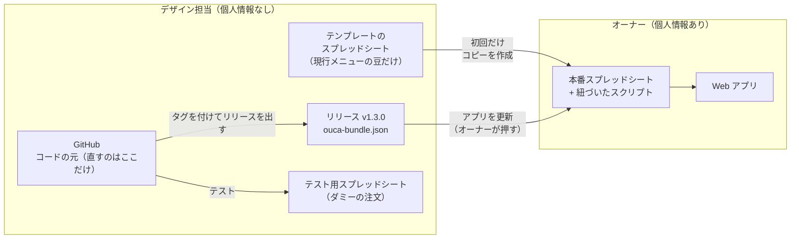
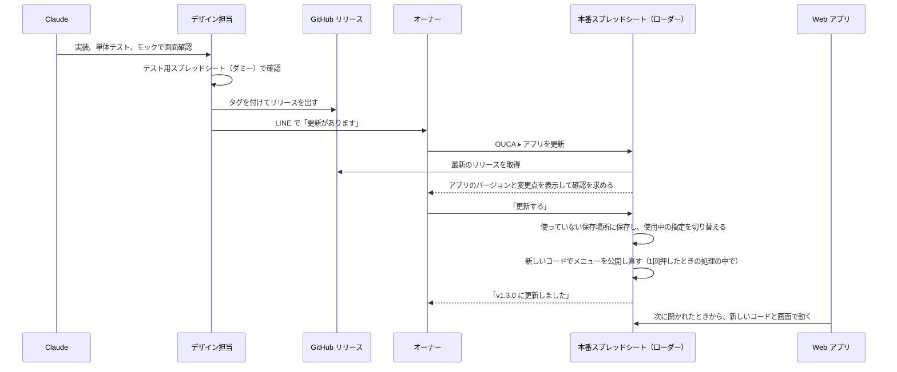

# 【新設計】実装、受け渡し、更新の流れ

> 【新設計】作り直した後の姿についての文書。現行サイトの解析は `docs/as-is/` を見る。

設計は `docs/to-be/design.md`。

## 用語

説明の元は `docs/to-be/glossary.md`。

| 用語 | 意味 |
|---|---|
| ローダー | スプレッドシートに紐づくスクリプト。外から呼べる関数（入口）、`_コード` タブからの読み込み、「アプリを更新」と「前のバージョンに戻す」の処理、初期のコードを持つ。テンプレートのコピーの後は変えない。「アプリを更新」でも変わらないので、ローダーの中の処理に不具合があっても、「アプリを更新」では直せない |
| 入口 | ローダーの中で、GAS が直接呼ぶ関数。メニュー OUCA、管理タブのボタン、トリガー、Web アプリ、画面からの呼び出しは、すべてここから入る |
| バンドル | アプリのコード（モジュールと画面の HTML）を1つにまとめたファイル。GitHub のリリースに置き、「アプリを更新」で `_コード` タブに取り込む |
| モジュール | バンドルのうち、サーバーで動く処理の部分。ローダーが `_コード` タブから文字列として読み込み、動かせる関数に変えて（評価して）呼ぶ |
| 初期のコード | ローダーの中に最初から入れておくバンドル。`_コード` タブに最初のバンドルを入れるときと、`_コード` タブが読めないときに使う |
| `_コード` タブ | バンドルを保存する、非表示のタブ |
| 保存場所（A、B） | `_コード` タブの中で、バンドルを1つずつ入れる2か所。片方に今のアプリのバージョンが入る。もう片方には、1つ前のアプリのバージョンがあればそれが入る（「前のバージョンに戻す」の戻す先）。「アプリを更新」は、使っていない方に新しいアプリのバージョンを書く |
| 使用中の指定 | A と B のどちらの保存場所のバンドルを動かすかを書いた設定。スクリプトのプロパティに置く。スクリプトのプロパティはテンプレートのコピーに引き継がれないので、同じ内容を `_コード` タブのセルにも書く。2か所が違うときは、スクリプトのプロパティの方に従う。「アプリを更新」と「前のバージョンに戻す」は、この指定を書き換えて切り替える |
| 読み込み方式 | アプリのコードを `_コード` タブに置き、ローダーが動くたびに読み込んで動かす方式。スクリプトが自分の中身を書き換える方式が成り立たなかったので、T1-1（アプリの自己更新）で選んだ |
| リリース | GitHub の機能。コードのある時点に番号（タグ。v1.3.0 など）を付け、バンドルを添付して出す。オーナーは「アプリを更新」で、最新のリリースのバンドルを取り込む |
| テンプレート | デザイン担当が作る、初期設定済みのスプレッドシート。オーナーは「コピーを作成」でこれを複製して、本番のスプレッドシートにする |
| テスト用スプレッドシート、テスト用スクリプト | デザイン担当が持つ、ダミーデータだけのスプレッドシートと、それに紐づくスクリプト。`npm run push:test` でローダーを送り、GAS の上の動きを確かめる |
| 外から呼べる関数 | GAS では、スクリプトの一番外側に書いた関数を、メニュー OUCA、ボタン、トリガー、画面から名前で呼べる。このアプリの Web アプリは誰でも開ける設定なので、知らない人も画面からこれらの関数を呼べる。名前の末尾が `_` の関数は、画面からは呼べない |
| 持ち主 | Google ドライブの上でスプレッドシートやスクリプトを持っている人。Google の画面では「オーナー」と出る。本番では、お店のオーナーが持ち主になる |
| スクリプトのプロパティ | スクリプトごとに値を保存しておける、GAS の設定の置き場。シートには出ず、テンプレートのコピーには引き継がれない |
| トリガー | 決まったとき（シートを開いた、編集した、決めた時刻になった）に、関数を自動で動かす GAS の仕組み |
| Web アプリ | スクリプトを URL で開けるページにしたもの。お客さんが注文する画面になる |
| デプロイ | Web アプリを作る操作と、作った結果のこと。このアプリでは、オーナーが初回に1つだけ作り、作り直さないので、URL は変わらない |
| 承認 | スクリプトが初めて権限の要る処理をするときに出る画面で、持ち主が権限を許可すること |
| マニフェスト | スクリプトの設定ファイル（`appsscript.json`）。スクリプトが求める権限の範囲や、Web アプリの設定を書く。ローダーの側にあるので、「アプリを更新」では変えられない |
| 権限の範囲（`oauthScopes`） | スクリプトが使ってよい Google の機能の一覧（スプレッドシートの読み書き、メールの送信など）。マニフェストに書き、持ち主が承認の画面で許可する |
| キャッシュ（`CacheService`） | GAS の一時的な保存の場所。読み込みを速くすることと、二重送信を見分けることに使い、最長6時間で消える |
| `LockService` | ロックを取る処理どうしが、同時に動かないようにする GAS の仕組み。注文と「アプリを更新」で使う |
| Apps Script API、既定の Cloud プロジェクト | Apps Script API は、スクリプトの中身やデプロイを外から変える Google の仕組み。スクリプトごとに自動で作られる Cloud プロジェクト（既定の Cloud プロジェクト）では、この API を有効にできなかった（T1-1） |
| clasp | 手元のコードを Apps Script のスクリプトに送る、Google の道具。このプロジェクトでは、テスト用スクリプトに送るときだけ使う |
| メニュー OUCA | スプレッドシートの上に出る、このアプリのメニュー。「OUCA ▸ メニューを公開」のように、中の項目を押して操作する。初期設定の前は「初期設定」など少しの項目だけが出る |
| 名寄せ | 書き方の違う同じ人の名前（「岡本」と「岡本太郎」など）を、1人の名前にまとめること。スクリプトが候補を出し、オーナーがお客さんタブで確かめる |
| 端末ID | お客さんの端末（ブラウザ）ごとに作る、名前の入っていない ID。同じ端末からの注文だと分かる手がかりとして、名寄せに使う |
| `_公開データ` タブ | 「メニューを公開」が書く、お客さんの画面に出すメニューのデータ（JSON）を置く非表示のタブ |
| モック、偽物 | どちらも本物の代わりに、決まった値を返すもの。モックは手元で画面を確かめるときに使い（`mock/catalog.json`）、偽物はテストで GAS の機能（`SpreadsheetApp` など）の代わりに置く |
| T 番号、D 番号 | ワークプランのタスクの番号（T1-2 など）と、ユーザーに決めてもらうことの番号（D-1 など）。対応は `work-plan.md` §3、§4 にある。文書の中では、初めて出る位置でタスクの名前を添える |
| § | 文書の節の番号。「`delivery-flow.md` §5.3」は、受け渡しの文書の 5.3 の節を指す |

## 1. 方針

- デザイン担当（ユーザー）は、オーナーのスプレッドシートに一切アクセスしない。注文の名前や好みなどの個人情報を見ない
- スプレッドシート、スクリプト、Web アプリはすべてオーナーのアカウントに置き、オーナーの権限で動く
- コードはデザイン担当の GitHub で管理し、リリースを出す。オーナーのシートは、オーナーがボタンを押したときだけそれを取り込む
- メニューの公開とアプリの更新は、オーナーがメニュー OUCA（または管理タブのボタン）から手動で行う。Web アプリを作る操作だけは、初回に1回、エディタで行う（§4.1 の手順 4）
  - メニューの公開（豆や設定の変更を画面に出す）: 「OUCA ▸ メニューを公開」
  - アプリの更新（新しいリリースを取り込み、Web アプリを新しいコードで動かす）: 「OUCA ▸ アプリを更新」
- テストは、デザイン担当の GitHub、手元の環境、ダミーデータだけのテスト用スプレッドシートで行う

## 2. 役割

| 担当 | 持ち物 | やること |
|---|---|---|
| オーナー | 本番のスプレッドシート、紐づいたスクリプト、Web アプリ | メニューの編集と公開、アプリの更新ボタン、注文の対応 |
| デザイン担当 | GitHub のリポジトリとリリース、Figma、テンプレートのスプレッドシート、テスト用のスプレッドシート（ダミーデータ） | 実装の確認、リリースを出す、オーナーへの連絡 |
| Claude | （デザイン担当のリポジトリで作業） | 設計、実装、テスト、手順書の作成 |

## 3. 置き場所とデータの流れ



- 矢印はすべてデザイン担当からオーナーへの一方向。オーナー側のデータがデザイン担当に戻る経路はない
- オーナーが不具合を相談するときに必要なら、「OUCA ▸ 調査用に書き出す」で名前と備考を伏せたデータを作り、オーナーの判断で渡す（§7）

## 4. 初回の受け渡し

### 4.1 手順（新しい URL で始める。2026-11-21 決定）

| 順 | 担当 | 作業 |
|---|---|---|
| 1 | デザイン担当 | テンプレートのスプレッドシート（初期設定済みのタブ、ボタン、グラフ、現行メニューの豆、紐づいたスクリプト入り）の「コピーを作成」リンクを LINE で送る |
| 2 | オーナー | リンクを開いて「コピーを作成」を押す。スプレッドシートとスクリプトがオーナーのものとして作られる。オーナーはテンプレートを閲覧できればよく、編集者にしなくてよい。閲覧者にコピーを許す共有の設定はオンにしておく（`docs/to-be/spikes.md` の「T1-2 テンプレートのコピー」）。「コピーを作成」の画面のチェックボックス（同じユーザーと共有するなど）の扱いは T6-2（テンプレートのスプレッドシート）で確かめ、手順書に書く |
| 3 | オーナー | 「OUCA ▸ 初期設定」を押し、承認画面を通す（下の「承認画面」）。承認の画面だけが出て終わったときは、もう一度押す。コピーした直後は、初期設定の前のメニュー OUCA（「初期設定」など少しの項目だけ）になる（§5.3）。使用中の指定（スクリプトのプロパティ）とトリガーはコピーされないので、初期設定が `_コード` タブから使用中の指定を作り直し、トリガーを作る。タブ、保護、入力規則、条件付き書式、グラフ、ボタン、`_コード` タブ、豆の表はテンプレートからコピーされている。何度押しても同じ結果になる（`docs/to-be/design.md` §8） |
| 4 | オーナー | Apps Script のエディタで Web アプリを作る（デプロイ。1回だけ）。「拡張機能 ▸ Apps Script」でエディタを開き、「デプロイ ▸ 新しいデプロイ」で種類「ウェブアプリ」、「次のユーザーとして実行: 自分」、「アクセスできるユーザー: 全員」を選んで「デプロイ」を押す。出た URL を控える。Apps Script API が使えないので、スクリプトからは作れない（`docs/to-be/spikes.md` の「T1-1 アプリの自己更新」の、シナリオ 7「既定の Cloud プロジェクトのままで Apps Script API を呼べる」）。画面の文言は T6-3（オーナー向け手順書）で実際の画面と照合する |
| 5 | オーナー | 豆の表を確かめ、味わいなどを入力して「メニューを公開」を押す |
| 6 | オーナー | 「OUCA ▸ アプリを更新」を押し、最新のリリースを取り込む。手順 4 の URL を LINE で共有する |

- テンプレートには個人情報を入れない。オーナーのコピーとテンプレートはつながっていないので、コピーの後にデザイン担当がオーナーのデータを見ることはない

承認画面
- 個人のアカウントで作った GAS では「このアプリは Google で確認されていません」と出る。「詳細」→「（安全ではないページに）移動」で進む
- 求める権限: スプレッドシートの読み書き、メールの送信（通知を使う場合）、外部への通信（リリースの取得）、トリガーの管理、メールアドレスの取得（持ち主の確かめ）
- 権限の範囲はテンプレートのスクリプトのマニフェストで決まり、「アプリを更新」では変えられない。将来使う可能性のある範囲も最初から入れておく（`docs/to-be/spikes.md` の「読み込み方式 9. マニフェストにない範囲を新しいコードが使ったときの動き」）
- オーナー向けの手順書（画面写真つき）を実装時に `docs/to-be/owner-guide.md` として作る

## 5. 普段の更新

### 5.1 メニューの更新（オーナーだけで完結）

豆の表などを編集 → 「OUCA ▸ メニューを公開」。コードの更新は要らない。

### 5.2 コードの更新（デザイン担当がリリース → オーナーが取り込む）

スクリプトがスクリプト自身の中身を書き換える方式は、既定の Cloud プロジェクトで Apps Script API を有効にできないため採らない（`docs/to-be/spikes.md` の「T1-1 アプリの自己更新」の、シナリオ 7「既定の Cloud プロジェクトのままで Apps Script API を呼べる」）。読み込み方式にする（2026-11-21 決定、2026-11-22 に検証）。

- テンプレートのスクリプト（ローダー）は、入口の関数（`onOpen`、`doGet`、メニュー OUCA、画面の API、トリガー）、`_コード` タブからの読み込み、「アプリを更新」と「前のバージョンに戻す」の処理、初期のコードを持ち、コピーの後は変えない
- バンドル（サーバーのモジュールと画面の HTML）は、スプレッドシートの非表示の `_コード` タブに保存する。保存場所を2つ（A と B）持ち、使用中の指定をスクリプトのプロパティに置く。使用中の指定を切り替えるときは、同じ内容を `_コード` タブのセルにも書く。スクリプトのプロパティの方に従い、セルはスクリプトのプロパティに記録がないとき（テンプレートのコピーの直後）だけ使う（`docs/to-be/design.md` §8）
- ローダーは、実行のたびに使用中の保存場所のモジュールを読み込み（2回目以降はキャッシュから）、評価して動かす。Web アプリの画面も使用中の保存場所の HTML から出す
- Web アプリのデプロイは初回に1つ作るだけで、更新では作り直さない。URL も変わらない



- 更新は次の工程で進める。LockService で、同時に2つ動かないようにする
  1. リリースの取得と確認
  2. 使っていない保存場所への保存（読み直して確かめる）
  3. 使用中の指定の切り替え（スクリプトのプロパティに書き、続けて `_コード` のセルに同じ内容を書く。スクリプトのプロパティの方に従うので、先に書けば、セルに書く前に止まってもこのシートの動きは変わらない）
  4. 新しいコードでメニューの公開のやり直し（1回押したときの処理の中で読み込み直したコードで行える）
- 途中で止まったら、もう一度押すと最初からやり直す。続きから進める記録は持たない（2026-11-22 決定）
  - 取得したバンドルが使用中の保存場所のバンドルと同じアプリのバージョンなら、保存と切り替えを飛ばす。セルの使用中の指定がスクリプトのプロパティと違えばセルを直し、メニューの公開のやり直しだけを行い、「既に vX.Y.Z です。メニューを公開し直しました」と出す
  - 切り替えの前（取得か保存の後）で止まった場合は、使っていない保存場所に書いただけなので、今のコードも戻す先も変わらない
  - 切り替えの後で止まった場合は、上の規則で保存と切り替えを飛ばすので、前のコードの保存場所を上書きしない
  - 切り替えの後からメニューの公開のやり直しの前までの間に止まると、やり直すまで、古いコードが `_公開データ` タブに書いた古い形式のメニューのデータを、新しいコードが読む。新しいコードは古い形式のメニューのデータでも動くようにする（T4-7（アプリを更新、前のバージョンに戻す）の仕様に書く）
- オーナーが押すまで、シート側の動きも Web アプリも変わらない。使用中の指定を切り替えた直後から、メニュー OUCA、トリガー、Web アプリのすべてが新しいコードになる
- 更新や戻しの前にお客さんが開いた画面は、アプリのバージョンが今のサーバーと合わないまま API を呼ぶ。画面は自分のアプリのバージョンを API に送り、サーバーのアプリのバージョンと違えば再読み込みを促す
- 結果（成功、どこで止まったか、今のアプリのバージョン）は、ダイアログと管理タブに出す
- 「アプリを更新」は、確認の表示が要るので PC のブラウザで行う
- 取得先はコードに固定した URL だけにする（シートの設定で変えられないようにする）
  - 最新のリリースは、固定の名前のファイルを `https://github.com/yuk-wq/ouca/releases/latest/download/ouca-bundle.json` で取る。`UrlFetchApp` は既定で転送をたどり、認証なしで取れる（`docs/to-be/spikes.md` の「読み込み方式 7. リリースの添付ファイルを取れる」）
  - 添付ファイルを出した直後の数十秒は、古い中身が返ることがある。取ったバンドルの `version` を確認のダイアログに出す
  - GitHub の API（`api.github.com`）は使わない。認証なしでは IP ごとに1時間60回までで、GAS の通信は Google の共用の IP から出るので、制限にかかる可能性がある
- 取得したリリースは、形式のバージョン（`schemaVersion`）と必要なファイルがそろっているかを確かめてから保存する。そろっていなければ何も変えずに止める
- 権限の範囲はローダーのマニフェストで決まり、更新では足せない。保存したバンドルがマニフェストにない範囲を使うと例外になる（`docs/to-be/spikes.md` の「読み込み方式 9. マニフェストにない範囲を新しいコードが使ったときの動き」）。新しい範囲が要る変更は、オーナーにエディタでの作業を頼むことになるので避ける
- 保存したバンドルは、Web アプリとトリガーを通して持ち主の権限で動く。紐づいたスクリプトは、スプレッドシートの編集者ならエディタで書き換えられるので、本番のスプレッドシートには持ち主以外の編集者を置かない（手順書で伝える）。`_コード` タブは、うっかり書き換えないように保護する
- 画面の隅に小さくアプリのバージョンの番号を出し、不具合の連絡を受けたときにアプリのバージョンを特定できるようにする

### 5.3 戻すとき

- 「OUCA ▸ 前のバージョンに戻す」で、使用中の指定を前の保存場所に戻す（更新の切り替えと同じく、スクリプトのプロパティ、`_コード` のセルの順に書く）。メニュー OUCA、トリガー、Web アプリのすべてが前のコードに戻る。GitHub にはつながない（`docs/to-be/spikes.md` の「読み込み方式 6. 前のバージョンに戻せる」）
- 戻せるのは直前の1つだけ（保存場所が2つしかない）。それより前に戻すときは、デザイン担当が前のアプリのバージョンのコードを新しいリリースとして出し直し、オーナーが「アプリを更新」を押す
- 戻す先がないとき（テンプレートのコピーの直後など）は、何も変えずに知らせる
- 使用中の指定がないとき（テンプレートのコピーの直後で、初期設定の前）は、ローダーは初期設定の前のメニュー OUCA（「初期設定」など少しの項目だけ）を出し、「初期設定」を押すように案内する（`docs/to-be/spikes.md` の「T1-2 テンプレートのコピー」）
- 使用中の指定はあるのに `_コード` タブのバンドルが読めないとき（タブを消した、壊したなど）は、ローダーに同梱した初期のコードで動き、「アプリを更新」を押すように案内する

## 6. リポジトリ、リリース、テスト

### 6.1 コマンド

| コマンド | 内容 |
|---|---|
| `npm run dev` | モックのメニューで画面を手元に出す（スマホでも LAN 経由で見られる） |
| `npm test` | 共通ロジック、サーバー（GAS の API は偽物）、画面の部品のテストと、外から呼べる関数の一覧のテスト |
| `npm run build` | ローダーと、バンドル（サーバーのモジュールと画面の HTML）を作り、`dist/` に出す（`docs/to-be/design.md` §4.4） |
| `npm run push:test` | ビルドして、ローダーをデザイン担当のテスト用スクリプトに送る |
| `npm run bundle` | `dist/` からリリース用の1ファイルを、固定の名前（`ouca-bundle.json`。「アプリを更新」が取る）とバージョンつきの名前（`ouca-bundle-vX.Y.Z.json`。記録用）で作る |

- 本番へ送るコマンドは持たない。本番に入るのは、オーナーが「アプリを更新」で取り込んだリリースだけ
- アプリのバージョンの番号は `package.json` の `version` と Git のタグでそろえ、変更点（`CHANGELOG.md` の該当部分）をリリースに同梱する

### 6.2 リリースの中身

```json
{
  "app": "ouca",
  "version": "1.3.0",
  "schemaVersion": 1,
  "notes": "絞り込みの見た目を変更しました",
  "files": [
    { "name": "Code", "type": "SERVER_JS", "source": "…" },
    { "name": "index", "type": "HTML", "source": "…" }
  ]
}
```

- `Code` はローダーが評価するサーバーのモジュール、`index` は Web アプリの画面の HTML。マニフェストはローダーの側で固定なので、リリースには入れない（§5.2）

- 置き場所は、デザイン担当の GitHub のコードのリポジトリ（`yuk-wq/ouca`）のリリースの添付ファイル。オーナーのスクリプトが認証なしで取れるよう、このリポジトリは公開にする（コードに秘密情報は入れない。2026-11-21 決定、work-plan.md の D-5（リリースを置く場所））
- リポジトリは公開なので、コード、Issue、設計、解析の資料に個人情報と秘密情報を入れない。リポジトリを公開する前に T1-1（アプリの自己更新）で確かめ、現行サイトの URL を伏せた新しいリポジトリに移した（2026-11-21。旧リポジトリは非公開の `yuk-wq/ouca-archive` としてアーカイブした）
- 配布専用の公開リポジトリを分ける案は採らない。オーナーの操作はどちらの形でも「アプリを更新」を押すだけで変わらず、分ける理由は開発の内側（Issue、設計、解析の資料）を隠すことだけになる。個人情報は入れていないので、隠す必要はないとユーザーが判断した（Issue #3（リポジトリを分ける案の見直し）、2026-11-21）

### 6.3 テスト環境

- 手元: `npm run dev` とモックのメニュー。画面とロジックの確認はほぼここで済ませる
- GitHub: プッシュごとに単体テストとビルドを動かす（GitHub Actions）
- テスト用スプレッドシート: テンプレートのコピーに、ダミーの豆と注文を入れたもの。テスト用の Web アプリはデザイン担当の権限で動く。シートの操作（メニューの公開、集計、名寄せ）と、「アプリを更新」の取り込みもここで試す
- 本番のデータはテストに使わない

## 7. 個人情報と信頼

- デザイン担当は本番のスプレッドシートの共有に入らない。オーナーがデザイン担当に何かを共有しない限り、デザイン担当は個人情報を見られない
- 不具合の調査で実データの形が要るときは、オーナーが「OUCA ▸ 調査用に書き出す」を押す。名前、備考、端末ID を伏せた（または置き換えた）コピーを作り、オーナーが中身を見てから渡す
- オーナーのスクリプトはデザイン担当のリリースを取り込んで動くので、オーナーはデザイン担当のコードを信頼することになる。オーナーが更新のたびに変更点を見て押す形にし、勝手には更新しない（自動更新は付けない）
- オーナーがエディタを開くのは、初回の Web アプリを作る操作（§4.1 の手順 4）だけにする。ローダーのコードを直すと「アプリを更新」でも直らないので、手順書でエディタのコードを触らないよう伝える

## 8. 実装時に確かめること

- テンプレートの共有のしかた（「リンクを知っている全員（閲覧者）」にするか）と、そのときのコピーの手順（T6-2（テンプレートのスプレッドシート））
- Google アカウントにログインしたブラウザで Web アプリを開けないことがある件。お客さんのスマホで開けるか（T1-4（Web アプリの動作））

確かめ終えたこと
- テンプレートのコピーでの受け渡し（T1-2 テンプレートのコピー。`docs/to-be/spikes.md` の同じ名前の節）
  - 閲覧者が「コピーを作成」を押すと、紐づいたスクリプトも複製され、スプレッドシートとスクリプトはコピーした人のものになる。テンプレートの持ち主は、編集者、閲覧者、保護の編集者に残らない
  - 保護、入力規則、条件付き書式、グラフ、ボタンの割り当て、非表示の `_コード` タブとその保護は残る
  - トリガーとスクリプトのプロパティはコピーされない。初期設定が、トリガーと、使用中の指定を作る（§4.1 の手順 3）
  - コピーした人がエディタで作った Web アプリは、その人の権限で動く（その人のブラウザと、ログインしていないブラウザで確かめた。ログインした別のアカウントでは開けず、T1-4 に送った）
- アプリの自己更新（T1-1）
  - Apps Script API で自分の中身を変える方式は、既定の Cloud プロジェクトで API を有効にできないので成り立たなかった
  - 読み込み方式に決めた（`docs/to-be/spikes.md` の「T1-1 アプリの自己更新」、§5.2、§5.3）。確かめたことは次のとおり
    - 取得、保存、切り替え
    - 前のバージョンへの戻し
    - 1回押したときの処理の中でのメニューの公開のやり直し
  - 確かめ残したことは `docs/to-be/design.md` §11 にある
- clasp で設定ファイルを切り替えて、テスト用のスクリプトだけに送る方法（T0-1 リポジトリの土台。`npm run push:test`）
