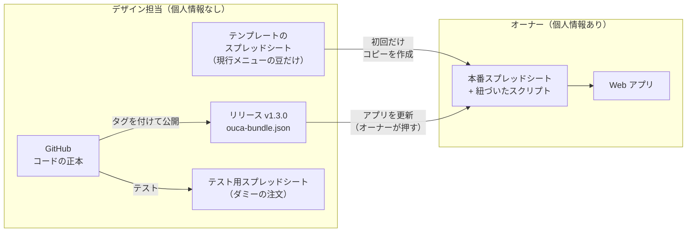
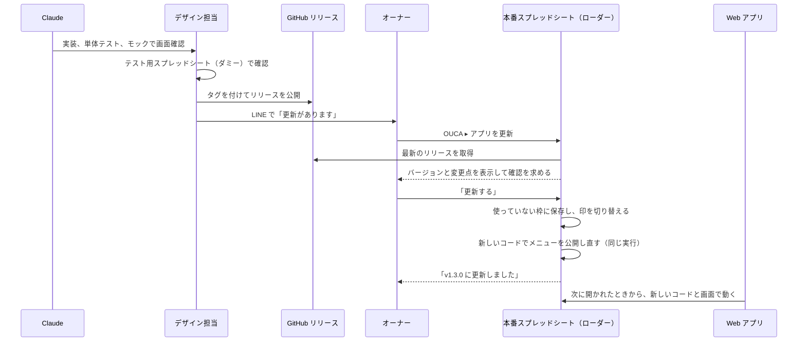

# 【新設計】実装、受け渡し、更新の流れ

> 【新設計】作り直した後の姿についての文書。現行サイトの解析は `docs/as-is/` を見る。

設計は `docs/to-be/design.md`。

## 1. 方針

- デザイン担当（ユーザー）は、オーナーのスプレッドシートに一切アクセスしない。注文の名前や好みなどの個人情報を見ない
- スプレッドシート、スクリプト、Web アプリはすべてオーナーのアカウントに置き、オーナーの権限で動く
- コードはデザイン担当の GitHub で管理し、「リリース」として公開する。オーナーのシートは、オーナーがボタンを押したときだけそれを取り込む
- 公開はオーナーがスプレッドシートのメニューから手動で行う
  - メニューの公開（豆や設定の変更を画面に出す）: 「OUCA ▸ メニューを公開」
  - アプリの更新（新しいリリースを取り込んで Web アプリに出す）: 「OUCA ▸ アプリを更新」
- テストは、デザイン担当の GitHub、手元の環境、ダミーデータだけのデザイン担当用スプレッドシートで行う

## 2. 役割

| 担当 | 持ち物 | やること |
|---|---|---|
| オーナー | 本番のスプレッドシート、紐づいたスクリプト、Web アプリ | メニューの編集と公開、アプリの更新ボタン、注文の対応 |
| デザイン担当 | GitHub のリポジトリとリリース、Figma、テンプレートのスプレッドシート、テスト用のスプレッドシート（ダミーデータ） | 実装の確認、リリースの公開、オーナーへの連絡 |
| Claude | （デザイン担当のリポジトリで作業） | 設計、実装、テスト、手順書の作成 |

## 3. 置き場所とデータの流れ



- 矢印はすべてデザイン担当からオーナーへの一方向。オーナー側のデータがデザイン担当に戻る経路はない
- オーナーが不具合を相談するときに必要なら、「OUCA ▸ 調査用に書き出す」で名前と備考を伏せたデータを作り、オーナーの判断で渡す（§7）

## 4. 初回の受け渡し

### 4.1 手順（新しい URL で始める。2026-11-21 決定）

| 順 | 担当 | 作業 |
|---|---|---|
| 1 | デザイン担当 | テンプレートのスプレッドシート（初期設定済みのタブ、ボタン、グラフ、現行メニューの豆、紐づいたスクリプト入り）の「コピーを作成」リンクを LINE で送る |
| 2 | オーナー | リンクを開いて「コピーを作成」を押す。スプレッドシートとスクリプトがオーナーのものとして作られる |
| 3 | オーナー | 「OUCA ▸ 初期設定」を押し、承認画面を通す（下の「承認画面」）。承認の画面だけが出て終わったときは、もう一度押す。スクリプトがトリガーを作る（トリガーはコピーされない）。タブ、保護、入力規則、豆の表はテンプレートからコピーされている。何度押しても同じ結果になる（`docs/to-be/design.md` §8） |
| 4 | オーナー | Apps Script のエディタで Web アプリを公開する（1回だけ）。「拡張機能 ▸ Apps Script」でエディタを開き、「デプロイ ▸ 新しいデプロイ」で種類「ウェブアプリ」、「次のユーザーとして実行: 自分」、「アクセスできるユーザー: 全員」を選んで「デプロイ」を押す。出た URL を控える。Apps Script API が使えないので、スクリプトからは作れない（`docs/to-be/spikes.md` のシナリオ 7）。画面の項目名は T6-3 で実際の画面と照合する |
| 5 | オーナー | 豆の表を確かめ、味わいなどを入力して「メニューを公開」を押す |
| 6 | オーナー | 「OUCA ▸ アプリを更新」を押し、最新のリリースを取り込む。手順 4 の URL を LINE で共有する |

- テンプレートには個人情報を入れない。オーナーのコピーとテンプレートはつながっていないので、コピーの後にデザイン担当がオーナーのデータを見ることはない

承認画面
- 個人のアカウントで作った GAS では「このアプリは Google で確認されていません」と出る。「詳細」→「（安全ではないページに）移動」で進む
- 求める権限: スプレッドシートの読み書き、メールの送信（通知を使う場合）、外部への通信（リリースの取得）、トリガーの管理、メールアドレスの取得（持ち主の確かめ）
- 権限の範囲はテンプレートのスクリプトのマニフェストで決まり、「アプリを更新」では変えられない。将来使う可能性のある範囲も最初から入れておく（`docs/to-be/spikes.md` の読み込み方式 9）
- オーナー向けの手順書（画面写真つき）を実装時に `docs/to-be/owner-guide.md` として作る

## 5. 普段の更新

### 5.1 メニューの更新（オーナーだけで完結）

豆の表などを編集 → 「OUCA ▸ メニューを公開」。コードの更新は要らない。

### 5.2 コードの更新（デザイン担当がリリース → オーナーが取り込む）

スクリプトがスクリプト自身の中身を書き換える方式は、既定の Cloud プロジェクトで Apps Script API を有効にできないため採らない（`docs/to-be/spikes.md` のシナリオ 7）。代わりに読み込み方式にする（2026-11-21 決定、2026-11-22 に検証）。

- テンプレートのスクリプト（ローダー）は、入口の関数（`onOpen`、`doGet`、メニュー、画面の API、トリガー）だけを持ち、コピーの後は変えない
- アプリの中身（サーバーのコードと画面の HTML）は、スプレッドシートの非表示のタブ「_コード」に保存する。保存の枠を2つ持ち、どちらが今のコードかを示す印をスクリプトのプロパティに置く
- ローダーは、実行のたびに今の枠のコードを読み込み（2回目以降はキャッシュから）、評価して動かす。Web アプリの画面も今の枠の HTML から出す
- Web アプリのデプロイは初回に1つ作るだけで、更新では作り直さない。URL も変わらない



- 更新は次の段階で進める。一度に1つだけ動くように LockService で守る
  1. リリースの取得と確認
  2. 使っていない枠への保存（読み直して確かめる）
  3. 印の切り替え（スクリプトのプロパティへの1回の書き込み）
  4. 新しいコードでメニューの公開のやり直し（同じ実行の中で読み込み直したコードで行える）
- 途中で止まったら、もう一度押すと最初からやり直す。続きから進める記録は持たない（2026-11-22 決定）
  - 段階 1 で、取ったバンドルのバージョンが今の枠と同じなら、段階 2、3 を飛ばして段階 4 だけを行い、「既に vX.Y.Z です。メニューを公開し直しました」と出す
  - 段階 1、2 の後で止まった場合は、使っていない枠に書いただけなので、今のコードも戻す先も変わらない
  - 段階 3、4 の後で止まった場合は、上の規則で保存と切り替えを飛ばすので、前のコードの枠を上書きしない
  - 段階 3 の後で止まると、段階 4 までの間は、新しいコードが古い形式の公開データを読む。新しいコードは古い形式の公開データでも動くようにする（T4-7 の仕様に書く）
- オーナーが押すまで、シート側の動きも Web アプリも変わらない。印を切り替えた直後から、メニュー、トリガー、Web アプリのすべてが新しいコードになる
- 更新や戻しの前にお客さんが開いた画面は、今のサーバーとバージョンが合わないまま API を呼ぶ。画面は自分のバージョンを API に送り、サーバーのバージョンと違えば再読み込みを促す
- 結果（成功、止まった段階、今のリリースのバージョン）は、ダイアログと管理タブに出す
- 「アプリを更新」は、確認の表示が要るので PC のブラウザで行う
- 取得先はコードに固定した URL だけにする（シートの設定で変えられないようにする）
  - 最新のリリースは、固定の名前のファイルを `https://github.com/yuk-wq/ouca/releases/latest/download/ouca-bundle.json` で取る。`UrlFetchApp` は既定で転送をたどり、認証なしで取れる（`docs/to-be/spikes.md` の読み込み方式 7）
  - 添付ファイルを出した直後の数十秒は、古い中身が返ることがある。取ったバンドルの `version` を確認のダイアログに出す
  - GitHub の API（`api.github.com`）は使わない。認証なしでは IP ごとに1時間60回までで、GAS の通信は Google の共用の IP から出るので、制限にかかる可能性がある
- 取得したリリースは、形式のバージョン（`schemaVersion`）と必要なファイルがそろっているかを確かめてから保存する。そろっていなければ何も変えずに止める
- 権限の範囲はローダーのマニフェストで決まり、更新では足せない。保存したコードがマニフェストにない範囲を使うと例外になる（`docs/to-be/spikes.md` の読み込み方式 9）。新しい範囲が要る変更は、オーナーにエディタでの作業を頼むことになるので避ける
- 保存したコードは、Web アプリとトリガーを通して持ち主の権限で動く。紐づいたスクリプトは、スプレッドシートの編集者ならエディタで書き換えられるので、本番のスプレッドシートには持ち主以外の編集者を置かない（手順書で伝える）。「_コード」タブは、うっかり書き換えないように保護する
- 画面の隅に小さくバージョンの番号を出し、不具合の連絡を受けたときにバージョンを特定できるようにする

### 5.3 戻すとき

- 「OUCA ▸ 前のバージョンに戻す」で、印を前の枠に戻す。メニュー、トリガー、Web アプリのすべてが前のコードに戻る。GitHub にはつながない（`docs/to-be/spikes.md` の読み込み方式 6）
- 戻せるのは直前の1つだけ（枠が2つのため）。それより前に戻すときは、デザイン担当が前のバージョンのコードを新しいリリースとして出し直し、オーナーが「アプリを更新」を押す
- 保存したコードが読めないとき（タブを消した、壊したなど）は、ローダーに同梱した初期のコードで動き、「アプリを更新」を押すように案内する

## 6. リポジトリ、リリース、テスト

### 6.1 コマンド

| コマンド | 内容 |
|---|---|
| `npm run dev` | モックのメニューで画面を手元に出す（スマホでも LAN 経由で見られる） |
| `npm test` | 共通ロジック、サーバー（GAS の API は偽物）、画面の部品のテストと、公開する関数の一覧のテスト |
| `npm run build` | 画面を1つの HTML に、サーバーを1つの JS にまとめ、`dist/` に出す |
| `npm run push:test` | ビルドしてデザイン担当のテスト用スクリプトに送る |
| `npm run bundle` | `dist/` からリリース用の1ファイルを、固定の名前（`ouca-bundle.json`。「アプリを更新」が取る）とバージョンつきの名前（`ouca-bundle-vX.Y.Z.json`。記録用）で作る |

- 本番へ送るコマンドは持たない。本番に入るのは、オーナーが「アプリを更新」で取り込んだリリースだけ
- バージョンの番号は `package.json` の `version` と Git のタグでそろえ、変更点（`CHANGELOG.md` の該当部分）をリリースに同梱する

### 6.2 リリースの中身

```json
{
  "app": "ouca",
  "version": "1.3.0",
  "schemaVersion": 1,
  "notes": "絞り込みの見た目を変更しました",
  "files": [
    { "name": "Code", "type": "SERVER_JS", "source": "…" },
    { "name": "index", "type": "HTML", "source": "…" }
  ]
}
```

- `Code` はローダーが評価するサーバーのモジュール、`index` は Web アプリの画面の HTML。マニフェストはローダーの側で固定なので、リリースには入れない（§5.2）

- 置き場所は、デザイン担当の GitHub のコードのリポジトリ（`yuk-wq/ouca`）のリリースの添付ファイル。オーナーのスクリプトが認証なしで取れるよう、このリポジトリは公開にする（コードに秘密情報は入れない。2026-11-21 決定、work-plan.md の D-5）
- リポジトリは公開なので、コード、Issue、設計、解析の資料に個人情報と秘密情報を入れない。公開の前に T1-1 で確かめ、現行サイトの URL を伏せた新しいリポジトリに移した（2026-11-21。旧リポジトリは非公開の `yuk-wq/ouca-archive` としてアーカイブした）
- 配布専用の公開リポジトリを分ける案は採らない（理由は #3）

### 6.3 テスト環境

- 手元: `npm run dev` とモックのメニュー。画面とロジックの確認はほぼここで済ませる
- GitHub: プッシュごとに単体テストとビルドを動かす（GitHub Actions）
- デザイン担当用のスプレッドシート: テンプレートのコピーに、ダミーの豆と注文を入れたもの。テスト用の Web アプリはデザイン担当の権限で動く。シートの操作（公開、集計、名寄せ）と、「アプリを更新」の取り込みもここで試す
- 本番のデータはテストに使わない

## 7. 個人情報と信頼

- デザイン担当は本番のスプレッドシートの共有に入らない。オーナーがデザイン担当に何かを共有しない限り、デザイン担当は個人情報を見られない
- 不具合の調査で実データの形が要るときは、オーナーが「OUCA ▸ 調査用に書き出す」を押す。名前、備考、端末ID を伏せた（または置き換えた）コピーを作り、オーナーが中身を見てから渡す
- オーナーのスクリプトはデザイン担当のリリースを取り込んで動くので、オーナーはデザイン担当のコードを信頼することになる。オーナーが更新のたびに変更点を見て押す形にし、勝手には更新しない（自動更新は付けない）
- オーナーがエディタを開くのは、初回の Web アプリの公開（§4.1 の手順 4）だけにする。ローダーのコードを直すと「アプリを更新」でも直らないので、手順書でエディタのコードを触らないよう伝える

## 8. 実装時に確かめること

- スクリプトから、同じプロジェクトの中身の置き換え（`projects.updateContent`）、バージョンの作成、デプロイの作成と更新ができるか（`UrlFetchApp` と `ScriptApp.getOAuthToken()` で Apps Script API を呼ぶ。マニフェストに書く権限の範囲）
- 実行中のスクリプトが自分の中身を置き換えても、その実行が最後まで動くか（置き換えの後にバージョンの作成とデプロイの更新を続けられるか）
- 置き換えの後、新しいコードの「メニューを公開」をどう呼ぶか（同じ実行では古いコードのまま動く可能性があるので、置き換えた後に Web アプリ経由やトリガーで新しいコードを動かすか、オーナーにもう一度押してもらうか）
- スプレッドシートの「コピーを作成」で、紐づいたスクリプトも一緒にコピーされ、オーナーのものになるか
- GitHub のリリースの添付ファイルを `UrlFetchApp` で取れるか（リダイレクトの扱い）
- 個人のアカウントの既定の Cloud プロジェクトのままで、スクリプトから自分に Apps Script API を呼べるか（オーナーに Cloud プロジェクトの作成を頼まずに済むか）
- 中身の置き換えの直後に、メニューから動く関数が新しいコードになるか。Web アプリはデプロイを切り替えるまで古いバージョンのままか
- 各段階の後で実行を止めたとき、もう一度押して続きから進められるか
- `projects.getContent` にバージョンの番号を渡して、前のバージョンの中身を取り出せるか
- バージョンの数の上限（1つのプロジェクトで 200 とされる）に達したときの挙動と、手順書に書くか
- テンプレートのコピーで、保護、入力規則、条件付き書式、グラフ、ボタンの割り当てが残るか
- clasp で設定ファイルを切り替える方法（テスト用のスクリプトだけに送る）
