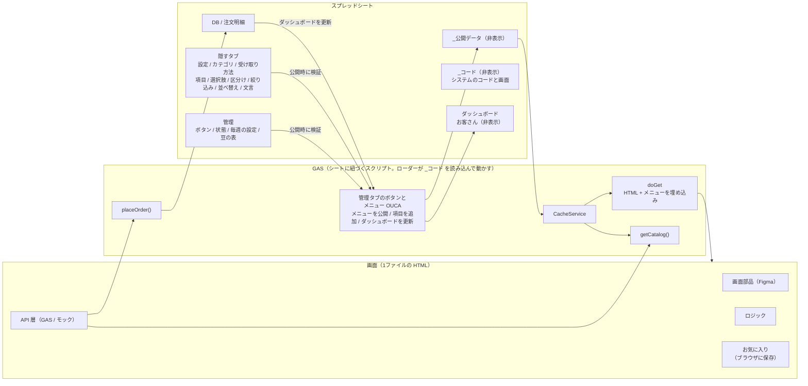
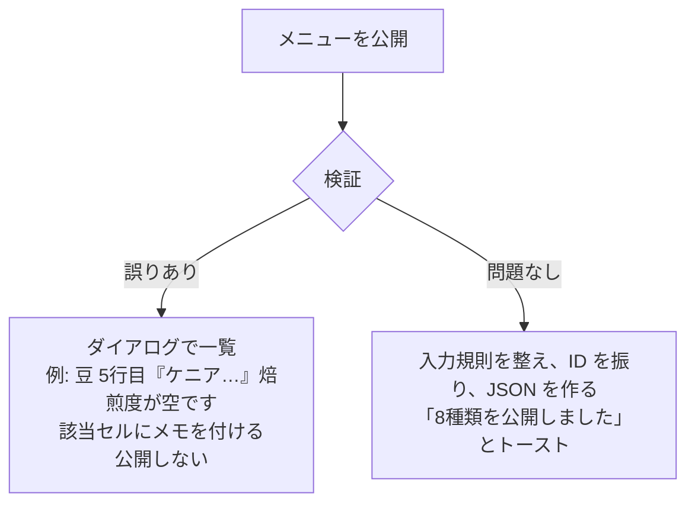
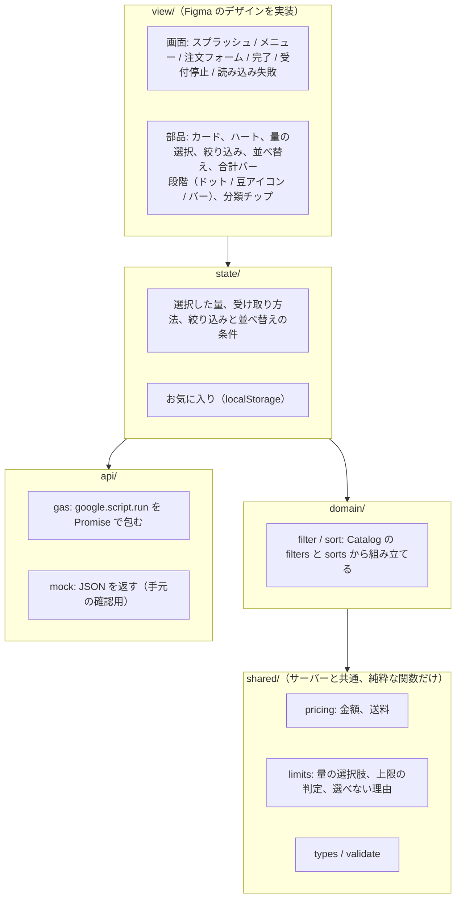
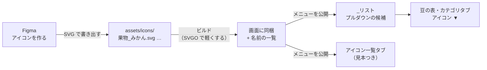
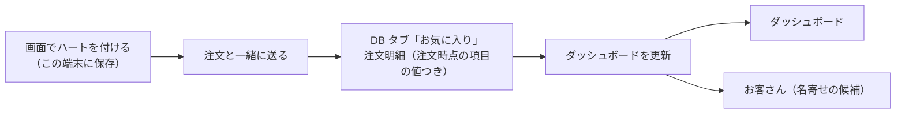

# 【新設計】OUCA 再構築 設計書

> 【新設計】作り直した後の姿についての文書。現行サイトの解析は `docs/as-is/site-analysis.md`、現行のデータは `docs/as-is/data-model.md` を見る。

## 用語

説明の元は `docs/to-be/glossary.md`。同じ言葉を意味ごとに書き分ける決まり（「公開」「メニュー」「バージョン」など）も、用語集の §1 にある。

| 用語 | 意味 |
|---|---|
| アプリ | お客さんが注文するサイト。スマホのブラウザ（LINE の中のブラウザを含む）で開くページで、メニューを見て注文する |
| 管理画面 | オーナーが設定、豆、公開、注文を管理する Web ページ。持ち主だけが操作できる。アプリと同じシステムの一部で、デプロイの URL で開く |
| システム | アプリと管理画面を動かすプログラム全体（モジュールと画面の HTML）。アプリと管理画面は1つのプログラムなので、「システムを更新」で両方が新しくなる。番号は「システムのバージョン」（v1.3.0 の形） |
| ローダー | スプレッドシートに紐づくスクリプト。外から呼べる関数（入口）、`_コード` タブからの読み込み、「システムを更新」と「前のバージョンに戻す」の処理、初期のコードを持つ。テンプレートのコピーの後は変えない。「システムを更新」でも変わらないので、ローダーの中の処理に不具合があっても、「システムを更新」では直せない |
| 入口 | ローダーの中で、GAS が直接呼ぶ関数。メニュー OUCA、管理タブのボタン、トリガー、デプロイの URL を開くこと、画面からの呼び出しは、すべてここから入る |
| バンドル | システムのコード（モジュールと画面の HTML）を1つにまとめたファイル。GitHub のリリースに置き、「システムを更新」で `_コード` タブに取り込む |
| モジュール | バンドルのうち、サーバーで動く処理の部分。ローダーが `_コード` タブから文字列として読み込み、動かせる関数に変えて（評価して）呼ぶ |
| 初期のコード | ローダーの中に最初から入れておくバンドル。`_コード` タブに最初のバンドルを入れるときと、`_コード` タブが読めないときに使う |
| `_コード` タブ | バンドルを保存する、非表示のタブ |
| 保存場所（A、B） | `_コード` タブの中で、バンドルを1つずつ入れる2か所。片方に今のシステムのバージョンが入る。もう片方には、1つ前のシステムのバージョンがあればそれが入る（「前のバージョンに戻す」の戻す先）。「システムを更新」は、使っていない方に新しいシステムのバージョンを書く |
| 使用中の指定 | A と B のどちらの保存場所のバンドルを動かすかを書いた設定。スクリプトのプロパティに置く。スクリプトのプロパティはテンプレートのコピーに引き継がれないので、同じ内容を `_コード` タブのセルにも書く。2か所が違うときは、スクリプトのプロパティの方に従う。「システムを更新」と「前のバージョンに戻す」は、この指定を書き換えて切り替える |
| 読み込み方式 | システムのコードを `_コード` タブに置き、ローダーが動くたびに読み込んで動かす方式。スクリプトが自分の中身を書き換える方式が成り立たなかったので、T1-1（システムの自己更新）で選んだ |
| リリース | GitHub の機能。コードのある時点に番号（タグ。v1.3.0 など）を付け、バンドルを添付して出す。オーナーは「システムを更新」で、最新のリリースのバンドルを取り込む |
| テンプレート | デザイン担当が作る、初期設定済みのスプレッドシート。オーナーは「コピーを作成」でこれを複製して、本番のスプレッドシートにする |
| テスト用スプレッドシート、テスト用スクリプト | デザイン担当が持つ、ダミーデータだけのスプレッドシートと、それに紐づくスクリプト。`npm run push:test` でローダーを送り、GAS の上の動きを確かめる |
| 外から呼べる関数 | GAS では、スクリプトの一番外側に書いた関数を、メニュー OUCA、ボタン、トリガー、画面から名前で呼べる。このシステムのデプロイは誰でも開ける設定なので、知らない人も画面からこれらの関数を呼べる。名前の末尾が `_` の関数は、画面からは呼べない |
| 持ち主 | Google ドライブの上でスプレッドシートやスクリプトを持っている人。Google の画面では「オーナー」と出る。本番では、お店のオーナーが持ち主になる |
| スクリプトのプロパティ | スクリプトごとに値を保存しておける、GAS の設定の置き場。シートには出ず、テンプレートのコピーには引き継がれない |
| トリガー | 決まったとき（シートを開いた、編集した、決めた時刻になった）に、関数を自動で動かす GAS の仕組み |
| シンプルトリガー | 関数に決まった名前（`onOpen`、`onEdit`）を付けるだけで動くトリガー。承認の前でも動くが、できることが限られる |
| インストール型のトリガー | スクリプトが作って登録するトリガー。作った人の権限で動く。テンプレートのコピーには引き継がれないので、初期設定で作る。決めた時刻や間隔で動くものを「時間主導のトリガー」と呼ぶ |
| `triggerUid` | トリガーが動いたときに関数に渡される、トリガーごとの ID。このスクリプトが作ったトリガーから呼ばれたかを確かめるのに使う |
| デプロイ | スクリプトを URL で開けるページにする GAS の設定と、その結果。アプリと管理画面は、デプロイの URL で開く。オーナーが初回に作り、作り直さないので、URL は変わらない（管理画面を2つ目のデプロイで出すかは #54 で決める） |
| `google.script.run` | アプリと管理画面（ブラウザ）から、サーバーの関数を呼ぶ GAS の仕組み。呼べるのは外から呼べる関数だけ（名前の末尾が `_` のものは除く） |
| 承認 | スクリプトが初めて権限の要る処理をするときに出る画面で、持ち主が権限を許可すること |
| マニフェスト | スクリプトの設定ファイル（`appsscript.json`）。スクリプトが求める権限の範囲や、デプロイの設定を書く。ローダーの側にあるので、「システムを更新」では変えられない |
| 権限の範囲（`oauthScopes`） | スクリプトが使ってよい Google の機能の一覧（スプレッドシートの読み書き、メールの送信など）。マニフェストに書き、持ち主が承認の画面で許可する |
| キャッシュ（`CacheService`） | GAS の一時的な保存の場所。読み込みを速くすることと、二重送信を見分けることに使い、最長6時間で消える |
| `LockService` | ロックを取る処理どうしが、同時に動かないようにする GAS の仕組み。注文、管理画面の書き込み、「システムを更新」で使う |
| clasp | 手元のコードを Apps Script のスクリプトに送る、Google の道具。このプロジェクトでは、テスト用スクリプトに送るときだけ使う |
| 項目 | 豆に付ける情報の種類（焙煎度、甘味、味わい、産地など）。項目タブに1行ずつ書き、オーナーが足したり名前を変えたりできる |
| 段階、分類、はい・いいえ | 項目の種類。段階は 1〜N の数で表す（焙煎度 1〜7 など）。分類は候補から選ぶ（味わいなど）。はい・いいえはチェックボックスで表す |
| 区分け | 段階の項目で絞り込むときに使う、範囲の名前（焙煎度 1〜2 を「浅め」とするなど） |
| まとめ（項目タブの列） | 複数の段階の項目を、1つのかたまりとして並べて出すための名前（「味のバランス」など） |
| メニュー OUCA | スプレッドシートの上に出る、このシステムのメニュー。「OUCA ▸ メニューを公開」のように、中の項目を押して操作する。初期設定の前は「初期設定」など少しの項目だけが出る |
| 名寄せ | 書き方の違う同じ人の名前（「岡本」と「岡本太郎」など）を、1人の名前にまとめること。スクリプトが候補を出し、オーナーがお客さんタブで確かめる |
| 端末ID | お客さんの端末（ブラウザ）ごとに作る、名前の入っていない ID。同じ端末からの注文だと分かる手がかりとして、名寄せに使う |
| `_公開データ` タブ | 「メニューを公開」が書く、アプリに出すメニューのデータ（JSON）を置く非表示のタブ |
| TypeScript、Preact、Vite、esbuild、Vitest | 開発の道具。TypeScript は型を書ける JavaScript、Preact は画面を部品で組み立てる道具、Vite は画面を手元で表示して1つの HTML にまとめる道具、esbuild はサーバーのコードを1つにまとめる道具、Vitest はテストの道具 |
| モック、偽物 | どちらも本物の代わりに、決まった値を返すもの。モックは手元で画面を確かめるときに使い（`mock/catalog.json`）、偽物はテストで GAS の機能（`SpreadsheetApp` など）の代わりに置く |
| 純粋な関数 | 受け取った値だけから結果を返し、シートや画面に触れない関数。GAS がなくてもテストできる |
| T 番号、D 番号 | ワークプランのタスクの番号（T1-2 など）と、ユーザーに決めてもらうことの番号（D-1 など）。対応は `work-plan.md` §3、§4 にある。文書の中では、初めて出る位置でタスクの名前を添える |
| § | 文書の節の番号。「`delivery-flow.md` §5.3」は、受け渡しの文書の 5.3 の節を指す |

## 0. 方針

現行と同じにすること
- メニューの表示、量の選択（種類数・合計の上限つき）、受け取り方法、名前と備考、注文の送信、完了表示
- 管理はスプレッドシート、配信は GAS、注文の確認は LINE

新たに実現すること
- オーナーが迷わずに更新できる
  - 設定はすべて「1行1件、各列はプルダウンかチェックボックス」の形で入力する。書式や記法を覚える必要のある欄を作らない
  - 変更は「メニューを公開」を押したときだけ画面に出る。押すと、検証してから、誤りを場所つきで知らせる
- 見せ方を設定で変えられる
  - 豆の項目（焙煎度、甘味、味わい、産地 …）の種類、段階の数、両端の名前、表示のしかた、絞り込みの区分け、並べ替えの候補と名前、画面の文言をシートで変えられる
  - HTML に直書きするのは、レイアウトと、設定で変える意味のない規則（金額の計算、絞り込みの組み合わせ方）だけにする
- 設定の一元化
  - 上限、刻み、送料、案内文、お知らせ、受付中かどうかをシートで持つ
- 注文の安全性
  - サーバーで検証して金額を計算する。二重送信を防ぎ、同時に来た注文は1件ずつ順に処理する。お客さんの入力はセルで数式にならないようにする
- 好みを知る
  - お客さんが豆にハートを付けられ、注文と一緒にお店に届く。注文の記録から、豆ごとの注文量、週ごとの件数と金額、人ごとの好みをダッシュボードに集計する。集計は事実だけにし、提案や営業の候補は出さない
- 初回表示の速さ
  - 公開済みのメニューを HTML に埋め込んで返す
- UI とロジックの分離
  - Figma のデザインを画面部品として実装し、ロジックに触らずに見た目を差し替えられる

今回やらないこと
- 決済、会員登録、在庫数の管理

## 1. 全体構成



- 金額と上限のロジックは画面とサーバーで同じコード（`shared/`）を使う
- スプレッドシートに紐づくスクリプトは「ローダー」にし、テンプレートのコピーの後は変えない。ローダーは、入口の関数、`_コード` タブからの読み込み、「システムを更新」と「前のバージョンに戻す」の処理、初期のコードを持つ（§4.4）。モジュールと画面の HTML はバンドルとして `_コード` タブに保存し、ローダーが動くたびに読み込んで動かす（読み込み方式。`docs/to-be/delivery-flow.md` §5.2、`docs/to-be/spikes.md` の T1-1（システムの自己更新））

## 2. スプレッドシート設計

### 2.0 共通ルール

- 1行が1件。行の並び順がそのまま画面の表示順になる（表示順の数値は持たない）
- プルダウンとチェックボックスは入力規則で「入力を拒否」にする。貼り付けで入力規則を通らずに入った値は、公開時の検証で見つける
- 見出しの行と、スクリプトが管理する列は保護（警告つき）にして灰色で塗る
- 条件付き書式で、必須の空欄を薄い赤に、使わない欄（項目の種類に合わない欄など）を灰色にする
- コードは見出しの文字で列を探す。照合の前に前後の空白（全角を含む）を取り除く
- 普段見えるタブは、管理、ダッシュボード、DB の3枚にする（§2.15）。ほかのタブは隠す。管理タブの「詳しい設定を開く」で表示するのは、隠すタブのうちオーナーが入力するもの（下の灰色のタブ）とアイコン一覧だけにする
- タブは色で分ける
  - 普段見えるタブ（管理、ダッシュボード、DB）は茶、隠すタブのうちオーナーが入力するもの（設定、カテゴリ、受け取り方法、見せ方のタブ（項目、選択肢、区分け、絞り込み、並べ替え、文言）、お客さん）は灰、スクリプトが書くタブ（注文明細、アイコン一覧、`_公開データ`、`_リスト`、`_コード`）は青
- プルダウンの候補は、非表示の `_リスト` タブに数式でまとめる（例「絞り込み」の対象 = 組み込みの候補 + 項目タブの項目名）。項目を足すと、関係するプルダウンにも自動で出る

### 2.1 設定

隠すタブ。めったに変えない設定を置く。毎週変える設定（受付中、受付停止の文言、お知らせ）と状態の表示は、管理タブに置く（§2.15）。

列は「項目」「値」「説明」。項目と説明は保護する。

| 項目 | 値の入力 | 例 |
|---|---|---|
| 案内文 | 文字（改行可） | 「ご注文の前に」の本文 |
| 種類数の上限 | 整数 | 3 |
| 合計の上限g | 整数 | 450 |
| 1種類の最小g | 整数 | 100 |
| 1種類の上限g | 整数 | 300 |
| 刻みg | 整数 | 50 |
| 1杯あたりg | 整数 | 15 |
| お気に入りを使う | ☑ | オン |
| 集計の期間 | ▼ 全期間 / 直近4週 / 直近12週 / 直近52週 | 全期間 |
| 通知先メール | メールアドレス | （空なら送らない） |


### 2.2 カテゴリ

| 名前 | 100g価格 | デカフェ | アイコン | 説明 |
|---|---|---|---|---|
| STANDARD | 500 | ☐ | ▼ | |
| SPECIAL | 600 | ☐ | ▼ | |
| DECAF カフェインレス | 650 | ☑ | ▼ | |

- アイコンは §4.3 のアイコンセットから選ぶ。空ならアイコンなし

### 2.3 豆

豆の表は、管理タブの上の段（§2.15）の下に置く。コードは見出しの文字で、豆の表の見出しの行を探す。上の段の行数が変わっても読める。

| 列 | 入力 | 備考 |
|---|---|---|
| ID | スクリプトが書く | 公開時に空なら自動で振る。保護・灰色。注文と分析はこの ID で結び付ける |
| 表示 | ☑（初期オン） | オフならメニューに出さない |
| 売り切れ | ☑ | オンなら「売り切れ」で出し、選べなくする |
| NEW | ☑ | |
| カテゴリ | ▼ | カテゴリタブの名前 |
| 名前 | 文字 | 必須 |
| アイコン | ▼（アイコンセットの名前） | 空なら既定のアイコン（§4.3） |
| 絵文字 | 文字 | 現行からの移行用。残すかは §4.3 の調査で決める |
| タグ、説明 | 文字 | |
| 100g価格 | 整数（任意） | 空ならカテゴリの価格 |
| 項目の列（焙煎度、甘味 …、味わい …） | 項目の種類に応じて ▼ か ☑ | 項目タブの1行が、ここの1列に対応する。入力規則は公開時と「項目を追加」でスクリプトが整える |

- 行の並びがおすすめ順

### 2.4 項目（見せ方の中心）

豆の性質を表す列を1行ずつ定義する。初心者が書くのは日本語の選択だけで、英字のキーや記法はない。

| 列 | 入力 | 意味 |
|---|---|---|
| 項目名 | 文字（保護） | 豆の表の列名と同じ。「項目を追加」で作る |
| 種類 | ▼ 段階 / 分類（1つ） / 分類（複数） / はい・いいえ | |
| 段階の数 | ▼ 3〜10 | 段階のときだけ |
| 小さい側の名前、大きい側の名前 | 文字 | 段階のときだけ。例「浅」「深」、「弱」「強」。スケールの両端と並べ替えの名前に使う |
| 表示のしかた | ▼ ドット / 豆アイコン / バー / チップ | 段階はドット・豆アイコン・バー、分類はチップ |
| まとめ | 文字（任意） | 同じまとめ名の段階の項目を、1つのブロックとして並べて出す。例「味のバランス」 |
| カードに出す | ☑ | |
| 詳細に出す | ☑ | |

初期の内容（現行サイトを再現する設定）

| 項目名 | 種類 | 段階の数 | 小さい側 | 大きい側 | 表示 | まとめ | カード | 詳細 |
|---|---|---|---|---|---|---|---|---|
| 焙煎度 | 段階 | 7 | 浅 | 深 | ドット | | ☑ | ☑ |
| 甘味 | 段階 | 5 | 弱 | 強 | 豆アイコン | 味のバランス | | ☑ |
| 酸味 | 段階 | 5 | 弱 | 強 | 豆アイコン | 味のバランス | | ☑ |
| コク | 段階 | 5 | 弱 | 強 | 豆アイコン | 味のバランス | | ☑ |
| 香り | 段階 | 5 | 弱 | 強 | 豆アイコン | 味のバランス | | ☑ |
| 味わい | 分類（複数） | | | | チップ | | | ☑ |

- 段階の数を変えると、公開時に豆の表のプルダウンを付け直し、範囲外の値を検証で知らせる
- 項目名の変更は、豆の表の列名と食い違うので公開時に止める。名前を変えたいときは「OUCA ▸ 項目の名前を変える」で関係するタブをまとめて直す

### 2.5 選択肢

分類の項目の候補。1列が1つの項目で、1行目が項目名、2行目から下が候補（上からの順が表示順）。

| 味わい | 産地 |
|---|---|
| フルーティー | エチオピア |
| 柑橘 | ブラジル |
| チョコ・ナッツ | ケニア |

- 豆の表の分類の列は、入力規則でこの列（2行目から下）を範囲として参照する。候補を下に1つ足すと、そのままプルダウンに出る

### 2.6 区分け

段階の項目を絞り込むときのまとまり。

| 項目 | 区分けの名前 | から | まで |
|---|---|---|---|
| 焙煎度 ▼ | 浅め | 1 ▼ | 2 ▼ |
| 焙煎度 | 中 | 3 | 4 |
| 焙煎度 | 深め | 5 | 7 |

- 段階の項目を絞り込みに使うには、区分けが1つ以上要る（公開時に検証）
- 0件になる区分けは画面に出さない

### 2.7 絞り込み

画面に出す絞り込みを1行ずつ並べる。行の並びが画面の並び。

| 名前（画面の表示） | 対象 ▼ | 使う |
|---|---|---|
| デカフェのみ | デカフェ | ☑ |
| お気に入り | お気に入り | ☑ |
| 焙煎度 | 焙煎度 | ☑ |
| 味のバランス | 味のバランス | ☑ |
| 味わい | 味わい | ☑ |
| カテゴリ | カテゴリ | ☐ |

対象の候補と、画面での選び方

| 対象 | 選び方 | 判定 |
|---|---|---|
| カテゴリ | チップ（複数可） | |
| デカフェ | トグル | カテゴリのデカフェ ☑ |
| お気に入り | トグル | この端末でハートを付けた豆 |
| 段階の項目 | 区分けのチップ | 区分けの範囲に入る |
| まとめの名前 | まとめの各項目のチップ | 選んだ項目が「大きい側から2段階以内」か「その豆のまとめの中で一番大きい」（現行の「4以上か一番強い」を段階の数によらない形にした） |
| 分類の項目 | 候補のチップ（複数可） | 豆の値に、選んだ候補のどれかが含まれる |
| はい・いいえの項目 | トグル | はい |

- 複数の絞り込みを使ったときは、すべてに当てはまる豆を出す。同じ絞り込みの中で複数選んだときは、どれかに当てはまる豆を出す（コードで固定）

### 2.8 並べ替え

画面の並べ替えの候補を1行ずつ並べる。1行目が初期の並び。

| 名前（画面の表示） | 対象 ▼ | 向き ▼ | 使う |
|---|---|---|---|
| おすすめ順 | おすすめ順 | | ☑ |
| 浅煎りから | 焙煎度 | 小さい順 | ☑ |
| 深煎りから | 焙煎度 | 大きい順 | ☑ |
| 酸味が強い順 | 酸味 | 大きい順 | ☐ |
| 価格が安い順 | 価格 | 小さい順 | ☐ |
| NEW を先に | 新着 | 大きい順 | ☐ |

- 対象の候補: おすすめ順（豆の表の行の順）、価格、新着、段階の項目
- 名前はオーナーが自由に付ける
- 並びが同じ豆は、おすすめ順で並べる

### 2.9 文言

画面に出る固定の文言（見出し、ボタン、完了の文、注意書き）を1行ずつ持つ。

| 場所（保護） | 文言 | 既定 |
|---|---|---|
| 見出し | COFFEE MENU | |
| タグライン | 丁寧に焙煎した、豆のある暮らし | |
| 注文フォームの見出し | ご注文はこちら | |
| 注文ボタン | この内容で注文する | |
| 完了の文 | 内容を確認したら、LINEで連絡します。 | |

- 行は初期設定で作る。文言を空にすると既定の文言を使う
- 行の一覧は Figma のデザインが固まってから決める

### 2.10 受け取り方法

| 名前 | 料金 | 説明 | 有効 |
|---|---|---|---|
| 手渡し | 0 | | ☑ |
| 郵送 | 300 | 住所はLINEで伺います | ☑ |

### 2.11 DB（注文）、注文明細（スクリプトが書き込む）

- DB タブは注文の一覧（購入履歴）。普段見えるタブにする。注文明細は隠す
- 注文の列: 状態▼、受付番号、受付日時、名前、受け取り方法、豆代、送料、合計、合計g、明細（一覧用の文字列）、お気に入り（豆名の一覧）、備考、リクエストID・端末ID（右端、非表示）
  - 状態はオーナーが変える（新規 / 確認済み / 渡し済み / キャンセル）
- 注文明細の列: 受付番号、受付日時、名前、豆ID、豆名、量g、100g価格、小計、項目の値（非表示）
  - 豆名、価格、項目の値（焙煎度や味わいなど）は注文時点の値を残す。後でメニューを直しても、過去の注文と分析は変わらない

### 2.12 お客さん、ダッシュボード

- お客さん（隠す）: 書き方の違う同じ人の注文の名前を、1人にまとめる表。スクリプトが候補を書き、オーナーが確かめる（§5.3）
- ダッシュボード: 「ダッシュボードを更新」を押すと、スクリプトが集計の表を書き直す。グラフはその表を元にする。キャンセルの注文は除く（§5.2）

### 2.13 _公開データ、_リスト、_コード（非表示、保護）

- `_公開データ`
  - A1 に公開済みメニューの JSON、B1 にメニューのバージョン（`catalogVersion`）、C1 に公開日時。1セルは5万字まで（現行の8種類で約5千字）。超える場合は複数のセルに分ける
- `_リスト`: プルダウンの候補を数式でまとめる
- `_コード`
  - 「システムを更新」で取り込んだバンドル（モジュールと画面の HTML）を置く
  - 保存場所を2つ（A と B）持つ。使用中の指定は、スクリプトのプロパティに置く
  - 使用中の指定を切り替えるときは、同じ内容を `_コード` のセルにも書く。2か所が違うときはスクリプトのプロパティの方に従い、セルはスクリプトのプロパティに記録がないときだけ使う
  - スクリプトのプロパティはテンプレートのコピーで引き継がれないので、使用中の指定がないときは初期設定が `_コード` から作り直す（§8。`docs/to-be/spikes.md` の T1-2（テンプレートのコピー））
  - うっかり書き換えないように保護する（`docs/to-be/delivery-flow.md` §5.2）
- キャッシュ（`CacheService`）は、読み込みを速くすることと、二重送信を見分けること（§3.2）に使う（最長6時間で消える）

### 2.14 メニュー OUCA

| メニュー OUCA の項目 | 内容 |
|---|---|
| メニューを公開 | 検証 → 豆の入力規則を整える → ID を振る → JSON を作る → `_公開データ` とキャッシュを更新。入力規則を整えるときは、既にある入力規則を `copy()` から作り直し、オーナーが手でオンにした複数選択を消さない（T1-3） |
| 項目を追加 | ダイアログで項目名と種類を聞き、項目タブの行、豆の表の列と入力規則、（分類なら）選択肢タブの列を作る。複数選ぶ種類の項目の入力規則は、スクリプトで一から作れないので、テンプレートに置いた見本のセル（手で複数選択をオンにしたもの）からコピーして作る（T1-3） |
| 項目の名前を変える | 項目タブ、豆の表、選択肢、区分け、絞り込み、並べ替えの名前をまとめて直す |
| ダッシュボードを更新 | 集計の表を書き直し、名寄せの候補をお客さんタブに書く（§5） |
| 詳しい設定を開く | オーナーが入力する隠すタブ（設定、カテゴリ、受け取り方法、見せ方のタブ、お客さん）とアイコン一覧を表示する。もう一度押すと隠す |
| システムを更新 | デザイン担当が出した最新のリリースを取り込み、`_コード` の使っていない保存場所に保存して切り替える。メニュー OUCA、トリガー、アプリと管理画面が新しいシステムのバージョンになる。途中で止まったら、もう一度押すと最初からやり直す（`docs/to-be/delivery-flow.md` §5.2） |
| 前のバージョンに戻す | 使用中の指定を、前の保存場所に戻す。戻せるのは直前の1つだけ。戻す先がないとき（テンプレートのコピーの直後など）は、何も変えずに知らせる（`docs/to-be/delivery-flow.md` §5.3） |
| 調査用に書き出す | 名前、備考、端末ID を伏せたコピーを作る。不具合の相談のとき、オーナーの判断で渡す（`docs/to-be/delivery-flow.md` §7） |
| 初期設定 | 空のスプレッドシートなら、タブ、見出し、入力規則、ボタン、グラフ、初期データ、`_コード`、使用中の指定、トリガーを作る。テンプレートのコピーなら、トリガーと、使用中の指定を作る。それ以外の形なら止める。何度押しても同じ結果になる（§8） |

- 管理タブのボタン（画像にスクリプトを割り当てたもの）は、メニュー OUCA と同じ処理を呼ぶ。PC のブラウザでは、ボタンを主に使う
- スマホのスプレッドシートアプリでは、メニュー OUCA も画像のボタンも使えない（T1-3 で確かめた）。チェックボックスを付けるとインストール型の編集トリガーが動き、トリガーの中で外したチェックはスマホの画面でも外れて見える（T1-3）。スマホでの管理は、Web ページの管理画面で行う方向にした（#54 で設計する）。管理タブのチェックボックスを残すかは #54 で決める。残さない場合も、入口の一覧はテンプレートの時点で決まるので、インストール型のトリガーの入口を一覧に入れるかは、#54 と合わせて決める



検証の内容
- 必須の空欄、プルダウンにない値、段階の範囲外の値、名前の重複
- 項目タブと豆の表の列の食い違い
- 段階の項目を絞り込みに使っているのに区分けがない、並べ替えの対象が段階の項目でない
- 表示中の豆が0件、受け取り方法が0件、使う並べ替えが0件
- 設定の数値の矛盾（最小 > 上限、合計の上限 < 最小 など）

### 2.15 管理、ダッシュボード、DB（普段見えるタブ）

オーナーが普段見るのは、この3枚だけにする。スプレッドシートの中で、簡単なアプリのように使えるようにする。

管理（先頭のタブ）
- 上の段
  - ボタン: メニューを公開、ダッシュボードを更新、詳しい設定を開く、システムを更新
  - 毎週変える設定: 受付中 ☑、受付停止の文言、お知らせ
  - 状態の表示
    - 受付中は、シートの値と公開中の値を並べて出す（例「シートではオフ、公開中はオン」）。公開中の値は「メニューを公開」が書く
    - 最終公開日時、未公開の変更の有無
    - 今のリリースのバージョン（v1.3.0 の形）と、最後に更新した日時。更新が止まったときは、どこで止まったかも出す（`docs/to-be/delivery-flow.md` §5.2）
    - 今週の注文件数と金額（数式で常に最新）
  - スマホ用の「メニューを公開」のチェックボックスと、その結果の欄（§2.14）
- 下の段: 豆の表（§2.3）

ダッシュボード
- 豆ごとの注文量、週ごとの件数と金額、人ごとの好みの表とグラフ（§5.2）
- 名寄せの確認待ちの件数。ボタンでお客さんタブを開く

DB
- 注文の一覧（§2.11）。オーナーはここで状態を変える

状態の表示の注意
- 「未公開の変更」は onEdit（シンプルトリガー）で「あり」にする。onEdit は手入力と貼り付けにしか反応しないので、表示が漏れる場合はある。管理タブには目安の表示であることを書き、最終公開日時を大きく出す。実害は「公開を押し忘れる」だけで、画面のデータは壊れない
- onEdit は行の挿入と削除に反応せず、インストール型の変更トリガー（onChange）は `INSERT_ROW`、`REMOVE_ROW` として受け取る（T1-3）。管理画面ができるとシートを直接編集することが減るので、onChange を足すかは #54 で決める

## 3. API

型は `src/shared/types.ts` に置き、画面とサーバーで共有する。`google.script.run` は Date を含む値を返せないので、戻り値はすべて JSON 文字列にし、画面で parse する。

### 3.1 getCatalog(): string（Catalog の JSON）

```ts
type Item =
  | { name: string; kind: 'scale'; levels: number; ends: [string, string];
      display: 'dots' | 'beans' | 'bar'; group?: string; onCard: boolean; onDetail: boolean;
      bands: { name: string; from: number; to: number }[] }
  | { name: string; kind: 'single' | 'multi'; options: string[]; display: 'chips'; onCard: boolean; onDetail: boolean }
  | { name: string; kind: 'flag'; onCard: boolean; onDetail: boolean };

type FilterTarget =
  | { type: 'category' } | { type: 'decaf' } | { type: 'favorite' }
  | { type: 'item'; item: string } | { type: 'group'; group: string };

type Catalog = {
  version: string;                 // 公開ごとに変わる
  publishedAt: string;             // ISO 形式の文字列
  settings: {
    accepting: boolean; closedMessage: string; notice: string; guide: string;
    limits: { maxTypes: number; maxTotalGrams: number; minGrams: number; maxGramsPerItem: number; stepGrams: number };
    gramsPerCup: number; favoritesEnabled: boolean;
  };
  texts: Record<string, string>;   // 文言タブ（空の行は含めない。画面が既定の文言を持つ）
  categories: { name: string; price100g: number; decaf: boolean; icon: string | null; description: string }[];
  deliveries: { name: string; fee: number; description: string }[];
  items: Item[];                   // 項目タブの順
  filters: { label: string; target: FilterTarget }[];
  sorts: { label: string; key: 'recommended' | 'price' | 'new' | `item:${string}`; dir: 'asc' | 'desc' }[];  // 先頭が初期値
  products: {
    id: string; category: string; name: string; icon: string | null; emoji: string; isNew: boolean; soldOut: boolean;
    tags: string; description: string; price100g: number;
    values: Record<string, number | string[] | boolean | null>;   // 項目名 → 値
  }[];                             // おすすめ順。非表示の豆は含めない
};
```

- 項目を足しても型は変わらない。画面は `items` を見て、種類と表示のしかたに合う部品で描く
- `doGet` は `_公開データ` の JSON を HTML に埋め込む。画面は埋め込みを使い、ない場合だけ `getCatalog()` を呼ぶ

### 3.2 placeOrder(reqJson: string): string（OrderResult の JSON）

```ts
type OrderRequest = {
  requestId: string;               // 画面が送信ごとに作る UUID
  catalogVersion: string;          // 画面が使っているメニューのバージョン
  name: string; delivery: string; note: string;
  lines: { productId: string; grams: number }[];
  favorites: string[];             // ハートを付けた豆の ID（自動で送る）
  deviceId: string;                // 端末ごとの匿名の ID（localStorage に保存。消えたら作り直す）
};
type OrderResult =
  | { ok: true; orderNo: string; subtotal: number; shipping: number; total: number; grams: number }
  | { ok: false; code: 'CLOSED' | 'INVALID' | 'SOLD_OUT' | 'LIMIT' | 'BUSY'; message: string; productIds?: string[] }
  | { ok: false; code: 'CHANGED'; message: string; catalog: Catalog };
```

サーバーの処理
1. `requestId` をキャッシュで探し、あれば前回の結果を返す
2. `LockService.getScriptLock()` を取る（取れなければ `BUSY`）
3. キャッシュになければ、DB タブのリクエストID列を TextFinder で探し、あれば前回の結果を返す
4. 入力を検証する
   - 名前は1〜30字、備考は500字まで。制御文字は取り除く
   - 明細は1件以上、種類数の上限以下、豆の重複なし、量は整数で最小・刻み・1種類の上限・合計の上限を守る
   - 受付中か、豆が存在し売り切れでないか、受け取り方法が有効か
   - お気に入りは公開中の豆の ID だけを残し、50件まで。端末ID は UUID の形でなければ空にする
5. `catalogVersion` が公開中のメニューのバージョンと違い、金額や上限に関わる変更があれば `CHANGED` と新しいメニューを返す
6. 金額を `shared/pricing.ts` で計算し、注文と注文明細に書く
   - お客さんが入力した文字は先頭に `'` を付けて書き、数式として解釈させない
7. 受付番号は「年月日 + その日の連番」（例 `261121-03`）。タイムゾーンは `Asia/Tokyo`
8. `SpreadsheetApp.flush()` の後にロックを外し、結果をキャッシュに6時間置く
9. 通知先メールがあれば、ロックの外で送る。失敗しても注文は成功として扱う（個人アカウントの MailApp は1日100通まで）

- 想定内のエラーは例外にせず `ok: false` で返し、画面は `code` ごとに文言と表示を変える

### 3.3 外から呼べる関数を絞る

GAS の決まり（公式の資料で確かめたこと）
- 画面から `google.script.run` で呼べるのは、スクリプトの一番外側にある関数だけ。名前の末尾が `_` の関数（private）は呼べない
- `google.script.run` の引数には、値（数、文字、真偽、null）と、それからなるオブジェクトと配列のほか、form の要素も渡せる。form の file 入力は Blob として届く。`Date` や関数は渡せない。API は JSON の文字列でやり取りする（§3.1、§3.2）
- デプロイを「自分として実行」にすると、スクリプトは常に持ち主として動く。`google.script.run` で呼ばれた関数も同じ権限で動くと考える（資料にはデプロイ全体の実行主体だけが書かれている）
- 画像に割り当てるスクリプト（`OverGridImage.assignScript`）は、末尾が `_` でない一番外側の関数でなければならない。末尾が `_` の関数も割り当てはできるが、押すと「スクリプト関数 … が見つかりませんでした」と出て動かない（T1-3 で確かめた）。スマホのスプレッドシートアプリでは、画像を押してもスクリプトは動かず、メニューも使えない（T1-3）
- `Session.getActiveUser().getEmail()` は、「自分として実行」のデプロイやシンプルトリガーでは空になる。開発者本人と、同じ Google Workspace のドメインの人には、この制限はない
- インストール型のトリガーは、作った人の権限で動く
- 末尾が `_` の関数は、メニュー OUCA の項目（`addItem`）、時間主導のトリガー、インストール型の編集トリガーから呼べる（資料には書かれていない。T1-3 で確かめた）
- 持ち主が自分で動かすと、メニュー、画像のボタン、インストール型のトリガーのどの入口でも、`Session.getActiveUser()`、`Session.getEffectiveUser()`、`getOwner()` のメールアドレスが一致する。知らない人（個人の Gmail のアカウントとログインしていないブラウザ）がデプロイの画面から呼ぶと、active は空になる。インストール型のトリガーのイベントの `triggerUid` は、`ScriptApp.getProjectTriggers()` の `getUniqueId()` と一致する（T1-3）
- アプリと管理画面から `google.script.run` で渡せる値のうち、メソッドを持つのは form の file 入力の Blob だけで、`getName`、`getBytes`、`getContentType` などを持ち、`getId` と `getSheet` は持たない（T1-3）
- 同じスクリプトの別のデプロイで開くと、doGet の中の `ScriptApp.getService().getUrl()` はデプロイごとに違う値を返す（T1-3）

このプロジェクトの設定から決まること
- デプロイは「自分として実行」「全員（匿名を含む）がアクセス可」にする（`appsscript.json` の `executeAs: USER_DEPLOYING`、`access: ANYONE_ANONYMOUS`）。末尾が `_` でない一番外側の関数は、知らない人も持ち主の権限で呼べる

方針
- ローダーの一番外側に出す関数（入口）は、`scripts/gas-globals.mjs` の一覧だけにする。システムのサーバーのコードは `_コード` タブに保存したモジュールで、ローダーが文字列から動かせる関数に変えて（`new Function` で評価して）呼ぶ（§1）ので、モジュールの中の関数は名前に関係なく外から呼べない。末尾の `_` に意味があるのは入口の名前だけになる
- モジュールの関数が一番外側に出ないように、次を守る
  - ローダーは、モジュールを入口の関数の中でだけ評価する。スクリプトが読み込まれたとき（関数の外）には評価しない
  - モジュールは `globalThis` に書き込まない
- ローダーからモジュールを呼ぶときの決まり（入口ごとにモジュールのどの関数を呼ぶか、モジュールに何を渡すか）と入口の一覧はテンプレートを作った時点で決まり、「システムを更新」では変えられない。将来使う可能性のある入口も最初から入れる。この決まりは `docs/to-be/spec/` に書く
- 入口の中身は薄くし、呼び出し元の確かめを先頭で行ってから、読み込んだモジュールの関数を呼ぶ。確かめは次の2つと、インストール型のトリガーの `triggerUid` の照合（下の「入口の種類ごとの確かめ」）を組み合わせる
  - 持ち主が自分で動かしているか: `Session.getActiveUser().getEmail()` が空でなく、`Session.getEffectiveUser().getEmail()` と、スプレッドシートの持ち主（`SpreadsheetApp.getActive().getOwner().getEmail()`）の両方と同じ。デプロイの画面から知らない人が呼ぶと、操作している人（active）が空か別の人になり、編集者が押すと持ち主と違うので止まる。持ち主が取れない（`getOwner()` が null、メールアドレスが空）ときも止める
  - 本物のシートのオブジェクトか: イベントの `e.source.getId` が関数で、`e.source.getId()` がこのスプレッドシートの ID と同じ。編集のイベント（`onEdit`、インストール型の編集トリガー）では、さらに `e.range.getSheet` が関数である。`onOpen` のイベントには `e.range` がないので求めない。Blob のように別のメソッドを持つオブジェクトを通さないように、確かめるメソッドは名前で決める。値だけのオブジェクトと form（Blob）を渡しても通らないことを、T1-3 で確かめた
- 入口の種類ごとの確かめ
  - 画面の API（`getCatalog`、`placeOrder`）
    - 誰が呼んでもよい。引数は JSON の文字列として検証し、文字列でなければ断る
  - 管理画面の API（`adminCall`）
    - 管理画面（Web ページ。#54 で設計する）から `google.script.run` で呼ぶので、末尾に `_` を付けない名前にする。持ち主が自分で動かしているときだけ動き、違えばシートに触れずに断る
    - 管理の操作ごとに入口を足すと、操作を足すたびにローダーを変えることになる。そのため入口は1つにし、引数の JSON で操作を選んで、モジュールの関数を呼ぶ。管理画面の操作は「システムを更新」で増やせる
    - `adminCall` は一番外側の関数なので、お客さんのデプロイの画面からでも、誰でも `google.script.run.adminCall` を呼べる。守りになるのは持ち主の確かめだけで、デプロイのアクセスの設定（「自分のみ」）には頼らない
    - 引数は JSON の文字列として検証し、文字列でなければ断る。操作の名前は、決めた一覧（その一覧の自分の鍵だけ。`Object.hasOwn` などで確かめる）から選び、知らない名前は断る。返り値も JSON の文字列にする
    - 管理画面は、オーナーが押すまで `adminCall` を呼ばない。URL の引数で操作を始めない（持ち主のブラウザでは確かめが通るので、細工したリンクを開かせると操作が動くおそれがある）
    - 管理画面には、お客さんが入力した名前や備考が出る。§4 の「シートの値を HTML として扱わない」を管理画面にも当てはめる（持ち主のブラウザでスクリプトを差し込まれると、`adminCall` が持ち主として通ってしまう）
    - 出し分けの方法（URL の引数か `getUrl()` か）と、2つ目のデプロイを使うかは、#54 で決める
  - デプロイの入口（`doGet`）
    - 誰が開いてもよい。URL の引数（`e.parameter`）で変えてよいのは、アプリと管理画面のどちらの HTML を返すかだけにする。管理画面の HTML にはシートの値を埋め込まず、値はすべて `adminCall` で持ち主の確かめを通してから取る
  - シンプルトリガー（`onOpen`、`onEdit`）
    - 名前が決まっているので、外から呼べる関数にする。本物のシートのオブジェクトのときだけ動く
  - オーナーの操作のうち、画像のボタンから呼ぶもの
    - 末尾に `_` を付けない名前にし、メニュー OUCA にも同じ入口を割り当てる。持ち主が自分で動かしているときだけ動き、違えばシートに触れずに止める。管理画面ができたら、画像のボタンを置くかは #54 で決める
  - オーナーの操作のうち、メニュー OUCA にだけ置くもの（初期設定、前のバージョンに戻すなど）
    - 末尾に `_` を付ける。画面から呼べない。そのうえで持ち主の確かめも行う
    - 管理画面はモジュール（`_コード` タブのコード）が出すので、更新したシステムのバージョンに不具合があると管理画面ごと動かなくなり得る。前のバージョンに戻す操作と初期設定は、ローダーの中の処理としてメニュー OUCA に残す
  - インストール型のトリガー（スマホのチェックボックスなど）
    - 末尾に `_` を付ける。イベントの `triggerUid` がこのスクリプトのトリガーの ID と一致すること、編集トリガーでは本物のシートのオブジェクトであること、持ち主の確かめの3つを行う
- オーナーが自分のブラウザでアプリや管理画面を開いたときは、持ち主の確かめでは止まらない。この場合は、シートの値を HTML として描画しないこと（§4。管理画面にも当てはめる）と、`doGet` が引数で変えるのは返す HTML の種類だけで、引数で操作を始めないことで、意図しない操作を防ぐ
- 入口の一覧は、名前と種類の組で1か所（`scripts/gas-globals.mjs`）に書く。種類は、デプロイ（`doGet`）、画面の API、管理画面の API、シンプルトリガー、ボタンのオーナーの操作、メニューだけのオーナーの操作、インストール型のトリガーの7つ。末尾 `_` は、メニューだけのオーナーの操作とインストール型のトリガーにだけ付け、ほかには付けない。ビルドはこの一覧から一番外側の関数を作り、テストは次を確かめる
  - ローダーの一番外側の関数は、すべて一覧と一致する（末尾が `_` の入口も含める）
  - モジュールを評価しても、一番外側の名前が増えない
  - 今の esbuild は、サーバーのコード全体を1つの名前（`OUCA_`）の中にまとめて出力している。このまとめ方はローダーに残す（ローダーの中の処理を外から呼べないようにするため）。`OUCA_` は関数でないので、`google.script.run` からもトリガーからも呼べない。テストでは、一番外側の名前のうち `OUCA_` だけを一覧の外として扱う。モジュールは、関数の本体として評価される形で出力するので、名前を持たない
  - オーナーの操作の入口と管理画面の API（`adminCall`）は、active が空のとき、active と effective が違うとき、active がスプレッドシートの持ち主と違うとき、持ち主が取れないときに、シートに触れずに止まる（`Session` と `SpreadsheetApp` の偽物で確かめる）。`adminCall` は、文字列でない引数と知らない操作の名前も断る
  - インストール型のトリガーの入口は、`triggerUid` がこのスクリプトのトリガーの ID と一致しないときに止まる
  - シンプルトリガーの入口は、値だけのオブジェクトや、別のメソッドを持つオブジェクト（Blob の偽物）を渡されると何もしない。`onOpen` は、`e.range` がなくても本物の `e.source` があれば動く

## 4. 画面側の構成



- HTML に直書きするのはレイアウトと規則だけにする。見出し、ボタン、注意書きは `texts`、数値は `settings`、項目・絞り込み・並べ替えは `items` / `filters` / `sorts` から描く
- 段階の部品は、段階の数（3〜10）が変わっても崩れないように作る
- 上限は押した後に知らせるのではなく、押す前に選べない量を無効にして理由を出す
- 合計バーには、料金のかかる受け取り方法のとき「送料込みの100gあたり約¥N」も出す（渡された HTML（`docs/as-is/site-analysis.md` §5）の機能を引き継ぐ）
- localStorage は補助の扱いにする。iPhone の LINE の中のブラウザでは、開き直すと消え、ホーム画面に追加したアイコンから開いても、開き直すと消えた（T1-4）。iPhone の Safari は再読み込みで残った。PC はシークレットウィンドウの同じセッションの中で、再読み込みと新しいタブで残った。閉じてから開き直した場合は確かめていない。読むときは、`window.localStorage` のプロパティを読む処理も含めて try/catch で囲み、失敗しても動くようにする（サードパーティの保存を止めたブラウザでは、プロパティを読むだけで例外になり得る）
- 長い文字列（名前、備考、説明）は折り返し（例 `overflow-wrap: anywhere`）、部品の幅を画面の幅に収め、横に動かせる画面にしない（T1-4 の調べる画面で、長い文字列がはみ出して横に動いた）
- シートの値は HTML として扱わない。Preact の既定のエスケープに任せ、`dangerouslySetInnerHTML` は使わない。案内文の改行は CSS の `white-space: pre-line` で出す
- 外部へのリンクは iframe の中で開かないよう `target="_top"` にする

### 4.1 スプラッシュ

- 開いてから表示までの流れ
  1. Google の外枠ページ（白い画面と警告バー）。`doGet` の実行中で、ここは変更できない
  2. 自分たちの HTML が読み込まれる。スプラッシュはここから出せる
  3. メニューを表示する
- HTML の先頭にスプラッシュを CSS ごとインラインで書き、JS の読み込みを待たずに出す。準備ができたらフェードアウトする
- メニューは埋め込みなのでデータ待ちはほぼない。最低表示時間は 0.6〜1 秒程度にし、続けて開き直したときは省く（どの範囲で省くかは T5-1（画面の土台）で決める）
- タブの名前は `setTitle`、アイコンは `setFaviconUrl` で付ける。外枠の背景色と警告バーは変えられない

### 4.2 HTML へのメニューの埋め込み

- Vite の出力を `createTemplateFromFile` に渡すと、バンドルの中の `<?` が GAS の HTML テンプレートの書き方として解釈され、HTML がおかしくなる可能性があるので使わない
- `HtmlService.createHtmlOutput(html.replace(PLACEHOLDER, () => json))` のように置換は関数で渡す（置換文字列の `$&` などを解釈させない）。`PLACEHOLDER` は、HTML の中でメニューの JSON を入れる位置に置いた目印の文字列
- JSON は `<` を `\u003c` に置き換え、`<script type="application/json">` に入れる
- `setTitle`、`addMetaTag('viewport', …)`、`setFaviconUrl` を doGet で付ける。viewport は効き、iPhone で画面の幅が端末の幅と同じになった。HTML の中に書いた viewport の meta は効かない（T1-4）。`addMetaTag` に渡せたのは `viewport`、`apple-mobile-web-app-capable`、`mobile-web-app-capable` の3つで、`apple-mobile-web-app-title`、`apple-mobile-web-app-status-bar-style`、`theme-color`、`description` は「指定したメタタグはこのコンテキストでは使用できません。」で断られた（T1-4）
- 画像を base64 でバンドルに埋め込まない（HTML が重くなる）

### 4.3 アイコン

| 場所 | 現行 | 新設計 |
|---|---|---|
| 豆 | オーナーが豆の表で絵文字を入力（OS によって見た目が変わる） | アイコンセットから ▼ で選ぶ。空なら既定のアイコン |
| カテゴリ | 見出しに 🫘 を HTML に直書き | カテゴリタブで ▼ で選ぶ |
| 段階の表示 | ドットと豆の形を CSS で描画 | Figma の部品（ドット / 豆アイコン / バー） |
| ハート、閉じる、矢印など | 文字（×、▾） | アイコンセットに含める |
| ブラウザのタブ | なし | `setFaviconUrl` で付ける |
| スプラッシュのロゴ | なし | アイコンセットと同じ形で同梱 |

アイコンセット
- デザイン担当（ユーザー）が Figma で作り、SVG で書き出す。オーナーは豆の表とカテゴリタブのプルダウンから選ぶだけにする
- 方針（2026-11-21 決定）
  - 数を絞り（目安 20〜40 個）、描き方（線の太さ、角の丸み、グリッド）をそろえる。安っぽく見えないことを優先し、OS ごとに絵柄が変わる絵文字とは混ぜない方向にする
- 詳細は別途調査する（下の「保留」）
- 画像ファイル（PNG など）を Google ドライブから読む方式は、表示が不安定なので使わない



書き出しの決まり（Figma 側）
- 1つのアイコンを 24×24 のフレームに収める。余白はフレームの中で取る
- ファイル名は「グループ_表示名.svg」（例 `果物_みかん.svg`、`菓子_チョコ.svg`、`操作_ハート.svg`）。プルダウンには「果物：みかん」と出し、グループ順・名前順に並べる
- 色
  - 1色だけで描いたアイコンは、コードで文字色に塗り替える（`currentColor`）。豆カードの色や選択中の色に合わせて変わる
  - 2色目を使う場合は、色そのものではなく「アクセント色」として描き、実際の色はコードの色設定で決める（ブランドの色を変えるとまとめて変わる。調査で確定）
- 線はアウトライン化して塗りにする。文字、画像の埋め込み、ぼかしなどの効果は使わない
- 「操作」グループ（ハート、閉じる、矢印、チェックなど）は画面の部品用で、オーナーのプルダウンには出さない
- スプラッシュのロゴとファビコンの元画像も同じ形で書き出す

取り込みと運用
- `assets/icons/` に SVG を置いてビルドすると、画面に同梱され、名前の一覧ができる。公開時にこの一覧を `_リスト` に書き、プルダウンの候補にする
- 公開時に「アイコン一覧」タブ（保護）を作り直し、各アイコンの見本と名前を並べる。オーナーはここで形を見てから選ぶ（セルには SVG は入れられず、PNG なら入れられる。T1-3。見本をタブに出すか管理画面に出すかは T7-3 で決める）
- アイコンを足すのはデザイン担当の作業（Figma で作る → 書き出す → ビルドしてリリースを出す → オーナーが「システムを更新」）。オーナーの操作では増やせない
- アイコンの名前を変えたり消したりすると、それを選んでいた豆は公開時の検証で止まる
- 容量の目安: 1個 0.5〜1KB、100個で 50〜100KB。HTML に同梱しても初回表示への影響は小さい

保留（別途調査で決める）
- 描き方のスタイル（線画 / 塗り、線の太さ、2色目を使うか）と、そろえる数
- アイコンを豆ごとに選ぶか、分類（味わいの候補など）に付けてカードに出すか
- 豆の表の絵文字の欄をなくすか（なくす場合、アイコンが空の豆には既定のアイコンを出す）
- カード上でのアイコンの大きさと強さ（文字を主役にして控えめに置くか）

GAS で決められないこと
- ファビコンは `setFaviconUrl` に、誰でも開ける場所に置いた PNG の URL を渡す。置き場所（GitHub など）が別に要る
- ホーム画面に追加したときのアイコン（apple-touch-icon）は付けられない。iPhone でホーム画面に追加すると、アイコンは文字（「T」）になった（T1-4）。ホーム画面のアイコンから開くと保存も消える（§5.1）ので、お客さんにホーム画面への追加は勧めない

### 4.4 技術の選択とビルド

- ビルドの結果は2つに分ける
  - ローダー
    - シートに紐づくスクリプトに置く。テンプレートを作るときと、テスト用スクリプトに送るときだけ使い、リリースでは配らない
    - 持つもの
      - 入口の関数
      - `_コード` からの読み込み
      - 「システムを更新」と「前のバージョンに戻す」
      - 初期のコード（`_コード` タブに最初のバンドルを入れるときと、`_コード` タブが読めないときに使う）
  - バンドル
    - モジュールと画面の HTML。リリースの添付ファイル（`ouca-bundle.json`）として配る（`docs/to-be/delivery-flow.md` §6.2）
- テスト用スクリプトで、リリースを出さずに今のバンドルを動かす方法は、T4-7（システムを更新、前のバージョンに戻す）で決める（§11）
- 権限の範囲はローダーのマニフェストで決まり、更新では足せない。将来使う可能性のある範囲も最初から入れる
- 画面: TypeScript + Preact + Vite。`vite-plugin-singlefile` で1つの HTML にまとめる
- サーバー: TypeScript を esbuild でまとめる。clasp 3 は TypeScript を変換せず、GAS は実行時に ES modules を使えない
  - ローダーは1ファイルにし、入口の関数を一番外側の `function` 宣言として出力する（全体を包んですぐ実行する関数（IIFE）の中の関数は、トリガーからも `google.script.run` からも呼べない）
  - モジュールは、関数の本体として評価される形（`return` で関数の入ったオブジェクトを返す）で出力する
- `shared/` は DOM も GAS の API も使わない純粋な関数だけにし、画面とサーバーの両方に同梱する
- テスト: Vitest。`shared/` と `domain/` の純粋な関数、`server/` の判断と変換（純粋な関数として）と GAS の API を呼ぶ部分（偽物に置き換えて）、画面の部品の振る舞い、ビルド結果の外から呼べる関数の一覧を確かめる。進め方はテスト駆動（`CLAUDE.md`）
- ローダーの `appsscript.json`: `runtimeVersion: V8`、`timeZone: Asia/Tokyo`、`webapp.executeAs: USER_DEPLOYING`、`webapp.access: ANYONE_ANONYMOUS`

### 4.5 フォルダ構成（予定）

```
OUCA/
  docs/
    as-is/              【現行】サイトの解析（更新しない）
    to-be/              【新設計】設計書、受け渡しの流れ、オーナー向け手順書
  src/
    shared/             型、金額、上限、検証（画面とサーバー共通）
    server/             doGet, getCatalog, placeOrder, シートの読み書き, メニュー OUCA, 集計, 初期設定
    client/
      api/  state/  domain/  view/
      index.html
  assets/icons/         アイコンセットの SVG（Figma から書き出し、ファイル名は「グループ_表示名.svg」）
  mock/catalog.json     手元確認用（現行メニューから作る）
  dist/                 ビルド結果（ローダーは clasp でテスト用スクリプトに送り、バンドルはリリースの1ファイルにまとめる）
  _work/                Claude の作業用
```

## 5. お気に入りと好みの分析



### 5.1 お気に入り（画面）

- カードにハートを付け、豆の ID を localStorage に保存する。次に開いたときもハートが残る。絞り込みの「お気に入り」で、ハートを付けた豆だけを出せる
- 注文のときは、ハートの一覧を自動で一緒に送る。お客さん向けの表示や切り替えは出さない
- 制約
  - 端末とブラウザごとの保存なので、別の端末とは共有されない
  - iframe の中の保存なので、ブラウザによっては消える。iPhone の LINE の中のブラウザと、ホーム画面に追加したアイコンから開いたときは、開き直すと消えた（T1-4）。消えても注文には影響しない。お客さんは LINE のリンクから開くことが多いので、LINE の外のブラウザで開くようにする案（LINE の URL の引数 `openExternalBrowser=1`）を T5-3（通しの確認）で確かめる
  - 同じスクリプトの `/exec` と `/dev` では、iframe の保存先（オリジン）が同じだった（T1-4）。別のスクリプト（テンプレートのコピーなど）では保存先が変わる見込み
- 注文を伴わない閲覧やハートの操作は送らない。お店に届くのは注文のときのハートだけにする

### 5.2 ダッシュボード（シート）

注文明細には注文時点の項目の値が残るので、メニューを後で直しても集計は変わらない。人は「お客さん」タブでまとめた名前で束ねる（§5.3）。

- 集計は事実だけにする。好みの傾向を文にする列や、豆を勧める相手の候補のような、提案や判断の列は作らない。お店への提案や営業の候補出しは、このシステムの範囲外とする
- 「ダッシュボードを更新」を押したときだけ計算する。集計は、行の配列を受け取る純粋な関数にして Vitest で確かめる。項目の数が変わっても、作り直さずに済む
- 対象の期間は、設定タブの「集計の期間」で選ぶ。キャンセルの注文は除く
- グラフはスクリプトが書いた表を元にし、テンプレートに作っておく

豆ごと（1行が1種類）

| 列 | 中身 |
|---|---|
| 豆名 | |
| 注文g、注文した人数、2回以上買った人数 | |
| ハートの数 | 期間中に注文した各人の、最新の注文で届いたハートを数える |

週ごと（1行が1週）

| 列 | 中身 |
|---|---|
| 週の初日 | |
| 注文件数、合計金額、合計g | |

人ごと（1行が1人）

| 列 | 中身 |
|---|---|
| 名前 | お客さんタブでまとめた名前 |
| 注文回数、最終注文日、合計g | |
| よく買う豆 | 量の多い順に3つ |
| お気に入り | 最新の注文で届いたハート |
| 段階の項目ごとの平均 | 量で重み付け。例 焙煎度 4.2、酸味 3.1 |
| 分類の項目ごとの上位 | 例 味わい: フルーティー 60% |

### 5.3 同じ人の注文を束ねる（名寄せ）

名前は自由入力なので、「岡本」と「岡本太郎」、「おかもと」のように同じ人の名前の書き方が異なる。お客さんの入力は増やさず、画面とシートの両方で1人にまとめる。

画面（お客さんの手間は増やさない）
- 名前欄に、前回この端末で入力した名前を自動で入れる。同じ人が同じ表記で注文しやすくなる
- 端末ごとに匿名の ID（端末ID）を作って localStorage に保存し、注文と一緒に送る。LINE の中のブラウザでは開き直すと消える（T1-4）ので、LINE から開くお客さんでは、前回の名前の自動入力と端末ID は働かないことが多い

シート「お客さん」タブ（オーナーが確かめる）

| 注文の名前 | まとめる名前 | 確認 | 候補の理由（スクリプト） | 最初の注文 | 注文回数 |
|---|---|---|---|---|---|
| 岡本 | 岡本 | ☑ | | 2026/11/21 | 4 |
| 岡本太郎 | 岡本 | ☐ | 同じ端末から「岡本」の注文あり | 2026/12/05 | 1 |
| おかもと | おかもと | ☐ | | 2026/12/12 | 1 |

- 「ダッシュボードを更新」のときに、まだ表にない注文の名前を行として足す
- 次のどれかに当てはまると、スクリプトが「まとめる名前」に候補を入れ、理由を書く
  - 同じ端末ID から、別の名前の注文がある（一番強い手がかり）
  - 空白・全角半角・敬称（さん、様）を除き、カタカナをひらがなにそろえると同じ（オカモト と おかもと）
  - 一方の名前がもう一方で始まる（岡本 と 岡本太郎）。2文字以上の名前に限る
- 候補が2つ以上ある場合（「岡本」に対し「岡本太郎」と「岡本花子」）は、「まとめる名前」を変えず、理由の列に候補をすべて書く
- 「まとめる名前」の候補は、☑ の付いた名前か、その名前自身にする。候補が候補を指す連鎖を作らない
- 敬称の一覧と、書き方をそろえる手順の順番は、検証規則の仕様（T2-3）で決める
- 集計は「確認」に ☑ が付いた行だけを「まとめる名前」で束ねる。☑ のない行は、その名前のまま1人として扱う
- オーナーは LINE のやり取りで誰かわかっているので、候補を見て ☑ を付けるか、「まとめる名前」を直す。ひらがなと漢字の違い（おかもと と 岡本）は自動ではまとめず、オーナーが直す
- 端末ID は localStorage が消えると作り直されるので、手がかりの1つとして使い、これだけで自動でまとめない
- 集計の対象期間は設定タブの「集計の期間」で選ぶ

## 6. オーナーの操作

普段の操作は、管理、ダッシュボード、DB の3枚のタブで行う。ボタンは管理タブにあり、同じ処理はメニュー OUCA からも呼べる。

毎週
1. 管理タブの豆の表で、今週の豆の「表示」と「売り切れ」を切り替える
2. 管理タブの「メニューを公開」を押す。誤りがあれば一覧に従って直し、もう一度押す。スマホでは、管理タブのチェックボックスを付ける
3. DB タブで「状態」を更新し、LINE で連絡する

ときどき
- 豆を足す: 豆の表の空いた行に入力し、「メニューを公開」を押す（ID は自動）
- 隠したタブを編集する: 管理タブの「詳しい設定を開く」で表示し、終わったらもう一度押して隠す
- 項目を足す（例 産地）: 「詳しい設定を開く」→「OUCA ▸ 項目を追加」→ 選択肢タブに候補を入力 → 豆の表で各豆に値を選ぶ → 絞り込みタブに1行足す →「メニューを公開」
- 並べ替えを変える: 並べ替えタブで「使う」を切り替え、行の順と名前を変えて「メニューを公開」を押す
- 受付を止める: 管理タブの「受付中」をオフにして「メニューを公開」を押す
- 好みを見る: 「ダッシュボードを更新」を押し、ダッシュボードを見る。名寄せの確認待ちがあれば、お客さんタブで確かめる
- システムを更新する: デザイン担当から連絡があったら、PC で管理タブの「システムを更新」を押す。止まったと出たら、もう一度押す

メニューの変更に、コードの変更とデプロイの作り直しは要らない。コードの更新はデザイン担当がリリースを出し、取り込みはオーナーがメニュー OUCA から行う（`docs/to-be/delivery-flow.md`）。

## 7. 開発とリリースの流れ

- 画面は手元でモック（`mock/catalog.json`）を使って確かめ、シートの操作と GAS 上の動作は、テスト用スプレッドシート（デザイン担当が持つ、ダミーデータだけのもの）で確かめる。本番のデータは使わない
- 本番に入るのは、デザイン担当が GitHub で出したリリースを、オーナーが「OUCA ▸ システムを更新」で取り込んだものだけにする。デザイン担当は本番のスプレッドシートにアクセスしない。デプロイは初回にオーナーが作ったものを使い続け、更新では変えないので、URL は変わらない
- 流れと手順は `docs/to-be/delivery-flow.md` §5.2、§6.3

## 8. 移行

新しい URL で始める（2026-11-21 決定）。現行のスクリプトとスプレッドシートには手を入れず、切り替えの後に止める。

- デザイン担当は、空のスプレッドシートで「初期設定」を実行し、テンプレートにする。作るものは、タブ、見出し、入力規則、保護、条件付き書式、管理タブのボタン、ダッシュボードのグラフ、`_コード`（初期のコードを入れる）、初期の項目・区分け・絞り込み・並べ替え・文言、豆の表の初期データ、トリガー
- 豆の表の初期データは、現行のメニュー（`_work/raw/getMenuData_2026-11-21.json`）から作る。テンプレートに入れておくので、オーナーのコピーで取り込み直す処理は持たない。味わいの分類はオーナーに入れてもらう
- オーナーはテンプレートをコピーし、「OUCA ▸ 初期設定」を押して承認する。コピーではタブを作らず、トリガーと、使用中の指定を作る（トリガーとスクリプトのプロパティはコピーされない）。続けて、エディタでデプロイを作る（スクリプトからは作れない）。手順は `docs/to-be/delivery-flow.md` §4
- 紐づいたスクリプトは編集者ならエディタで書き換えられ、持ち主の権限で動かせてしまうので、本番のスプレッドシートには持ち主以外の編集者を置かない（`docs/to-be/delivery-flow.md` §5.2）
- 「初期設定」は、スプレッドシートの形で3つに分ける
  - 空のスプレッドシート（OUCA のタブが1つもない）: すべてを作る。使用中の指定は、スクリプトのプロパティと `_コード` のセルの両方に書く
  - テンプレートのコピー（OUCA のタブがそろっている）: トリガーと、使用中の指定を作る（`_コード` がなければ、それも作る）
    - スクリプトのプロパティに使用中の指定がないときは、次の順で使用中の保存場所を決める（2026-11-22 決定）
      1. `_コード` のセルに書いた使用中の指定（テンプレートで最後に切り替えたときのもの）が、読める保存場所を指していれば、その保存場所
      2. セルの使用中の指定がないか、指す保存場所が読めなければ、読める保存場所（保存した文字数と合うもの）のうち、保存したバンドルのバージョンが新しい方
      3. 読める保存場所がなければ、同梱の初期のコードを A に保存し、A
    - 決めた結果は、スクリプトのプロパティと `_コード` のセルの両方に書く
    - スクリプトのプロパティに使用中の指定があり、セルの内容と違うときは、セルを直す
    - もう片方の保存場所は戻す先として扱わないので、コピーの直後は「前のバージョンに戻す」で戻せない
    - バージョンの比べ方（1.10.0 は 1.9.0 より新しい）と、同じシステムのバージョンのときにどちらを選ぶかは、T4-1（シートの読み書きと初期設定）と T4-7 の仕様で決める
    - 保護、入力規則、条件付き書式、グラフ、ボタンの割り当て、非表示の `_コード` とその保護は、コピーでそのまま残る。保護の編集者もコピーした人に置き換わるので、作り直さない（`docs/to-be/spikes.md` の T1-2）
  - それ以外（タブの一部だけがある）: 何もせずに止め、足りないタブを知らせる
  - うっかり消した後も初期設定が止まらないように、`_コード` は、タブがそろっているかの判定に含めない。なければ作る
- 何度押しても同じ結果になるようにする。トリガーは、同じものがあれば作らない。初めて押したときは承認の画面だけが出て処理が動かないことがあるので、手順書には「承認の後にもう一度押す」と書く
- 現行の注文の記録を取り込めば、ダッシュボードの集計に使える（取り込むかは要相談。項目の値がないので、現在のメニューの値で補う）
- 新しい URL を LINE などで共有し、現行の URL は「新しいページに移りました」の案内に差し替えるか止める（現行側の作業はオーナーに依頼する）

## 9. Figma で用意して欲しいもの

画面
- スプラッシュ
- メニュー（初期表示、絞り込み中、0件）
- 豆の詳細（カード内で開くか、下から出るシートか）
- 注文フォーム（入力前、前回の名前が入った状態、入力中、送信中、エラー、メニューが更新された）
- 完了（受付番号つき）
- 受付停止中、読み込み失敗

部品（状態つき）
- 豆カード: 通常、選択中、売り切れ、NEW、ハートあり・なし、カードに出す項目あり
- ハート: オン、オフ
- 量の選択: 選べる、選択中、選べない（理由の出し方も）
- 合計バー: 未選択、選択中、上限いっぱい
- 段階の表示: ドット、豆アイコン、バーの3種。段階の数が3〜10で変わっても崩れない形。両端の名前つき
- まとめの表示（味のバランスのように複数の段階を並べる）
- 分類のチップ
- 絞り込み: トグル（デカフェ、お気に入り）、チップの列（区分け、分類、まとめ、カテゴリ）。候補の数が増えても崩れない形
- 並べ替えの選び方
- お知らせ、案内文
- アイコンセット: 豆とカテゴリ用と、操作用（ハート、閉じる、矢印など）、スプラッシュのロゴ。数を絞り、描き方をそろえる。書き出しの決まりと調査中の点は §4.3

文言は文言タブから差し込むので、長さが変わっても崩れないようにして欲しい。

## 10. 決めて欲しいこと

ユーザーとオーナーに決めてもらうことは、`docs/to-be/work-plan.md` §4（D-1〜D-6）に一覧がある。決めるまでの状態と決めた内容は Issue で管理し、決めた内容はこの設計書か仕様に書き戻す。

## 11. 実装時に確かめること

- シートの機能（T1-3）は確かめ終えた。結果は `docs/to-be/spikes.md` の T1-3 にある（§2.0、§2.14、§3.3）。複数選択のプルダウンはスクリプトで一から作れず、手でオンにしたセルのコピーと `getDataValidation().copy().build()` で残る。`copy()` の後に範囲を変えても残るかは、T4-5（項目を追加）で確かめる
- Web アプリの動作（T1-4）は確かめ終えた。結果は `docs/to-be/spikes.md` の T1-4 にある（§4、§4.1、§4.2、§4.3、§5.1）
- テンプレートのコピーでの受け渡し（T1-2）は確かめ終えた。結果は `docs/to-be/spikes.md` の T1-2 と `docs/to-be/delivery-flow.md` §8 にある
- システムの自己更新（T1-1）は確かめ終え、読み込み方式に決めた。結果は `docs/to-be/spikes.md` の T1-1 にある（§1、§4.4）。次の3つは後のタスクで確かめる
  - 本番に近い大きさのバンドルでの読み込みの時間（フェーズ4）
  - 止まった後に押し直したときの動き（最初からやり直す規則と、同じシステムのバージョンならメニューの公開のやり直しだけを行う規則。T4-7 のテスト）
  - テスト用スクリプトで、リリースを出さずに今のバンドルを動かす方法（T4-7。`push:test` の後に同梱のコードを `_コード` に書き込む操作を足す、など）
- アイコン一覧タブのセルには、PNG の data URL なら `newCellImage()` で画像を入れられ、SVG の data URL は入れられない（T1-3）。見本を管理画面に出すか、ビルドで PNG に変えてタブに入れるかは、T7-3（アイコンセットの取り込み）で決める
