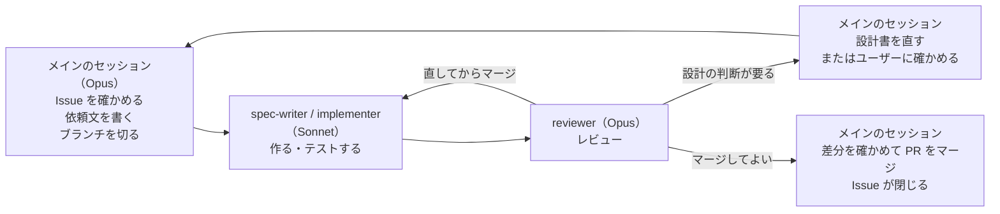
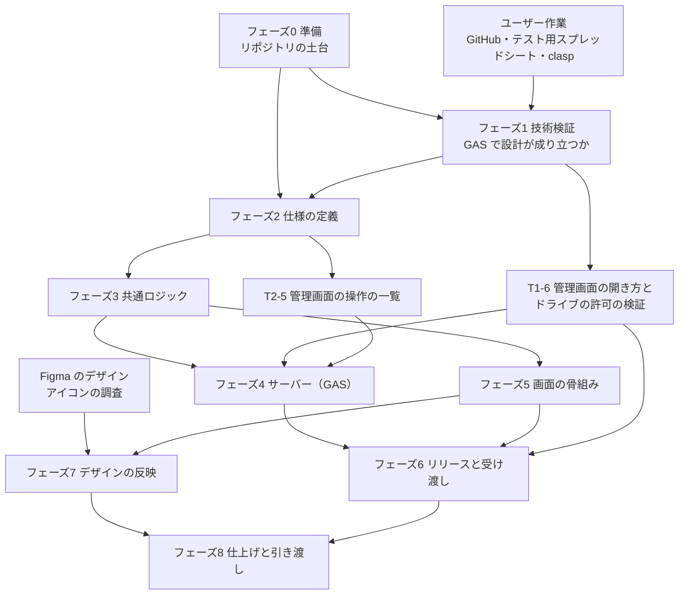

# 【新設計】ワークプラン

> 【新設計】作り直した後の姿についての文書。現行サイトの解析は `docs/as-is/` を見る。

2026-11-21 作成。設計は `docs/to-be/design.md`、受け渡しは `docs/to-be/delivery-flow.md`、作業の決まりは `CLAUDE.md`。
このワークプランは Claude Code のメインのセッション（Opus で起動）が上から順に進める。タスクの中身と状態は GitHub の Issue で管理する（§3 に対応を載せる）。

## 用語

説明の元は `docs/to-be/glossary.md`。

| 用語 | 意味 |
|---|---|
| アプリ | お客さんが注文するサイト。スマホのブラウザ（LINE の中のブラウザを含む）で開くページで、メニューを見て注文する |
| 管理画面 | オーナーが設定、豆、公開、注文を管理する Web ページ。持ち主だけが操作できる。アプリと同じシステムの一部で、デプロイの URL で開く |
| システム | アプリと管理画面を動かすプログラム全体（モジュールと画面の HTML）。アプリと管理画面は1つのプログラムなので、「システムを更新」で両方が新しくなる。番号は「システムのバージョン」（v1.3.0 の形） |
| ローダー | スプレッドシートに紐づくスクリプト。外から呼べる関数（入口）、`_コード` タブからの読み込み、「システムを更新」と「前のバージョンに戻す」の処理、初期のコードを持つ。テンプレートのコピーの後は変えない。「システムを更新」でも変わらないので、ローダーの中の処理に不具合があっても、「システムを更新」では直せない |
| `adminCall`、`adminUpload` | 管理画面と復旧用のページが `google.script.run` で呼ぶ入口。`adminCall` は引数の JSON の文字列で操作を選ぶ。`adminUpload` は、ファイルを受け取るために別に置く（GAS では、form を渡すときは form がただ1つの引数でなければならない）。どちらも、持ち主の確かめを通ってから動く |
| バンドル | システムのコード（モジュールと画面の HTML）を1つにまとめたファイル。GitHub のリリースに置き、「システムを更新」で `_コード` タブに取り込む |
| 復旧用のページ | 管理画面が開けないときのために、ローダーが自前で出す小さなページ。機能は「前のバージョンに戻す」と「システムを更新」の2つだけで、今のシステムのバージョンと使用中の保存場所を出す。HTML はローダーの中に持ち、モジュールを読み込まずにローダーだけで動くので、モジュールが壊れていても開ける。見た目は簡素な固定の HTML で、Figma のデザインの対象にしない |
| リリース | GitHub の機能。コードのある時点に番号（タグ。v1.3.0 など）を付け、バンドルを添付して出す。オーナーは「システムを更新」で、最新のリリースのバンドルを取り込む |
| システムを更新 | デザイン担当が出した最新のリリースのバンドルを取り込み、アプリと管理画面をまとめて新しくする操作。管理画面、復旧用のページ、メニュー OUCA から押せる。管理画面と復旧用のページからの更新は、リリースを取得して確かめる呼び出しと、更新する呼び出しの2回になる |
| テンプレート | デザイン担当が作る、初期設定済みのスプレッドシート。オーナーは「コピーを作成」でこれを複製して、本番のスプレッドシートにする |
| テスト用スプレッドシート、テスト用スクリプト | デザイン担当が持つ、ダミーデータだけのスプレッドシートと、それに紐づくスクリプト。`npm run push:test` でローダーを送り、GAS の上の動きを確かめる |
| デプロイ | スクリプトを URL で開けるページにする GAS の設定と、その結果。アプリと管理画面は、同じデプロイの URL（管理画面は引数つき）で開く。オーナーが初回に作り、作り直さないので、URL は変わらない（持ち主の確かめが通らないときは、管理画面を2つ目のデプロイで出す。T1-6 で確かめる） |
| 承認 | スクリプトが初めて権限の要る処理をするときに出る画面で、持ち主が権限を許可すること |
| マニフェスト | スクリプトの設定ファイル（`appsscript.json`）。スクリプトが求める権限の範囲や、デプロイの設定を書く。ローダーの側にあるので、「システムを更新」では変えられない |
| 権限の範囲（`oauthScopes`） | スクリプトが使ってよい Google の機能の一覧（スプレッドシートの読み書き、メールの送信など）。マニフェストに書き、持ち主が承認の画面で許可する |
| clasp | 手元のコードを Apps Script のスクリプトに送る、Google の道具。このプロジェクトでは、テスト用スクリプトに送るときだけ使う |
| 項目 | 豆に付ける情報の種類（焙煎度、甘味、味わい、産地など）。項目タブに1行ずつ書き、オーナーが管理画面の見せ方の設定で足したり名前を変えたりできる |
| 名寄せ | 書き方の違う同じ人の名前（「岡本」と「岡本太郎」など）を、1人の名前にまとめること。スクリプトが候補を出し、オーナーが管理画面で確かめる。結果はお客さんタブに残る |
| メインのセッション、実行役、レビュー役 | Claude Code の役割。メインのセッションは作業を設計して判断し、実行役（spec-writer、implementer）は仕様やコードを書き、レビュー役（reviewer）は成果物を確かめる（`CLAUDE.md`） |
| T 番号、D 番号 | ワークプランのタスクの番号（T1-2 など）と、ユーザーに決めてもらうことの番号（D-1 など）。対応は `work-plan.md` §3、§4 にある。文書の中では、初めて出る位置でタスクの名前を添える |
| § | 文書の節の番号。「`delivery-flow.md` §5.3」は、受け渡しの文書の 5.3 の節を指す |

## 1. 進め方

### 1.1 役割とモデル

メインのセッションと実行役、レビュー役の役割は `CLAUDE.md` の「役割とモデル」にある。ユーザー（デザイン担当）は、Google アカウントと GitHub が要る作業、デザインの判断、Figma を担う。

### 1.2 1つのタスクの流れ

- 作業は Issue から始め、PR で閉じる（`CLAUDE.md` の「Issue、ブランチ、プルリクエスト」）
- 実行役は、テストを書いたところで一度止まる。メインのセッションがテストを読み、足りないものを直してから実装に進ませる（§1.3）
- 実行役の「論点」はメインのセッションが決めるか、ユーザーに確かめる。決めたら設計書か仕様に書き戻してから次へ進む
- 小さな修正（誤字、1ファイルの数行）はメインのセッションが直接直してよい。その場合もレビュー役に通す
- 独立したタスク（依存がなく、触るファイルが重ならない）は、実行役を並行で動かしてよい

### 1.3 依頼文の型

実行役に渡す依頼文には、次のことをすべて書く。

1. タスク番号、Issue の番号、目的（Issue の「目的」）
2. 読むもの（Issue の本文、設計書の節、仕様、既存のコード）
3. 作るもの（ファイルの場所と中身の概要）
4. 守ること（設計上の決まり、触ってはいけない場所）
5. 完了条件（Issue の受け入れ基準。確かめられる形で。例「`npm test` が通る」「上限ちょうどの量を選べるテストがある」）。Issue の要件のシナリオごとにテストを書くこと、テストを先に書くことを求める（`CLAUDE.md` の「テスト駆動」）
6. 報告の形式（エージェント定義のとおり）

振る舞いを足す・変える依頼は、2回に分けて渡す。1回目は「テストを書き、落ちることを確かめて止まる」まで、2回目は、メインのセッションがテストを読んで直した後の実装（`.claude/agents/implementer.md`）。設計の判断が少ない小さな依頼で止まらなくてよいときは、依頼文にそう書く。

## 2. フェーズの全体

- フェーズ1 の技術検証は、結果しだいで設計（特に「システムを更新」の仕組み）が変わるので、仕様の定義より先に終える
- 画面はフェーズ5 で仮の見た目のまま動く状態まで作り、Figma のデザインが届いたらフェーズ7 で差し替える
- 管理画面は、要件（`admin-requirements.md`）を T2-5 で操作の一覧にし、T4-8、T4-9 でサーバー、T5-4〜T5-6 で画面、T7-5 でデザインを反映する。T1-6（管理画面の開き方と Google ドライブの許可の技術検証）は、T4-3、T4-8、T4-9 とテンプレート（T6-2）の前に終える

## 3. タスク

タスクの目的、要件のシナリオ、受け入れ基準、依存、読むもの、依頼文に書く注意は、Issue の本文に書く。状態（未着手、作業中、完了など）も Issue で管理する。

担当の略記: S = spec-writer（Sonnet）、I = implementer（Sonnet）、R = reviewer（Opus）、M = メインのセッション（Opus）、U = ユーザー

### フェーズ0 準備

| タスク | 担当 | Issue |
|---|---|---|
| T0-1 リポジトリの土台 | I、R | #5 |
| U-1 ユーザーの準備（T0-1 リポジトリの土台と並行） | U（手順は M が案内する） | #6 |

### フェーズ1 技術検証

設計の前提のうち、資料だけでは確かめられない点を、最小のコードで確かめる。コードは `spikes/` に置き、本体には入れない。結果は `docs/to-be/spikes.md` に「確かめたこと、結果、設計への影響」の形で残す。どれもテスト用スプレッドシートで、ダミーデータだけを使う。

- `npm run push:test` はテスト用スクリプトの中身とマニフェストを丸ごと置き換える。マニフェストの設定（`oauthScopes`、高度なサービス（Google の API をスクリプトから使うための設定）など）はリポジトリ側のマニフェストにだけ書き、テスト用スクリプトをエディタで直さない。依頼文にもこの2点を書く

| タスク | 担当 | Issue |
|---|---|---|
| T1-1 システムの自己更新（最重要） | I（検証コード）、U（実行と承認）、M（結果の判断） | #7 |
| T1-2 テンプレートのコピー | U（操作）、M（結果の記録） | #8 |
| T1-3 シートの機能 | I（検証コード）、U（実行） | #9 |
| T1-4 Web アプリの動作 | I（検証コード）、U（スマホで確認） | #10 |
| T1-5 検証結果の反映 | M（設計書と受け渡しの文書を直す）、R（直した設計のレビュー） | #11 |
| T1-6 管理画面の開き方と Google ドライブの許可の技術検証 | I（検証コード）、U（実行と、スマホ、複数ログインのブラウザでの確認） | #未定 |

- T1-6 は、フェーズ1 に置く。T2-1〜T2-4 は待たないが、T4-3（doGet）、T4-8、T4-9 とテンプレート（T6-2）の前に終える。確かめるのは次の3つ
  - 持ち主のスマホのブラウザで、全員向けのデプロイから、持ち主の確かめが通るか
  - 複数のアカウントでログインしたブラウザで、`/macros/u/0/s/…/exec?…` の形の URL なら開けるか。既定のアカウントが持ち主でないときに、管理画面が案内を出せるか
  - `drive.file` の許可で、GAS からファイルを作れるか

### フェーズ2 仕様の定義

| タスク | 担当 | Issue |
|---|---|---|
| T2-1 データモデル | S、R | #12 |
| T2-2 スプレッドシート構成の定義 | S、R | #13 |
| T2-3 検証規則と文言 | S、R | #14 |
| T2-4 仕様のまとめのレビュー | R（T2-1〜T2-3 を通して）、M（取捨と設計書への書き戻し） | #15 |
| T2-5 管理画面の操作の一覧と入出力 | S、R | #未定 |

### フェーズ3 共通ロジック（`src/shared/`、`src/client/domain/`。テストを先に書く）

| タスク | 担当 | Issue |
|---|---|---|
| T3-1 金額と上限 | I、R | #16 |
| T3-2 絞り込みと並べ替え | I、R | #17 |
| T3-3 シートの値からメニューを作る | I、R | #18 |
| T3-4 名寄せとダッシュボードの集計 | I、R | #19 |

### フェーズ4 サーバー（GAS）

各タスクはテスト用スプレッドシートで動作を確かめる（U が実行と承認）。

| タスク | 担当 | Issue |
|---|---|---|
| T4-1 シートの読み書きと初期設定 | I、R、U | #26 |
| T4-2 メニューを公開 | I、R、U | #27 |
| T4-3 doGet と getCatalog | I、R | #28 |
| T4-4 placeOrder | I、R、U | #29 |
| T4-5 項目を追加、項目の名前を変える | I、R、U | #30 |
| T4-6 ダッシュボードを更新、お客さん、調査用に書き出す | I、R、U | #31 |
| T4-7 システムを更新、前のバージョンに戻す | I、R、U | #32 |
| T4-8 管理画面の API | I、R、U | #未定 |
| T4-9 復旧用のページと、管理画面から呼ぶローダーの処理 | I、R、U | #未定 |

### フェーズ5 画面の骨組み（Figma の前。仮の見た目で動かす）

| タスク | 担当 | Issue |
|---|---|---|
| T5-1 画面の土台 | I、R | #33 |
| T5-2 画面部品 | I、R | #34 |
| T5-3 通しの確認 | U（スマホで操作）、R（確認項目の作成と結果の確認） | #35 |
| T5-4 管理画面の土台と毎週の操作 | I、R | #未定 |
| T5-5 管理画面の編集の画面 | I、R | #未定 |
| T5-6 管理画面のダッシュボード、名寄せ、システムの更新の画面 | I、R | #未定 |

### フェーズ6 リリースと受け渡し

| タスク | 担当 | Issue |
|---|---|---|
| T6-1 リリースの仕組み | I、R、U（テスト用のタグでの確認） | #36 |
| T6-2 テンプレートのスプレッドシート | U（作成）、M（手順） | #37 |
| T6-3 オーナー向け手順書 | S（下書き）、R、U（画面写真） | #38 |
| T6-4 受け渡しの通し確認 | U、R | #39 |

### フェーズ7 デザインの反映（Figma とアイコンの調査が前提）

| タスク | 担当 | Issue |
|---|---|---|
| T7-1 アイコンの調査 | M（調査の設計と取りまとめ）、U（判断） | #40 |
| T7-2 Figma のデザインの実装 | I、R、U（デザインの提供、スマホでの確認） | #41 |
| T7-3 アイコンセットの取り込み | I、R、U（アイコンの制作と書き出し） | #42 |
| T7-4 文言の行の確定 | S、R | #43 |
| T7-5 管理画面の Figma のデザインの実装 | I、R、U（デザインの提供、スマホでの確認） | #未定 |

### フェーズ8 仕上げと引き渡し

| タスク | 担当 | Issue |
|---|---|---|
| T8-1 最初のリリース（v1.0.0） | M、U | #44 |
| T8-2 オーナーへの引き渡し | U（オーナーとのやり取り）、M（手順書の最終確認） | #45 |

## 4. ユーザーに決めてもらうこと

決めるまでの状態と、決めた内容は Issue に書く。決めた内容は設計書か仕様にも書き戻す。

| 番号 | 内容 | 決める時期 | Issue |
|---|---|---|---|
| D-1 | 受付中の切り替えと、注文の通知メールを入れるか | フェーズ2 の前 | #20（決定: どちらも入れる。2026-11-28、#54） |
| D-2 | 郵送の住所と手渡しの日時は、今後も LINE で聞くか | フェーズ2 の前 | #21 |
| D-3 | 現行の注文の記録を、ダッシュボードの集計用に取り込むか | フェーズ4 の前 | #22 |
| D-4 | オーナーの了承（持ち物の分担、更新のたびにボタンで取り込む運用、メニューの公開の運用） | フェーズ6 の前 | #23 |
| D-5 | リリースを置く場所（コードのリポジトリを公開するか、リリース専用の公開リポジトリを作るか） | T1-1（システムの自己更新）の前 | #24（決定。Issue #3（D-5 の見直し）で見直し、変えないことにした。`docs/to-be/delivery-flow.md` §6.2） |
| D-6 | アイコンの方針の詳細（設計書 §4.3 の保留） | フェーズ7 の前 | #25 |
